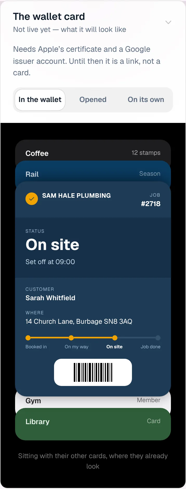
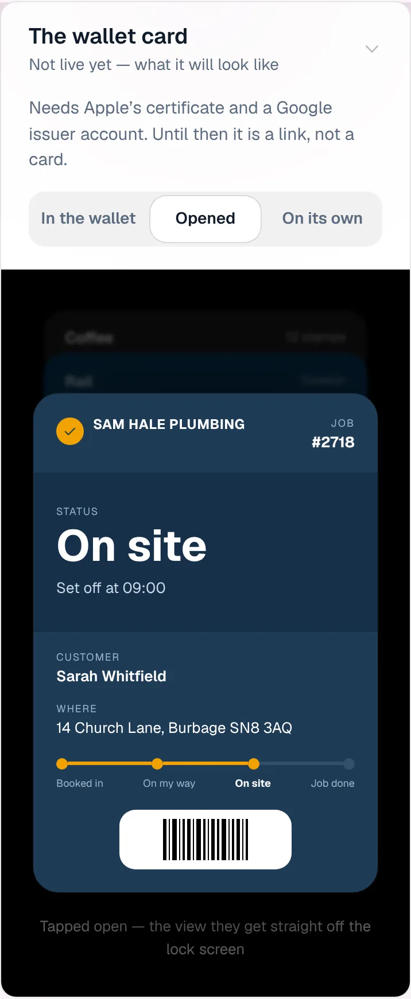
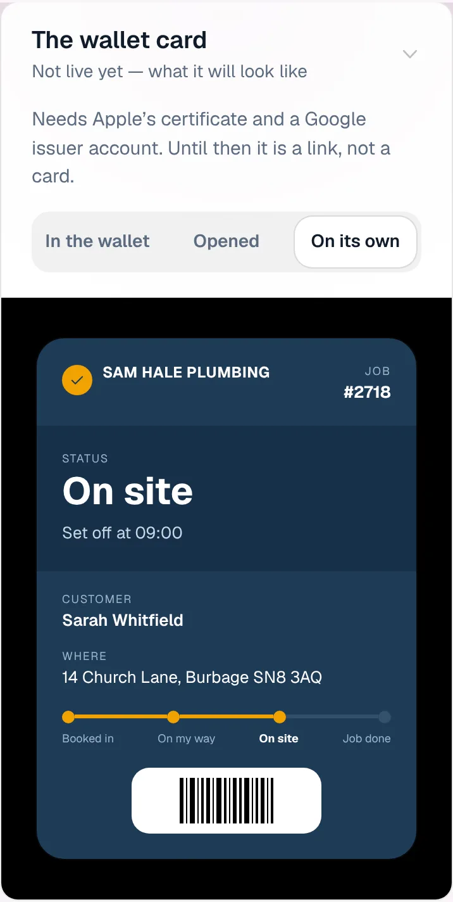
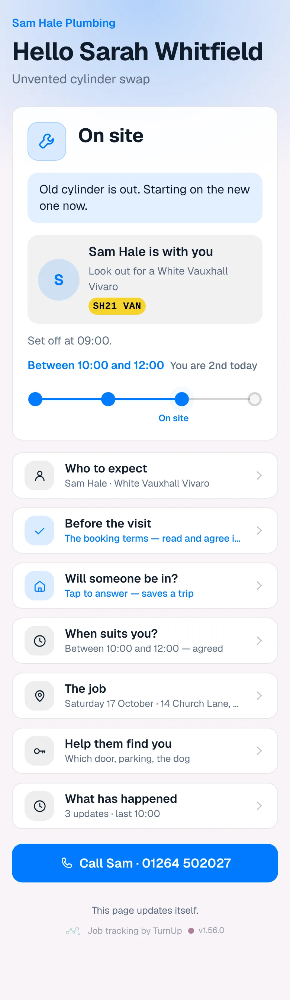
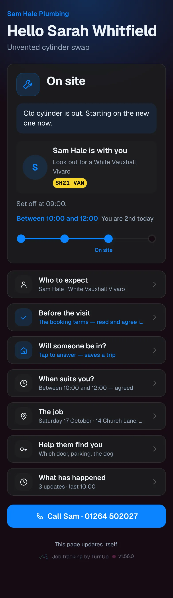
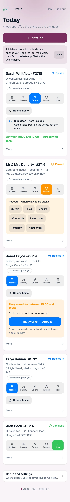
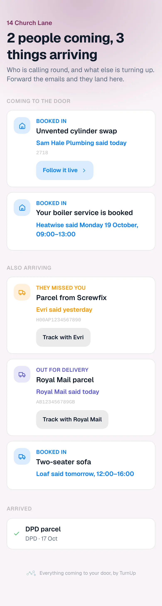
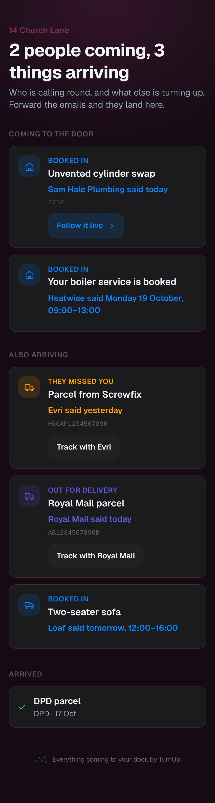

# v1.56.0 — Plum

**2026-10-17** · background `#f9f4f8` · accent `#7a2f5e`

- Nudges on time. The sweep that notices a window has passed, asks the day-before question at 4pm, asks how it went and follows every ServiceM8 booking was meant to run every five minutes. GitHub ran it about every four hours, so all four fired hours late. It now runs on Vercel's own scheduler every five minutes, with the GitHub job kept as a half-hourly backup. Two callers cannot send anything twice: every nudge is sent once and paced inside the sweep.

### wallet-in-stack

### wallet-opened

### wallet-alone

### customer-light

### customer-dark

### dashboard

### dashboard-setup

### login

### homepage

### homepage-dark

### household

### household-dark

