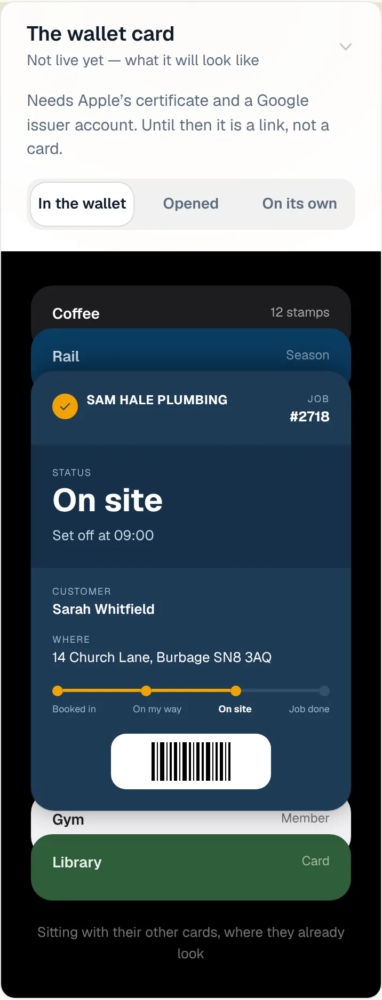
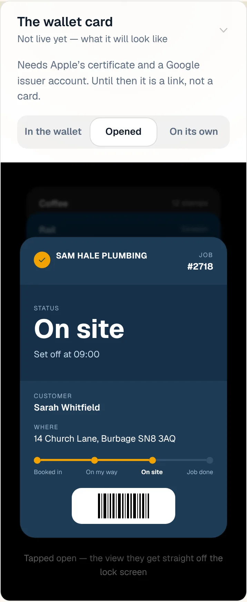
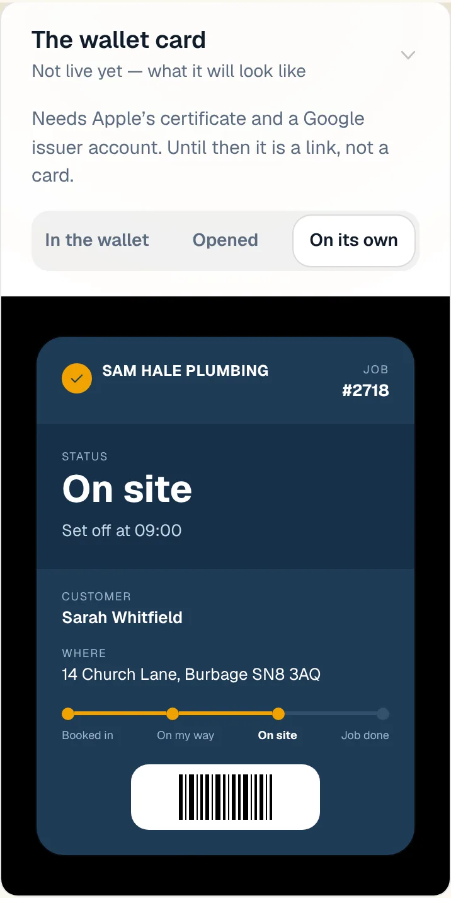
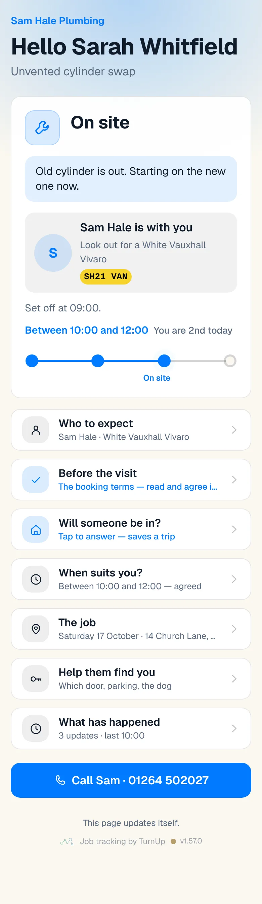
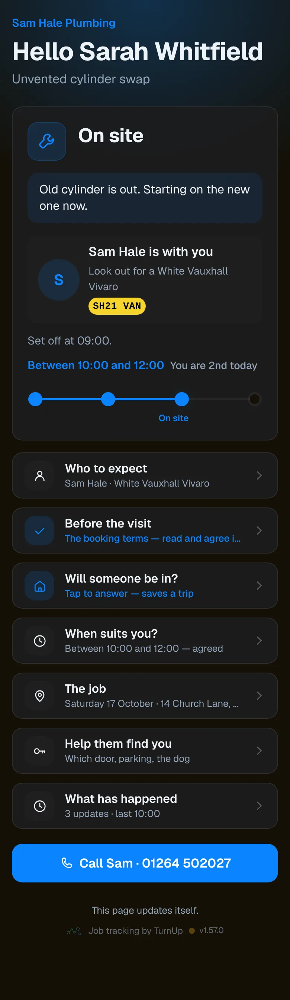
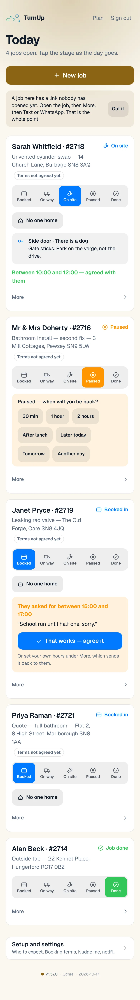
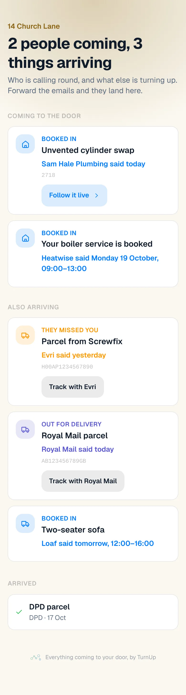
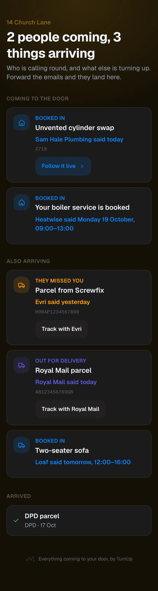

# v1.57.0 — Ochre

**2026-10-17** · background `#fbf8f0` · accent `#8a6414`

- The words catch up with the app (Standing Rule 24). Five things that work today were still filed as ideas or as waiting on a key: the day-before reminder that answers back, the review ask two hours after Job done, running late in one tap, ServiceM8 following the job, and the card moving itself on a ServiceM8 check-in. All five are live on the roadmap now, under Working now with the window-missed message and customer-not-home, which were live but filed among the big ideas: 38 live in all. The van lookup says what is true: DVSA approved the key on 14 Oct and three settings in Vercel are what is left.
- The business plan reads the app as it is, merged from the plan branch and then corrected against the live site: ServiceM8 connected since 9 Oct, nudges every five minutes, the Apple enrolment under review, and the letterbox honest about itself: getturnup.com is on Cloudflare but Email Routing for in.getturnup.com is not on, so nothing arrives yet. The owner's taps are the four that are actually left: ring Apple, start the thirty-day count, the DVSA keys, the ServiceM8 developer account. The homepage's not-built strip no longer shows the card moving itself, because it is built.

### wallet-in-stack

### wallet-opened

### wallet-alone

### customer-light

### customer-dark

### dashboard

### dashboard-setup

### login

### homepage

### homepage-dark

### household

### household-dark

