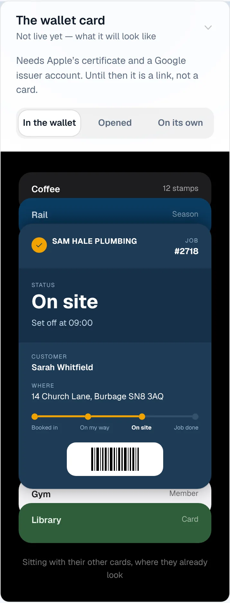
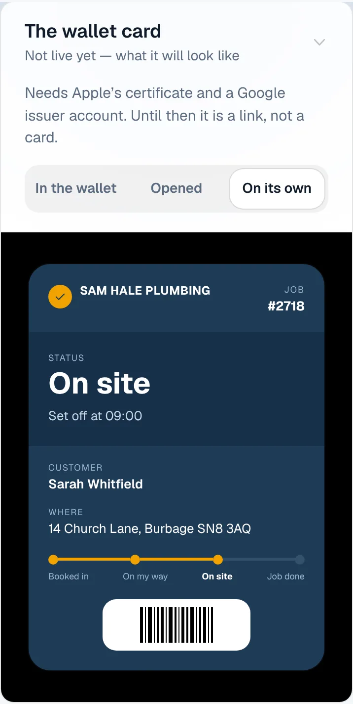
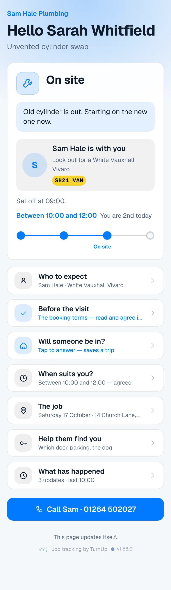
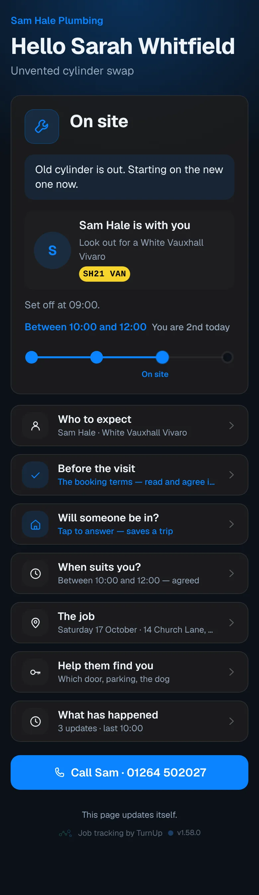
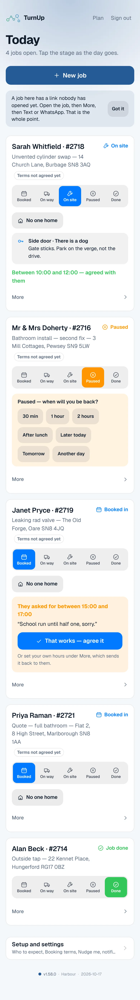
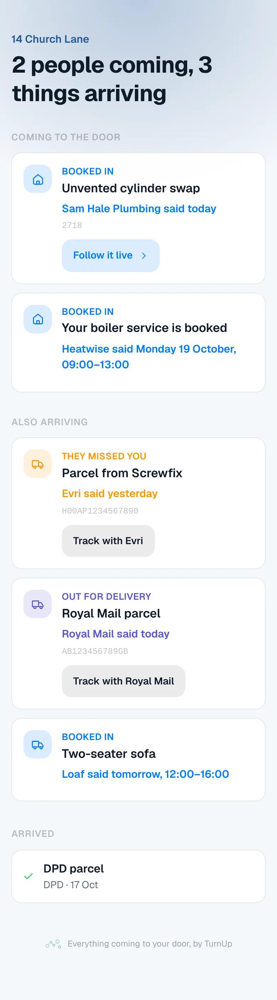
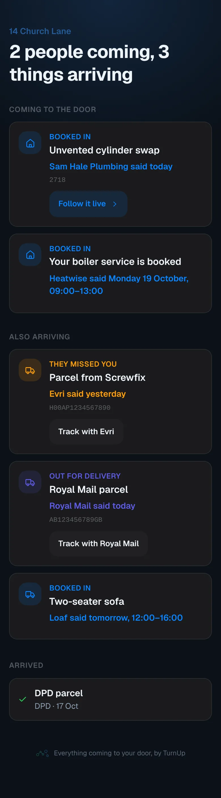

# v1.58.0 — Harbour

**2026-10-17** · background `#f4f7fb` · accent `#255a95`

- The pictures are of this month's app. Every small picture on the homepage, the dashboard's setup panels and the roadmap (the status card at each stage, each row of the customer's page opened, the stage buttons, the send box, the new-job form, the sign-in, the plate, the household card) and the phone at the top of the homepage were photographed before the flat look, so for a week the site showed a product that no longer existed. All re-shot from this build, in flat frames: the one corner radius and a hairline. The trade's screens are now photographed live by the capture script, signed in against the seeded database, instead of cut by pixel box from captures made weeks earlier.
- The household card says less and shows more: no sentence under the heading, and an empty card shows one example row so a household sees what forwarding does before doing it. On the dashboard, Household cards shows the card itself. The local seed now says so loudly when a stale database client skips the card, which is how three diaries photographed one that said it had expired.
- The review link in pictures: under Who to expect the Google review field sits under the row every customer sees after Job done, and How did it go? says one line, a review helps most, a note reaches the trade alone. Both doors stay open to everyone.
- The diary records the pictures too. Its full-page shots were taken from the top of the page, so every picture below the fold was still waiting to load: every homepage diary until now has empty frames where the pictures are. It scrolls the page first.
- What this could become, in pictures: every roadmap item that has a screen shows it; a row is a picture, a name and a chip, and the sentence opens on a tap. The live list is folded behind its count, on the roadmap and on the homepage, where it was a screen and a half of chips on a phone.

### wallet-in-stack

### wallet-opened

### wallet-alone

### customer-light

### customer-dark

### dashboard

### dashboard-setup

### login

### homepage

### homepage-dark

### household

### household-dark

