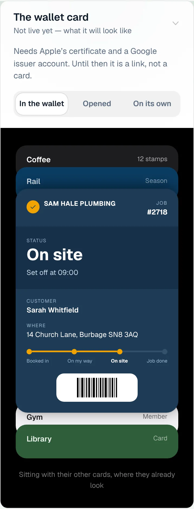
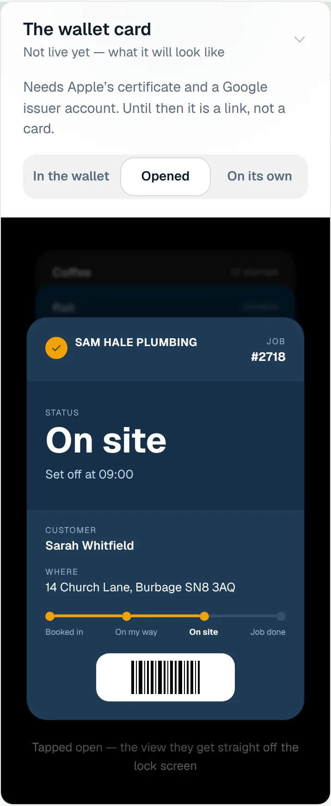
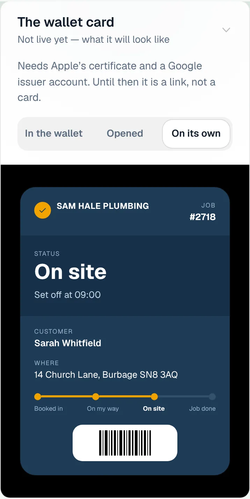
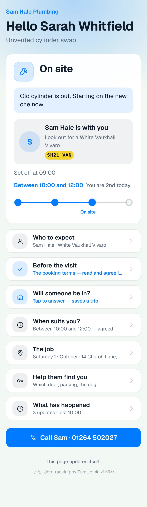
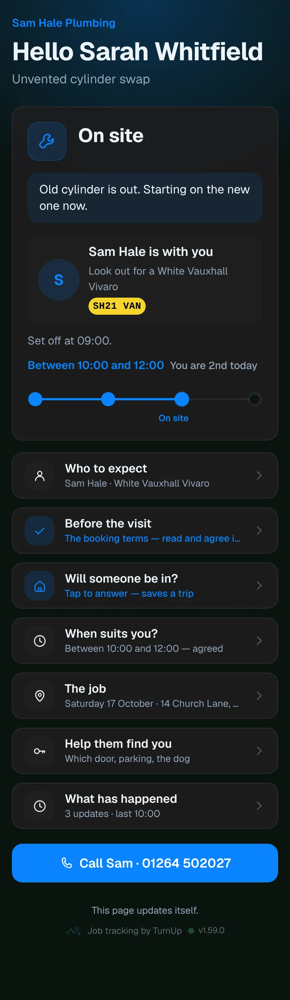
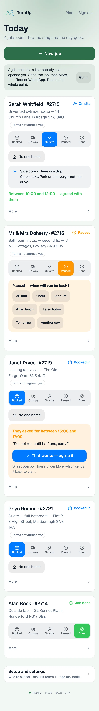
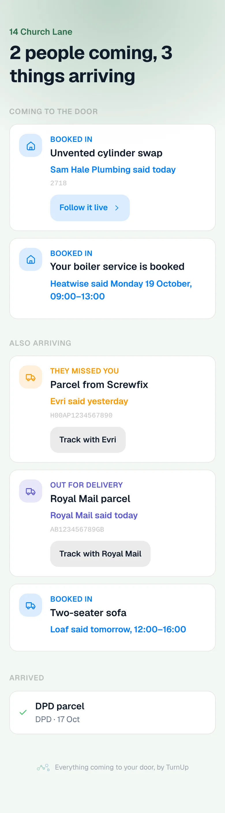
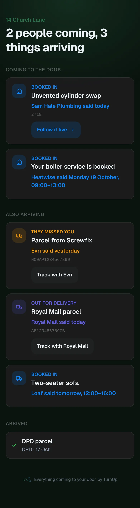

# v1.59.0 — Moss

**2026-10-17** · background `#f3f8f4` · accent `#2c6e49`

- Your job on your lock screen, written and waiting on Apple, now on main rather than on its own branch. native/ holds the iOS app: the dashboard in a native window, and the job you are on as a Live Activity, with the stage, the time it was tapped, the note, and On site, Paused, Back on site and Job done buttons on the lock screen and in the Dynamic Island. A button is a real tap: the same record, the same buzz to the customer, the same line in ServiceM8. Written 15 Oct; merged 17 Oct on the owner's go.
- In a browser nothing changes: the dashboard's half is a no-op outside the app. The lock-screen buttons sign in with a token the app fetches from the dashboard, so the operator check accepts that token as well as the cookie: the same secret, the same thirty days. It compiles on a Mac runner the day the Apple Developer membership is active; until then the iOS build job does not run.

### wallet-in-stack

### wallet-opened

### wallet-alone

### customer-light

### customer-dark

### dashboard

### dashboard-setup

### login

### homepage

### homepage-dark

### household

### household-dark

