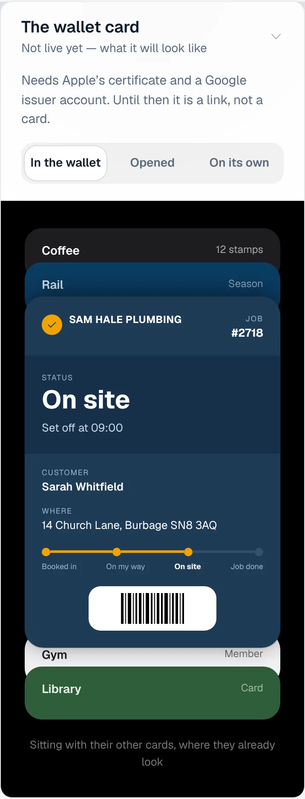
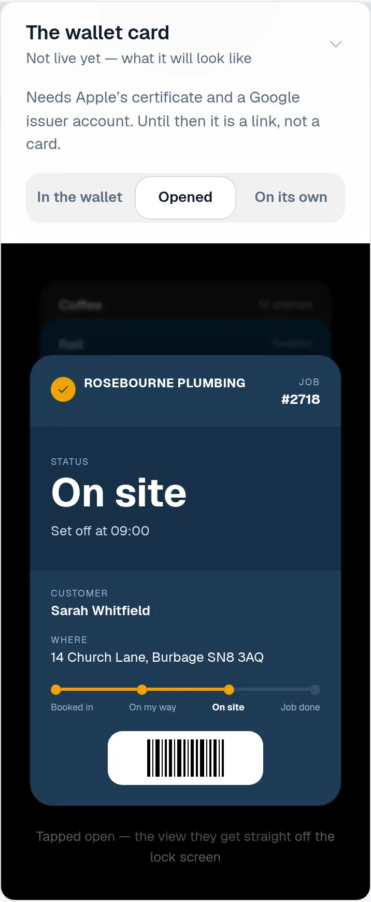
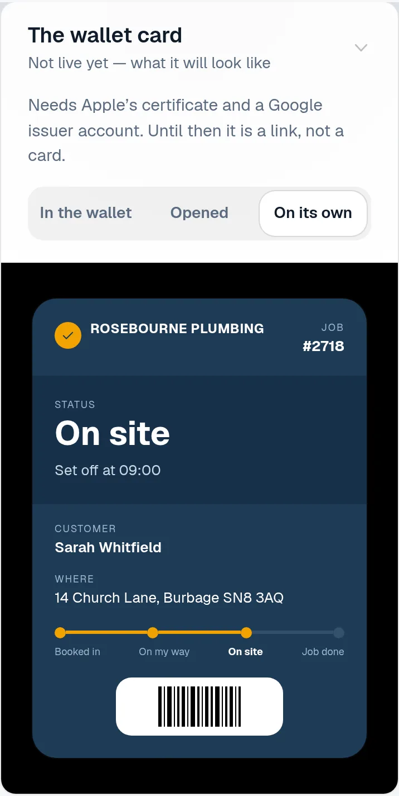
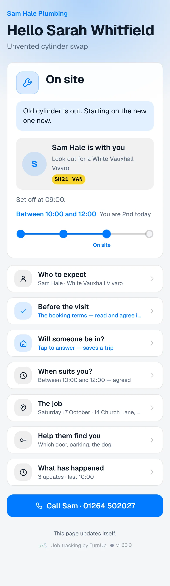
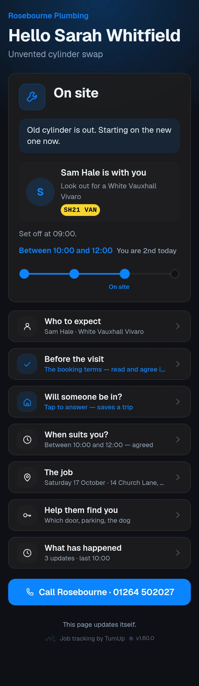
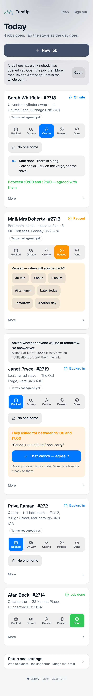
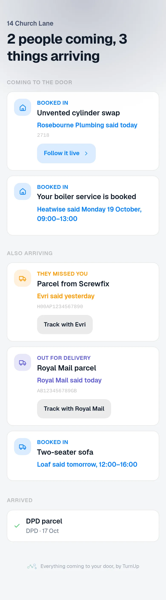
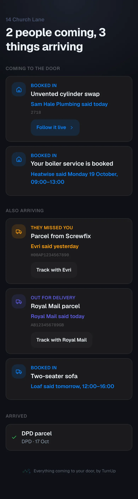

# v1.60.0 — Slate

**2026-10-17** · background `#f5f6f8` · accent `#44506b`

- The ServiceM8 store listing, written from their rules rather than from memory. docs/servicem8-store-listing.md has the name, both descriptions and the three screenshots ready to paste, the 90/10 revenue split, and the ten steps in the order they happen — every requirement read off ServiceM8’s own Add-on Store and Store Requirements pages on 17 Oct. Two of their numbers are not published (the image sizes and the description limits), so the file says to read those off the form instead of guessing them.
- TurnUp asks ServiceM8 for one permission fewer. It requested create_notifications for two versions and never called it once: the trade is notified by TurnUp’s own push, not ServiceM8’s. Their checklist says an add-on must ask for only what it needs, and a permission nothing reads is the same defect as a field on the public shape nothing shows. Now publish_diary_items and vendor, which are the two it uses.
- A privacy policy, at getturnup.com/privacy and linked from the homepage. The store cannot take a listing without one. It is written from what the code does rather than from a template — what is held, who can read it, the rule that the page carries what the trade told the customer and never what the customer told the trade — so if a line in it and the code ever disagree, the line is the bug.
- Found while writing it, and worth knowing before move 3 goes further: a ServiceM8 add-on may not take a payment between a trade and their customer inside a ServiceM8 interface. Pay-to-book and paid-on-the-page are both already parked behind the pilot, so nothing changes today, but the two ideas and the store listing pull against each other.

### wallet-in-stack

### wallet-opened

### wallet-alone

### customer-light

### customer-dark

### dashboard

### dashboard-setup

### login

### homepage

### homepage-dark

### household

### household-dark

