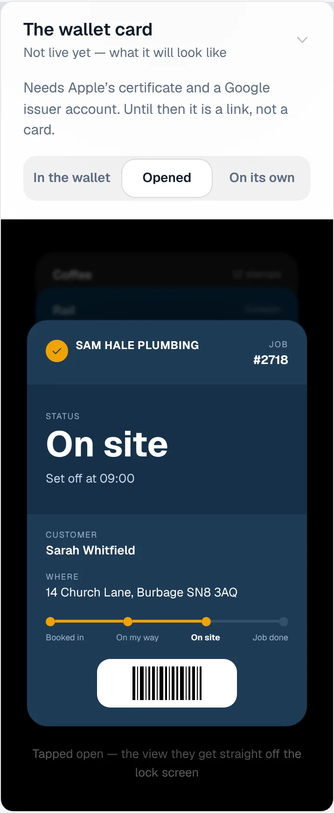
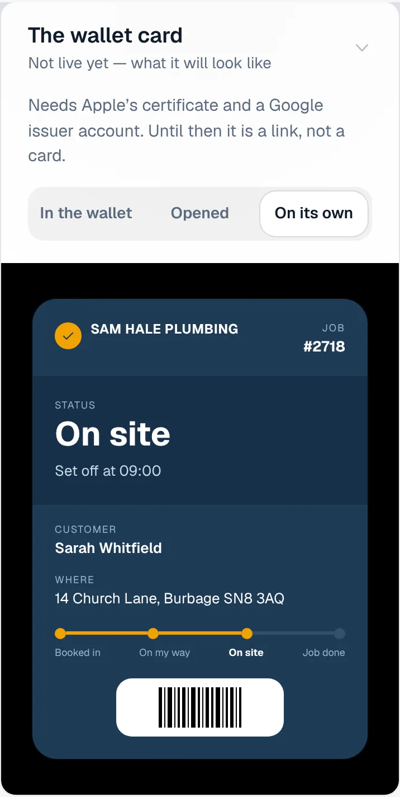
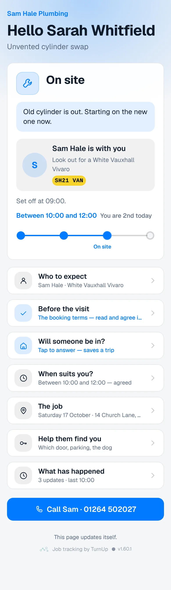
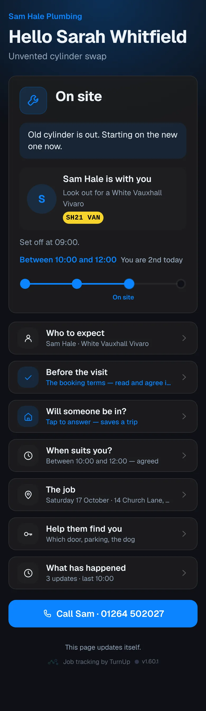
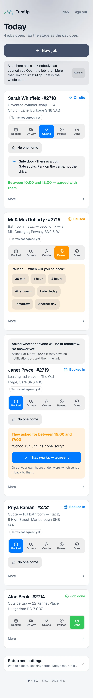
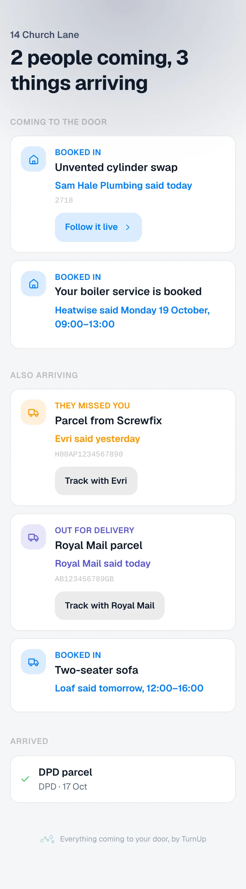

# v1.60.1 — Slate

**2026-10-17** · background `#f5f6f8` · accent `#44506b`

- The five-minute sweep now writes one line to the log each time it runs, saying who called it and how many jobs it checked. Without it a sweep that ran quietly left no trace, so nobody could see whether the schedule was keeping time. Counts only; no names.

### wallet-in-stack

### wallet-opened

### wallet-alone

### customer-light

### customer-dark

### dashboard

### dashboard-setup

### login

### homepage

### homepage-dark

### household

### household-dark

