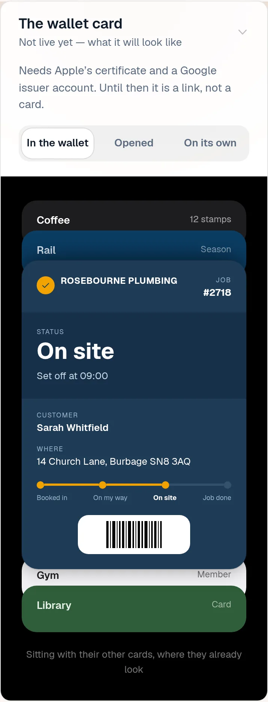
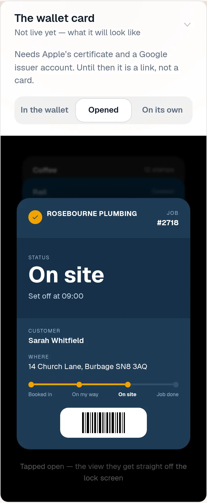
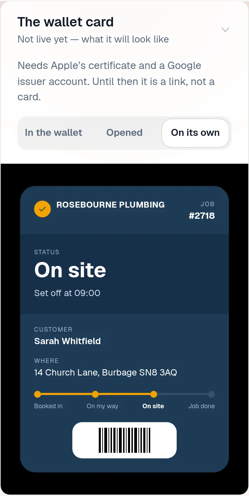
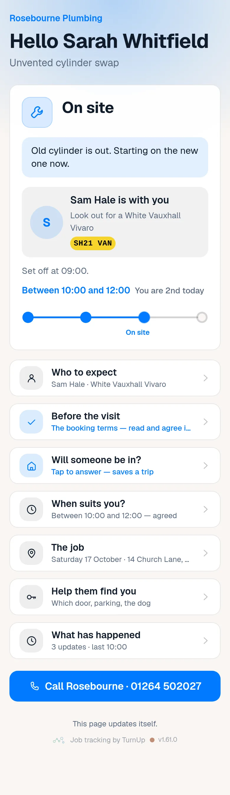
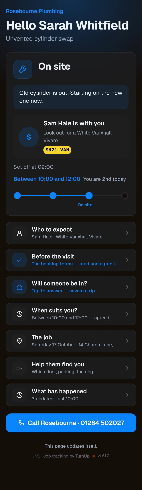
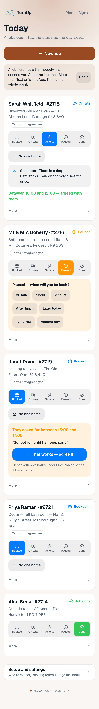
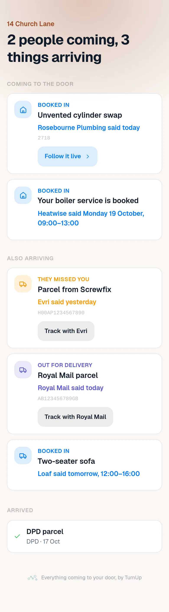
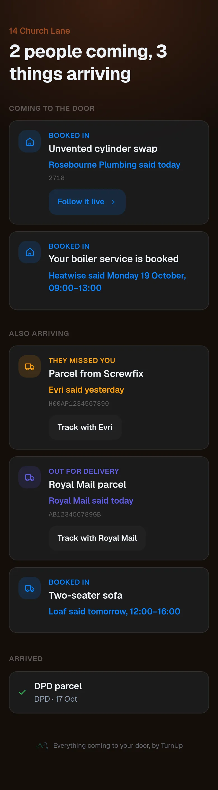

# v1.61.0 — Clay

**2026-10-17** · background `#faf6f2` · accent `#9a4a24`

- The privacy policy is a page, not a draft. getturnup.com/privacy, linked from the homepage footer, which is what a store listing actually takes: a public URL. It is written from what the code does rather than from a template — what is held, who can read it, and the rule that the page carries what the trade told the customer and never what the customer told the trade — so if a line in it and the code ever disagree, the line is the bug. One of the three things the listing said it was waiting on.
- Read in ServiceM8’s store rules while writing the listing, and worth knowing before move 3 goes further: an add-on may not take a payment between a trade and their customer inside a ServiceM8 interface. Pay-to-book and paid-on-the-page are both parked behind the pilot already, so nothing changes today — but those two ideas and a store listing pull against each other, and an external payment link is the shape that survives both.

### wallet-in-stack

### wallet-opened

### wallet-alone

### customer-light

### customer-dark

### dashboard

### dashboard-setup

### login

### homepage

### homepage-dark

### household

### household-dark

