# v1.62.0 — Indigo

**2026-10-17** · background `#f5f5fc` · accent `#463a94`

- The homepage no longer scrolls sideways on a phone. One section, the wallet drawings, pushed the whole page out to 917 pixels wide on a 375-pixel phone, so every section below it was cut off at the right edge. Every page was measured at three phone widths; the homepage was the only one wider than the screen.
- Getting on the list is now a card that builds itself: /join. Pick trade or home, and each answer files onto a card above as you go, with a tick and an Edit. Your postcode puts a map up and you drag the map until the pin is on your door; a photo shows as a picture, not a file name. Email is step one and that is the sign-up; everything after has a Skip. Only your name, email, trade and the first half of your postcode are sent. The pin, the photos, who else lives there and a work address stay on your own phone.
- Two new pages: /for-trades, one job start to finish as the screens that do it, and /for-homes, the household card, which the homepage did not mention at all. Both are linked from the top of every page.
- The privacy page now lists the waiting list, and four services it had missed: Anthropic for the Ask box, DVSA and DVLA for the van lookup, and postcodes.io and OpenStreetMap for the map on /join.

### wallet-in-stack

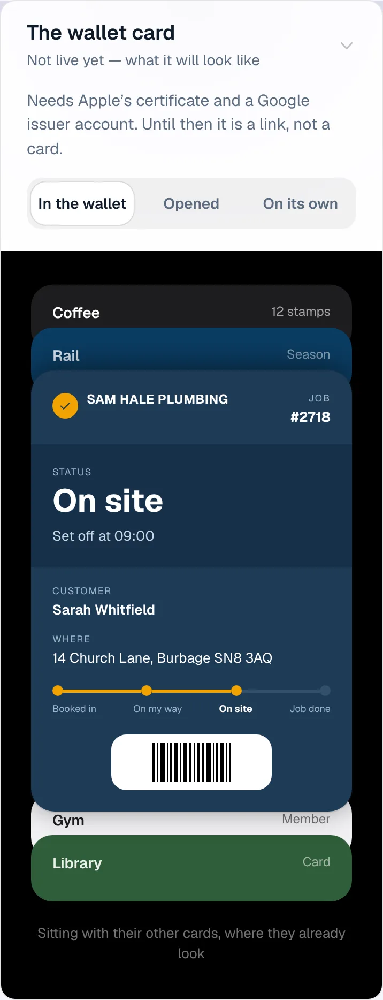

### wallet-opened

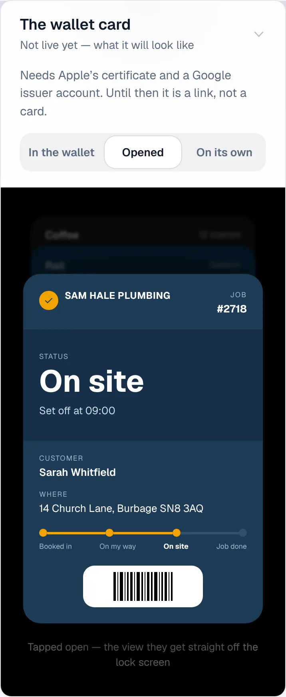

### wallet-alone

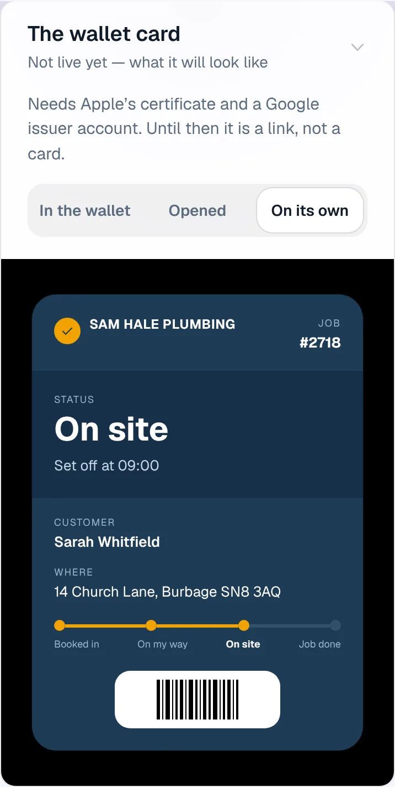

### customer-light

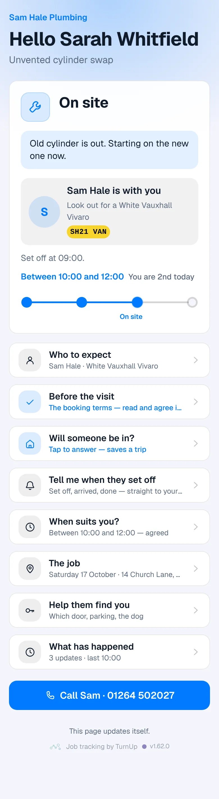

### customer-dark

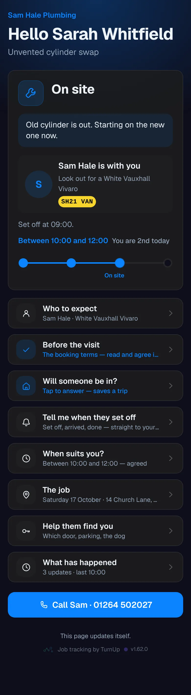

### dashboard

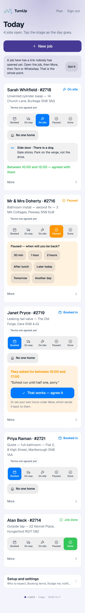

### dashboard-setup

### login

### homepage

### homepage-dark

### for-trades

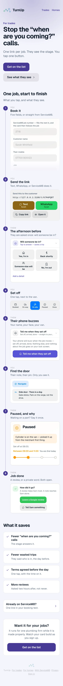

### for-homes

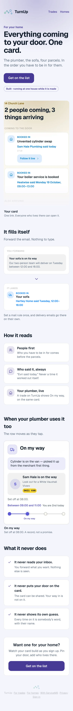

### join

### household

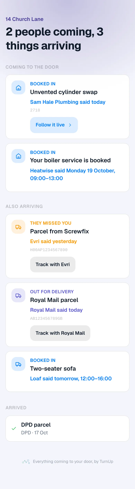

### household-dark

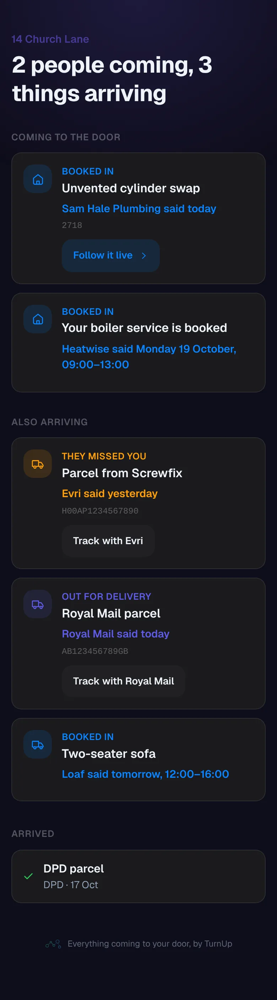

### join, filled in (phone, 375 wide)

Captured the same evening against this build by driving /join with an invented
trade and an invented household (scripts are not kept: a one-off). The map
tiles are OpenStreetMap's, fetched live.

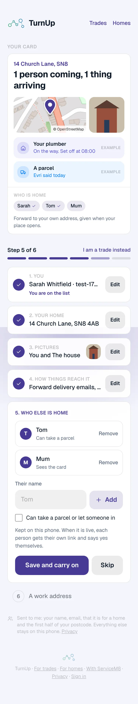
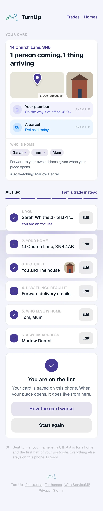
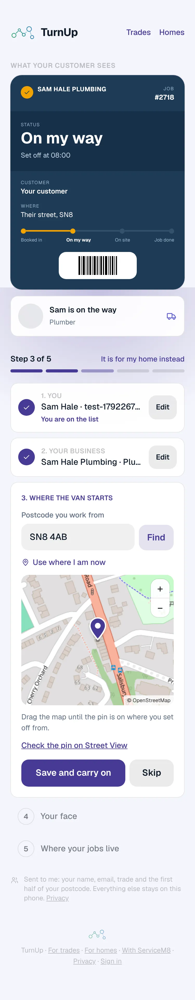
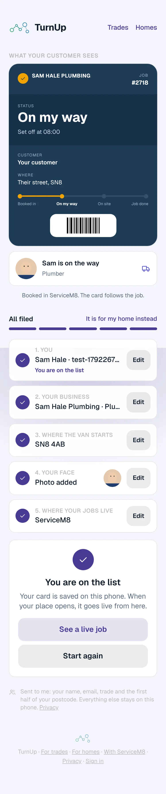
