# v1.63.0 — Teal

**2026-10-18** · background `#f2f9f9` · accent `#1f6f72`

- A household can make its own card. At the end of the home path on /join, pick a name for it and tap Make my card live: it becomes a real link for everyone who lives there, to open and share. Only the name goes on the card. Its forwarding address comes back once, is kept on that phone, and is shown only when the letterbox is actually receiving.
- The letterbox steps were wrong, and are fixed. They said to turn on a catch-all on in.getturnup.com; Cloudflare only allows a catch-all on the main domain, so it could never have worked. Every card now gets cards+<its key>@in.getturnup.com, and one Cloudflare rule for cards@ with plus-addressing switched on takes them all. The dashboard’s steps say so, and the whole job is one Cowork paste.
- The poster pictures are re-shot from today’s app: 13 phone screens and all 29 frames, from a new script, so they can be redone whenever a screen changes. The homepage’s Send it in one tap picture had shown a test address (127.0.0.1) since v1.58.0; it now shows getturnup.com, and both capture scripts put the real address in before every shot.

### wallet-in-stack

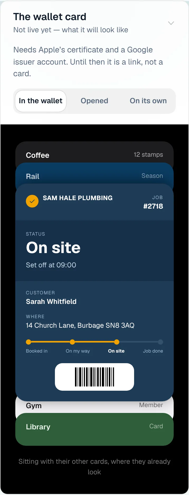

### wallet-opened

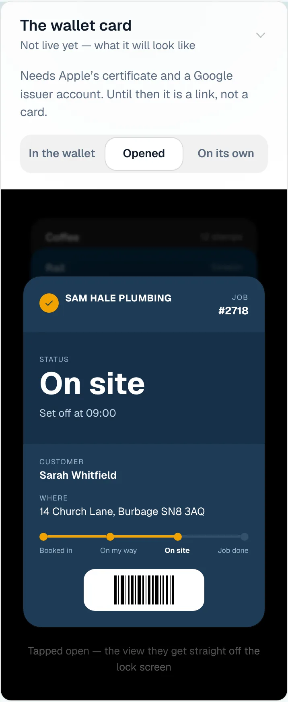

### wallet-alone

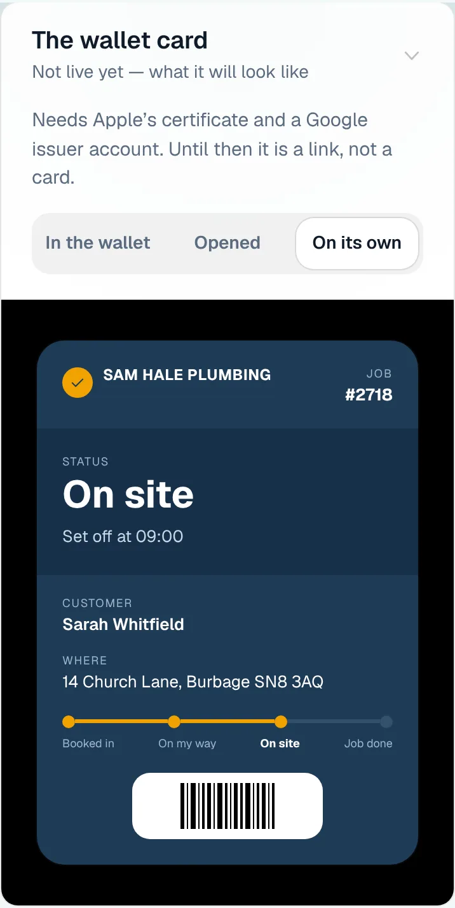

### customer-light

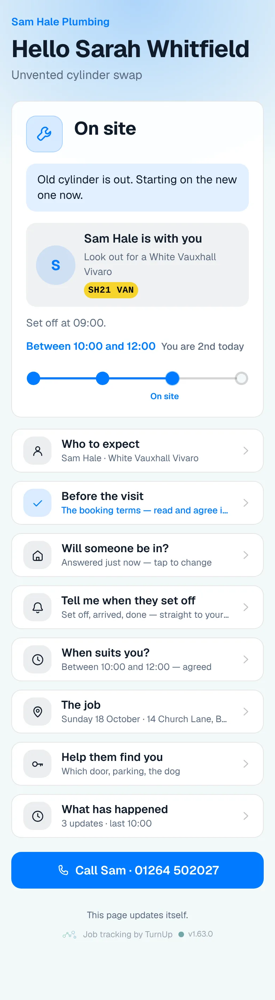

### customer-dark

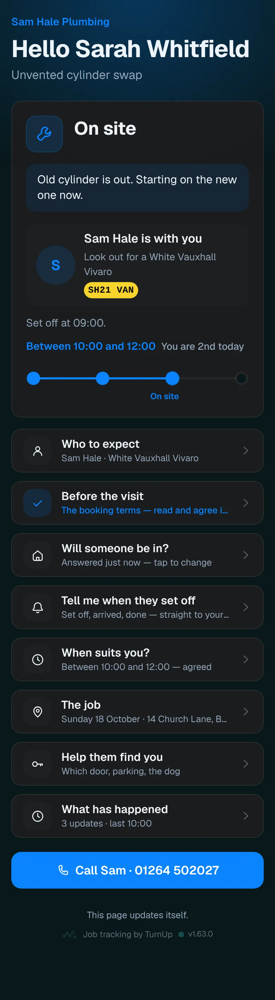

### dashboard

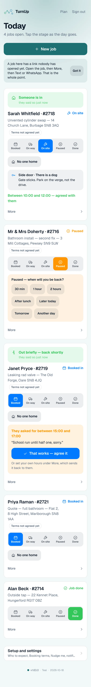

### dashboard-setup

### login

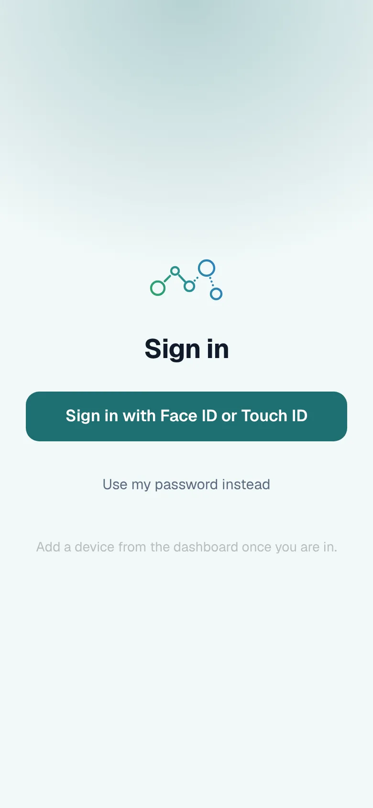

### homepage

### homepage-dark

### for-trades

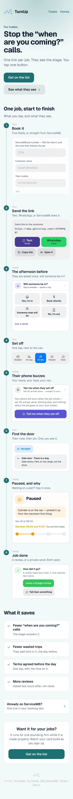

### for-homes

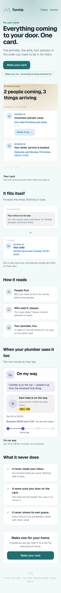

### join

### household

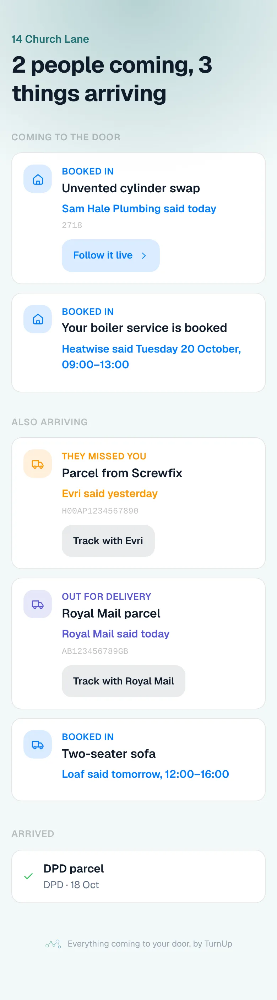

### household-dark

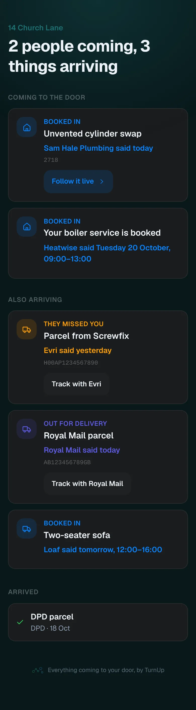

### a home making its own card (phone, 375 wide)

Driven through /join against this build with an invented household, then the
card it made opened at its /h/ link. The letterbox was not receiving in the
local run, so the forwarding address is held back, as it should be.

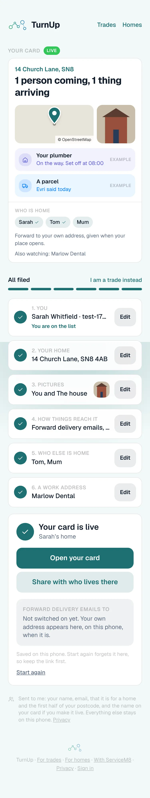
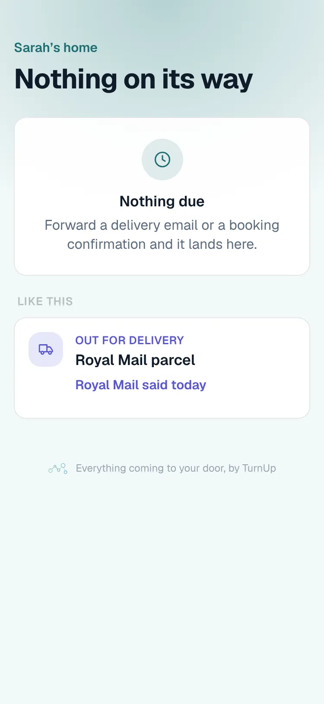
