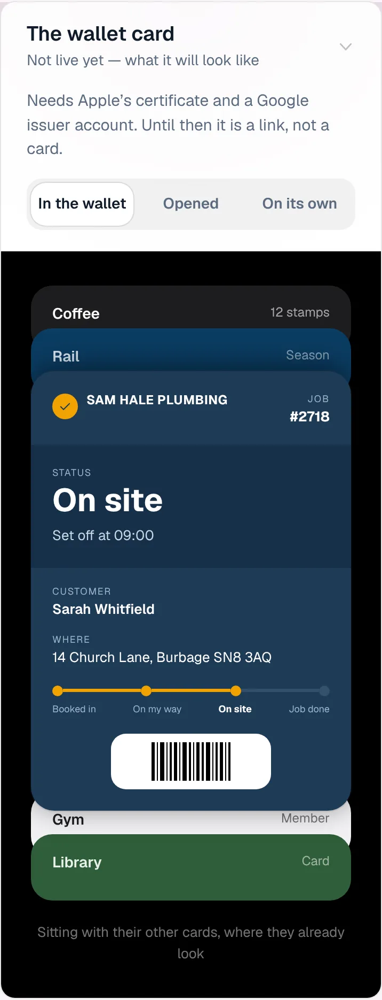
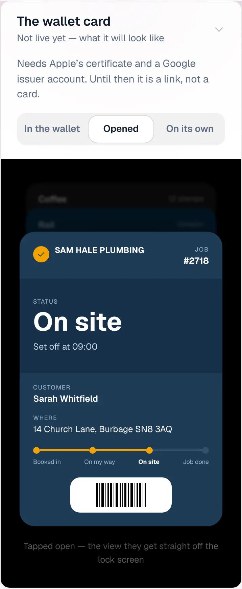
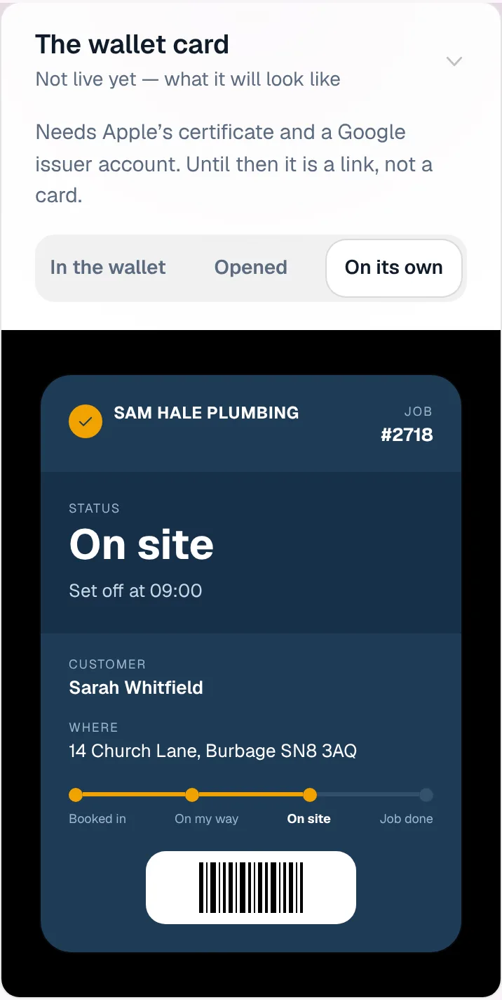
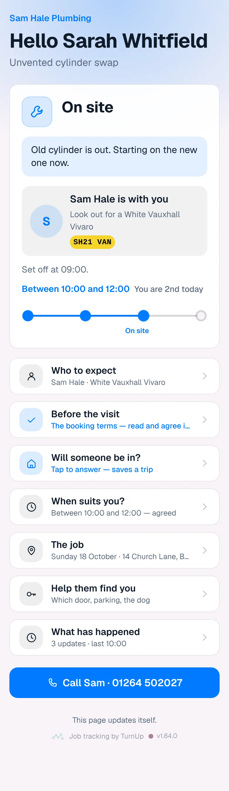
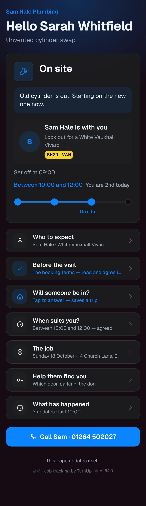
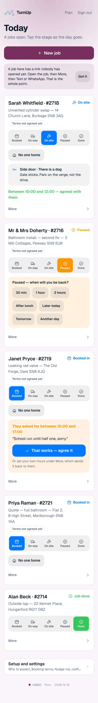
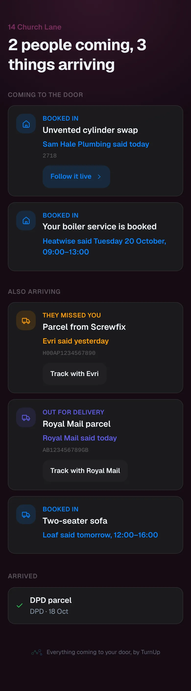

# v1.64.0 — Plum

**2026-10-18** · background `#f9f4f8` · accent `#7a2f5e`

- The household card reads the email inside the forward. Every card email is a forward, and until now the card read the wrapper: a live test on a household card showed Me as the sender and Fwd: Dispatched as the title. Gmail, Apple Mail and Outlook forwards are unwrapped first, a forward of a forward included, so the card shows Samsung UK and the subject they wrote.
- Dispatched is on its way, never arrived. A Samsung Dispatched email said the order should be delivered to your address, and the card filed it as arrived. The subject is now read before the body, since the headline names the stage the email is about, and arrived means only what is said after the event: delivered, left with someone, in your safe place.
- An order confirmation goes on the card as Ordered instead of being dropped. The shop's order number ties its three emails together, so order, dispatched and delivered move one row forward. An order for an e-ticket, a gift card or a download stays off: nothing comes to the door.

### wallet-in-stack

### wallet-opened

### wallet-alone

### customer-light

### customer-dark

### dashboard

### dashboard-setup

### login

### homepage

### homepage-dark

### for-trades

### for-homes

### join

### household

### household-dark

