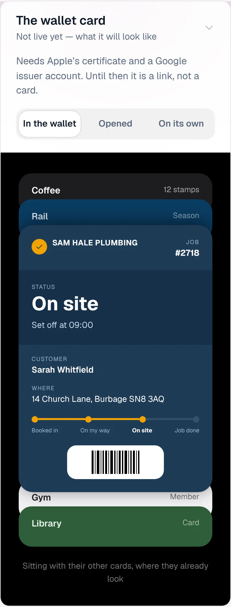
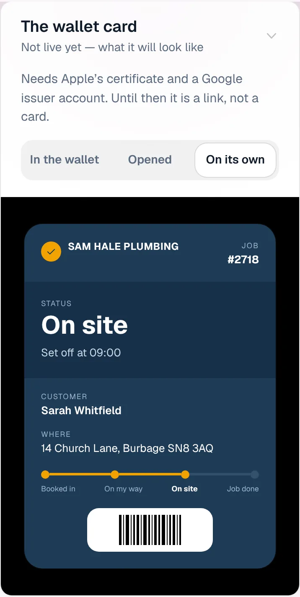
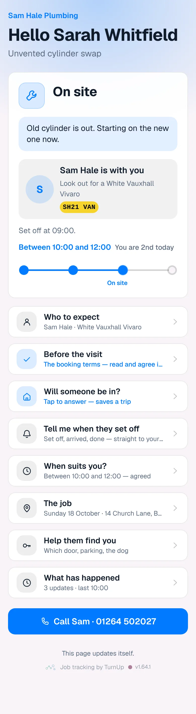
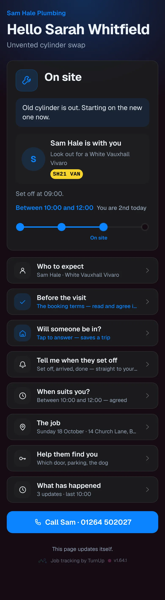
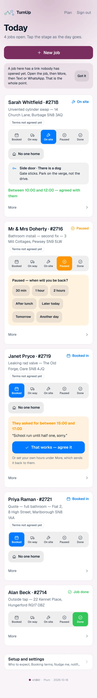
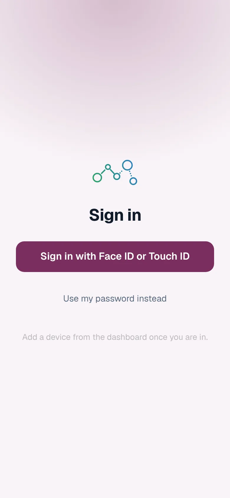
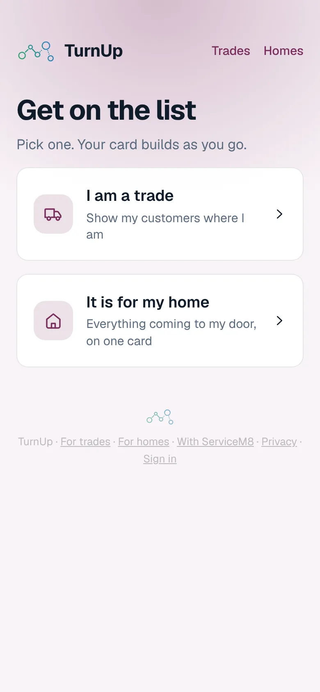
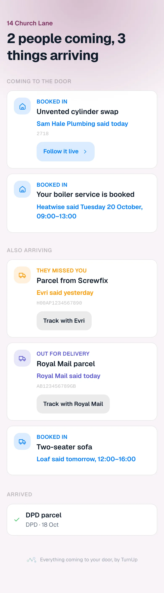

# v1.64.1 — Plum

**2026-10-18** · background `#f9f4f8` · accent `#7a2f5e`

- Gmail’s confirm-forwarding email now shows on the card. Before Gmail will forward to a new address it sends a code to that address, which is the card’s letterbox: it was not a delivery, so it was dropped, and Gmail waited for a confirmation nobody could see. Now the card shows One step left, the code, and a Confirm in Gmail button, and the notice goes once a delivery email arrives. The /join card screen also says how to set up Gmail, starting with one email forwarded by hand.

### wallet-in-stack

### wallet-opened

### wallet-alone

### customer-light

### customer-dark

### dashboard

### dashboard-setup

### login

### homepage

### homepage-dark

### for-trades

### for-homes

### join

### household

### household-dark

