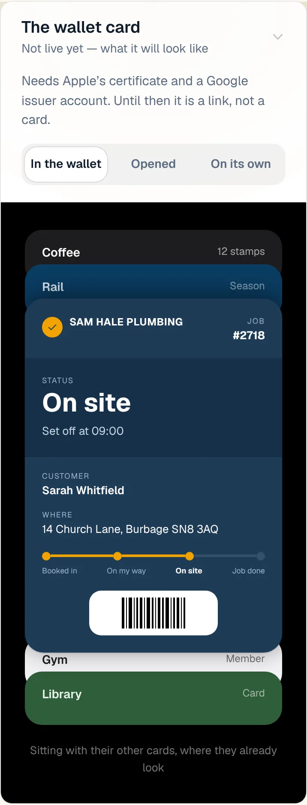
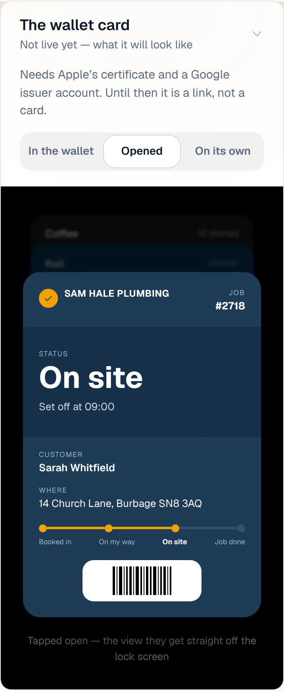
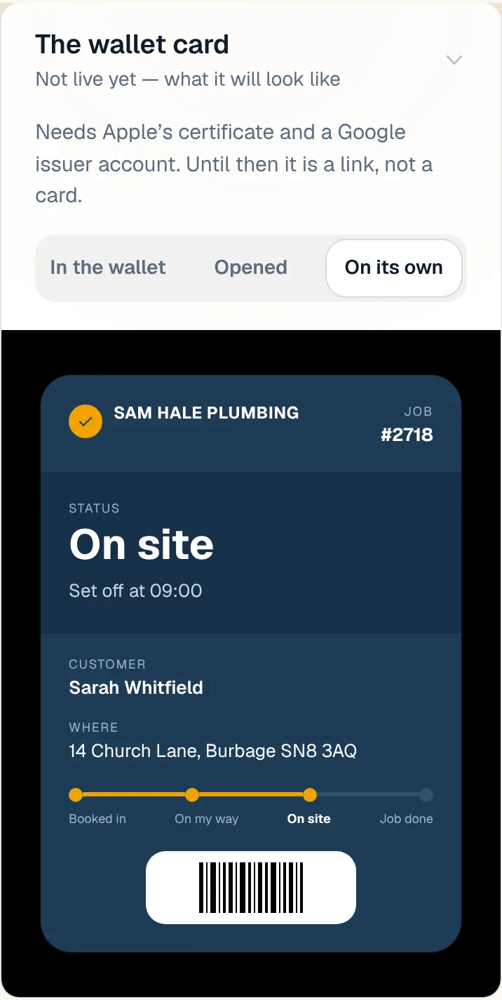
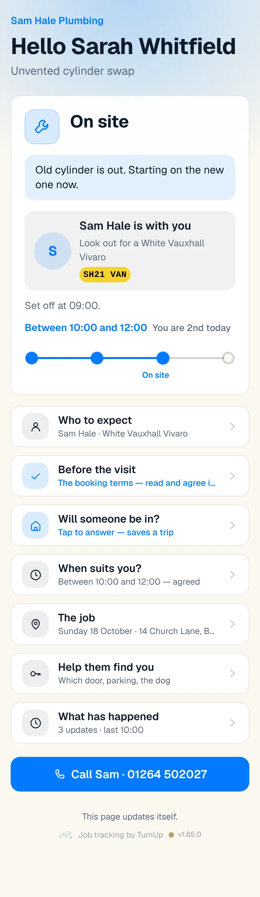
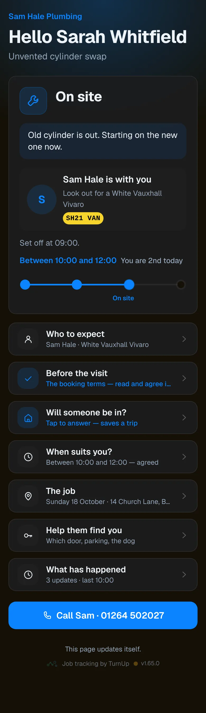
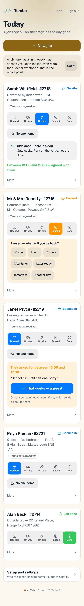
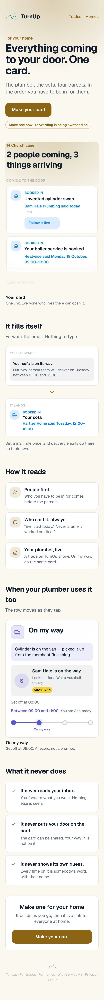
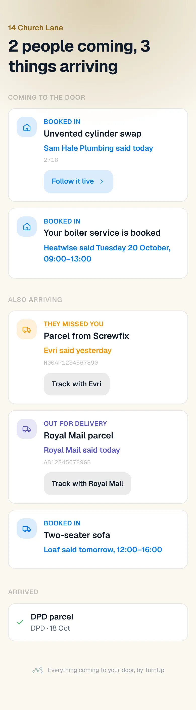
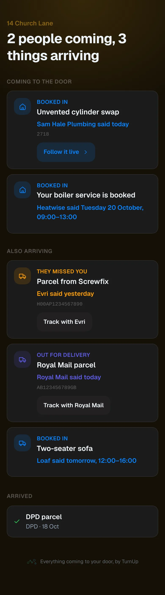

# v1.65.0 — Ochre

**2026-10-18** · background `#fbf8f0` · accent `#8a6414`

- A customer with no notifications still hears about the moments that matter. If no push reached them, they get an email instead when you set off, if the window is missed, and with the day-before ask. It goes through ServiceM8, from your own address, to the email on the ServiceM8 job, and it shows in the job diary. Once each per job, and it never mentions a time.
- Off until you switch it on: Setup and settings, ServiceM8, Email when notifications are off. Send me a test sends the set-off email to an address you type, so you can see exactly what a customer gets. Below it, the last few sends, including any job with no email on it.
- The missed-window notice now reaches the customer even when no trade phone is registered for nudges. Before, the window-started nudge waited for ever for a phone to take it and blocked the missed notice behind it.
- The day-before nudge to your phone now says when the ask went by email, so you only need to text the link if you want to be sure.

### wallet-in-stack

### wallet-opened

### wallet-alone

### customer-light

### customer-dark

### dashboard

### dashboard-setup

### login

### homepage

### homepage-dark

### for-trades

### for-homes

### join

### household

### household-dark

