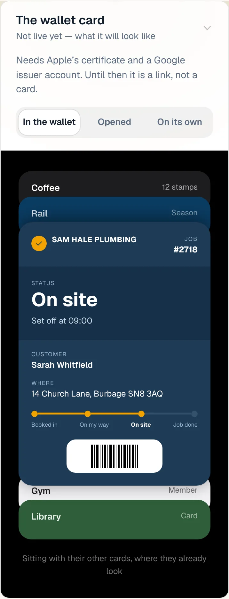
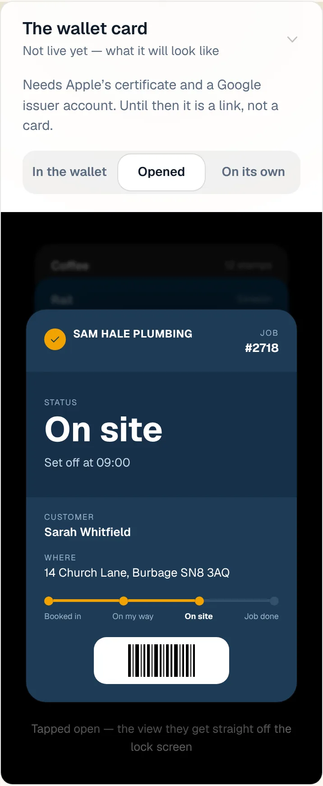
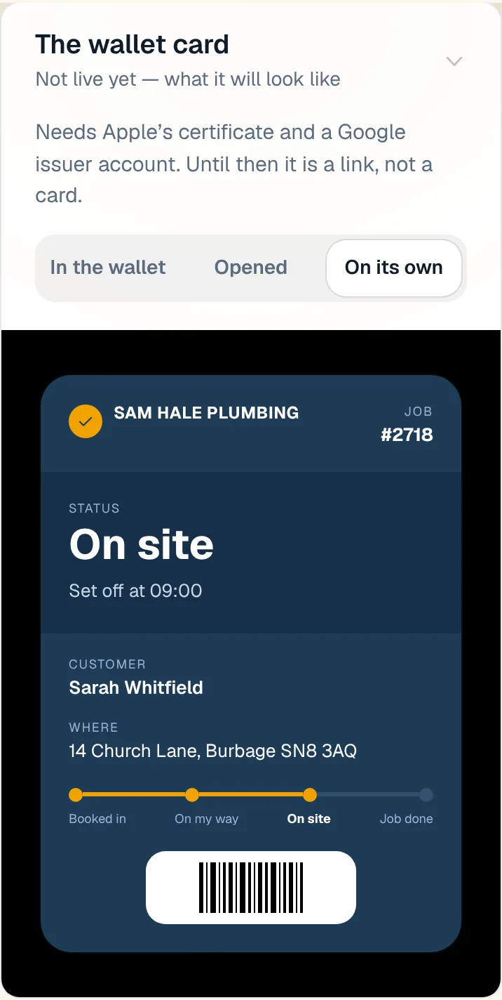
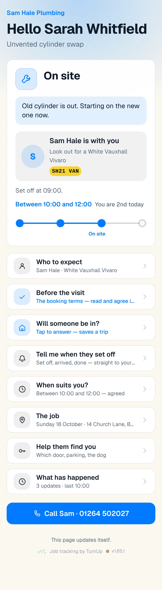
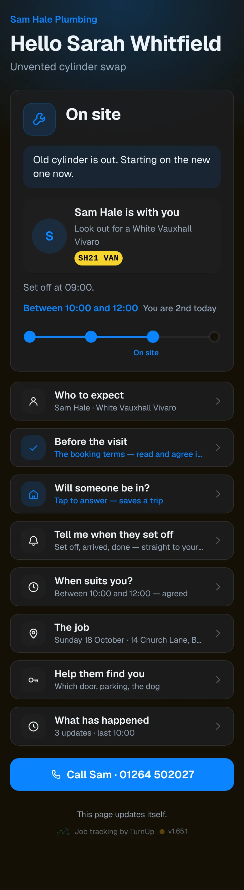
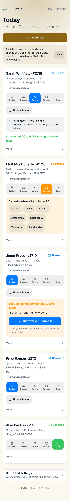
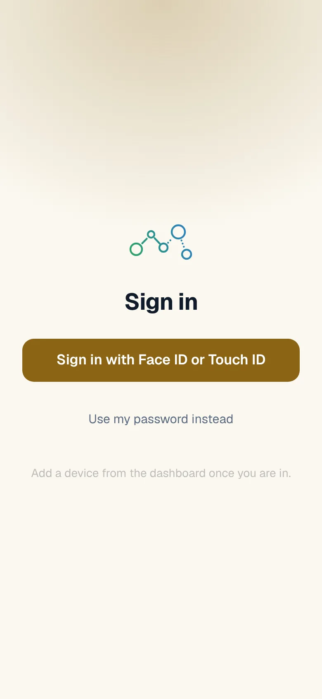
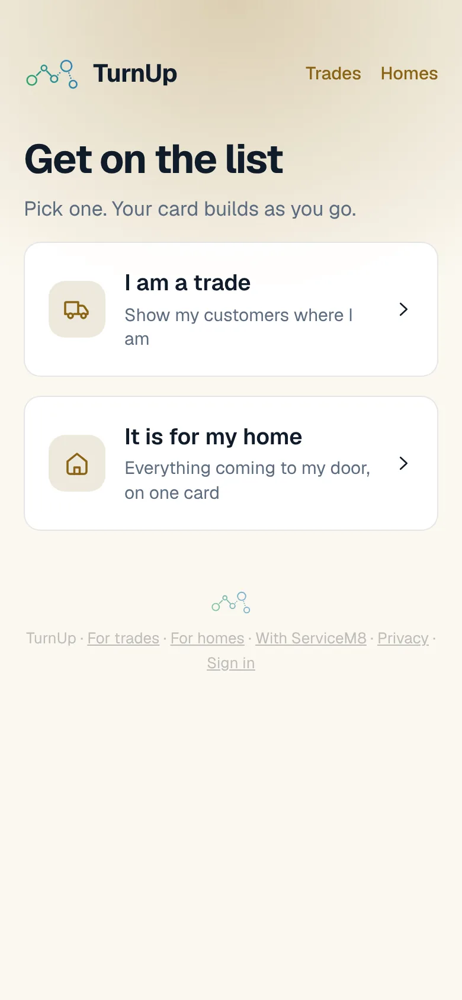
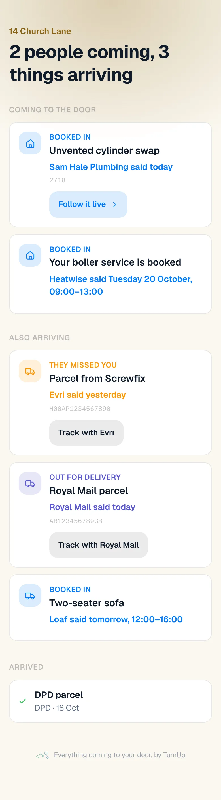

# v1.65.1 — Ochre

**2026-10-18** · background `#fbf8f0` · accent `#8a6414`

- An email forwarded from an iPhone now lands on the card properly. iPhone Mail starts every line of a forward with a > mark, and the card stopped reading at the first one, so a live test filed a Royal Mail dispatch as coming from the person who forwarded it, as Ordered, on the forward’s own date, with the word Receipt as its reference. Now it reads the shop as the sender, On the way, the day the shop gave, and the Royal Mail tracking number with a link to Royal Mail’s own page.
- "Marked as dispatched" reads as on its way. A reference always has a number in it. Where a shop posts by Royal Mail and links to Royal Mail’s tracking page, that number and that link are used, and the button says Track with Royal Mail; the shop is still who said it. The wrong row from the first try is replaced the next time the same email is forwarded.

### wallet-in-stack

### wallet-opened

### wallet-alone

### customer-light

### customer-dark

### dashboard

### dashboard-setup

### login

### homepage

### homepage-dark

### for-trades

### for-homes

### join

### household

### household-dark

