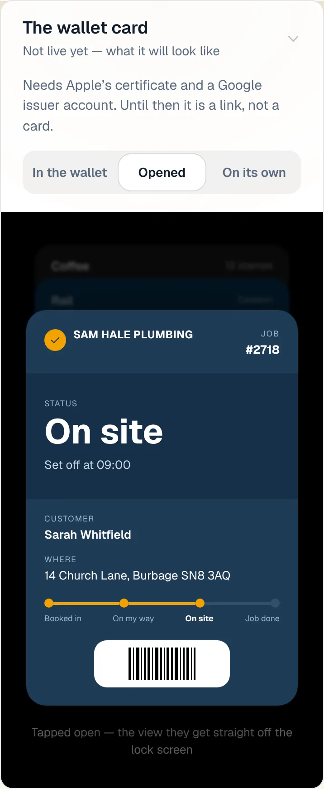
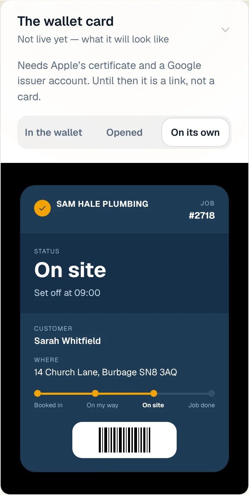
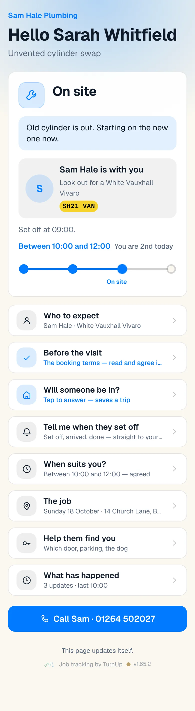
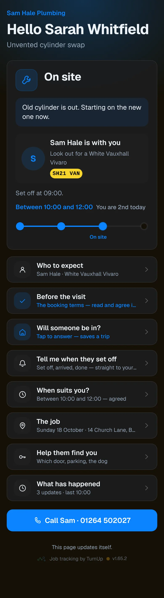
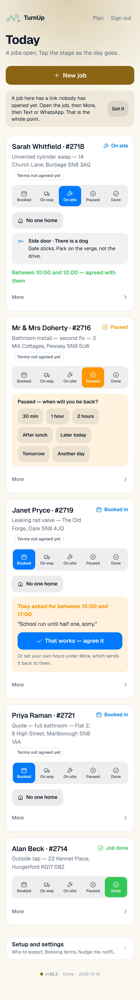
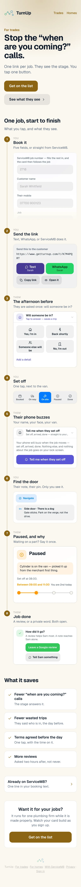

# v1.65.2 — Ochre

**2026-10-18** · background `#fbf8f0` · accent `#8a6414`

- A link that opens the dashboard at the right panel: getturnup.com/dashboard?open=doors goes straight to Household cards, ?open=servicem8 to ServiceM8, ?open=profile to Who to expect, and so on. Instructions can now be one tap instead of scroll, open Setup and settings, find the panel.

### wallet-in-stack

### wallet-opened

### wallet-alone

### customer-light

### customer-dark

### dashboard

### dashboard-setup

### login

### homepage

### homepage-dark

### for-trades

### for-homes

### join

### household

### household-dark

