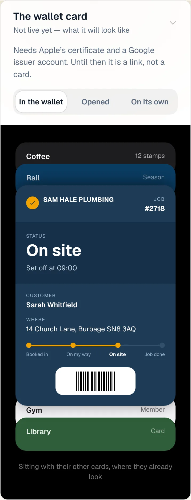
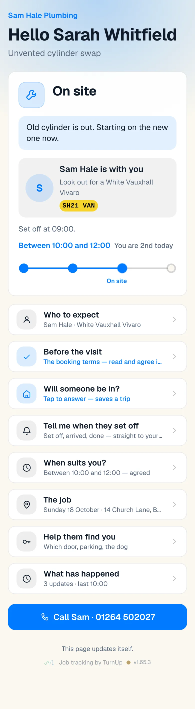
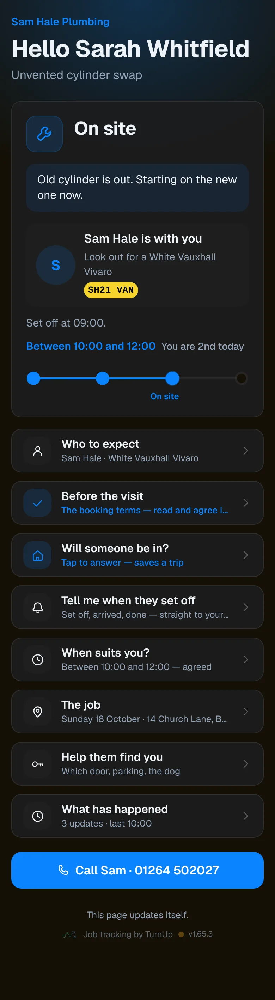
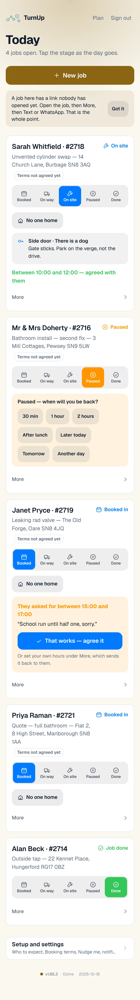
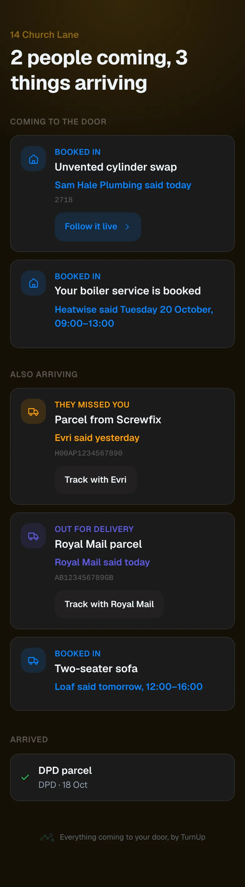

# v1.65.3 — Ochre

**2026-10-18** · background `#fbf8f0` · accent `#8a6414`

- Card titles say what the thing is. "Confirmation of your order: A28609474611. Please find your invoice attached." is now "Screwfix order", and "Your Order with divapor.com has been marked as dispatched" is "Di Vapor order": the stage already shows above the title, and an order number and an invoice line name nothing.
- Rows left over from before forwarded emails were read properly, with "Fwd:" at the front of the title and the household as the sender, no longer show on the card.

### wallet-in-stack

### wallet-opened

### wallet-alone

### customer-light

### customer-dark

### dashboard

### dashboard-setup

### login

### homepage

### homepage-dark

### for-trades

### for-homes

### join

### household

### household-dark

