# v1.66.0 — Harbour

**2026-10-19** · background `#f4f7fb` · accent `#255a95`

- Are you still coming? no longer crashes the customer's page. If the page was open when the window started, it went to Application error, at the exact moment a customer was watching for you. Found in an audit, reproduced in a browser, fixed, and a new check fails any change that brings it back.
- The household card's email reader is proven in every client: Gmail, Outlook and Apple Mail forwards, each at ordered, on its way, out for delivery and delivered. Dispatched never files as arrived in any of them. "Ordered:" (Amazon's wording) and "you ordered" now count as an order. The test emails use invented people and addresses only.
- An audit of everything the roadmap and the build list say, checked against the code: docs/audit/2026-10-19.md. The build list no longer says every event has an email fallback; three do.
- A plan for reading a household's inbox the way Shop does, without forwarding: docs/research/inbox-connect.md, with a source for every claim. On the roadmap as Connect Gmail, an idea with no date, because Google has to review it first.

### wallet-in-stack

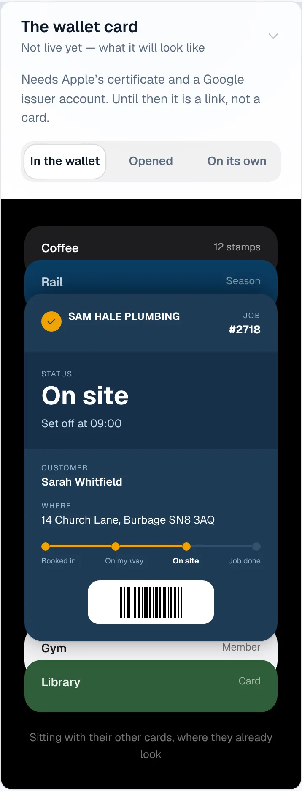

### wallet-opened

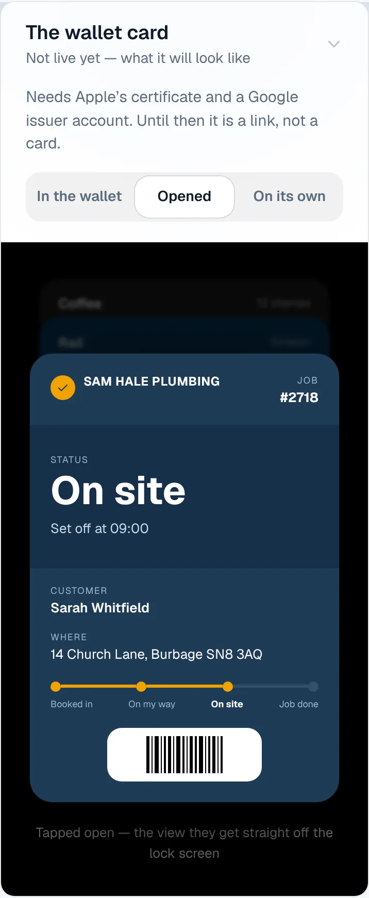

### wallet-alone

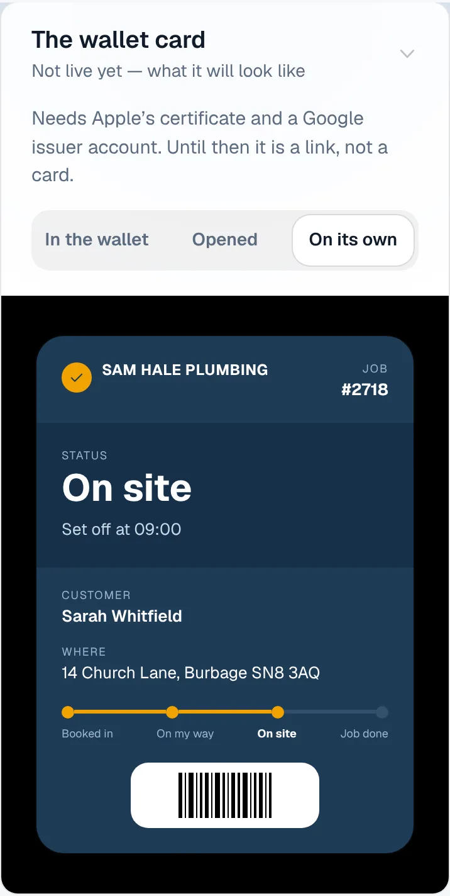

### customer-light

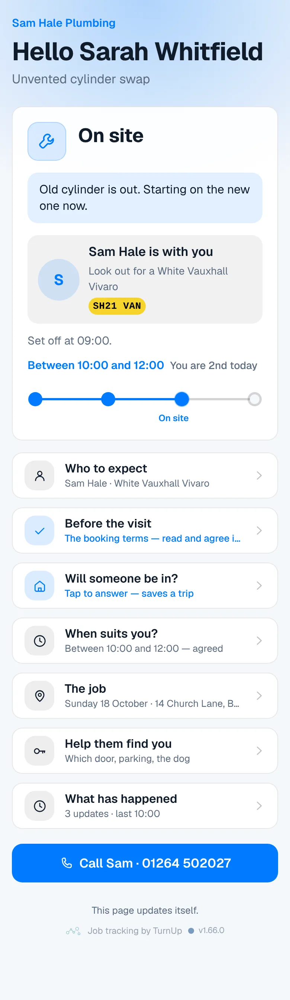

### customer-dark

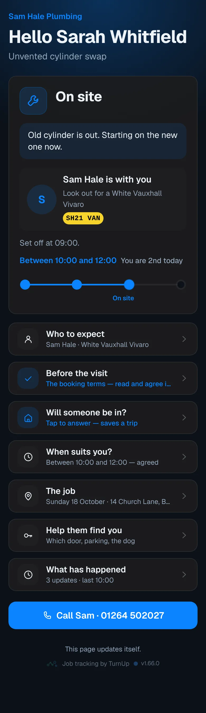

### dashboard

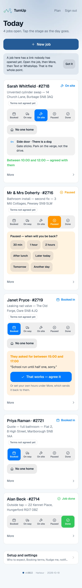

### dashboard-setup

### login

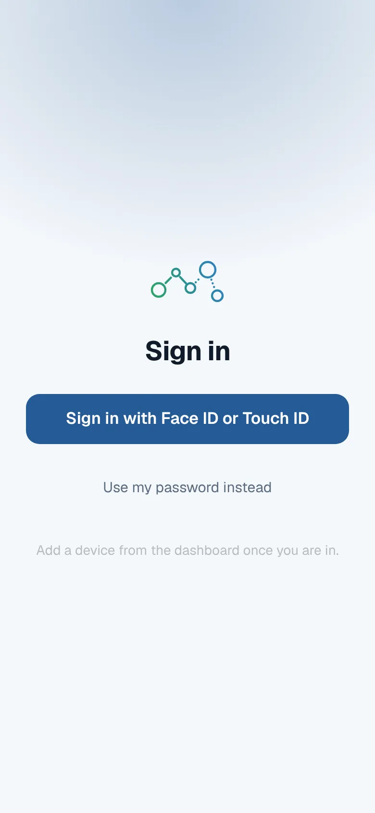

### homepage

### homepage-dark

### for-trades

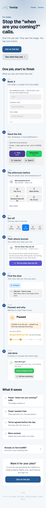

### for-homes

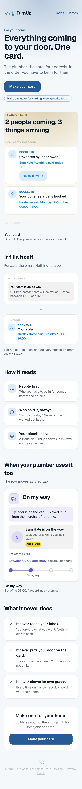

### join

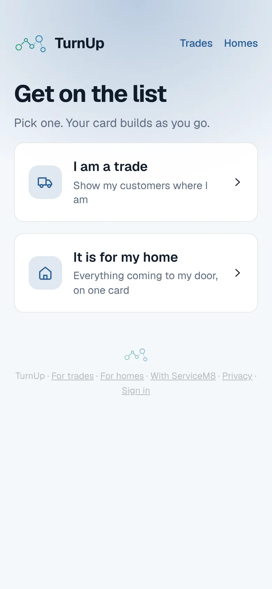

### household

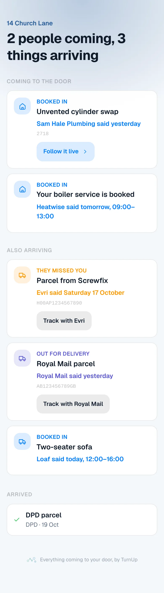

### household-dark

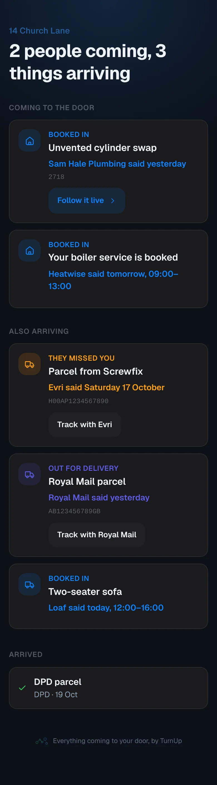
