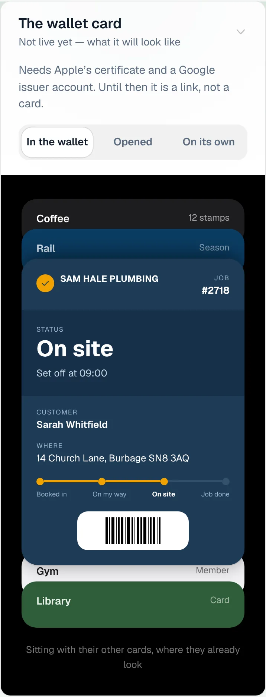
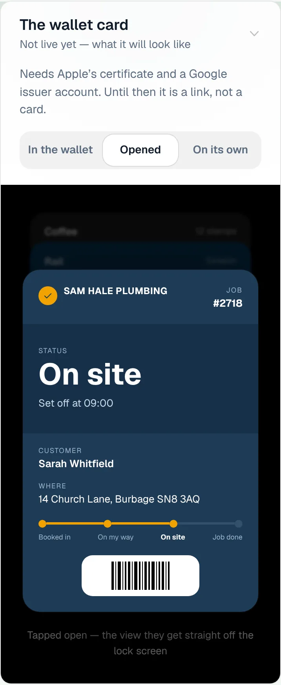
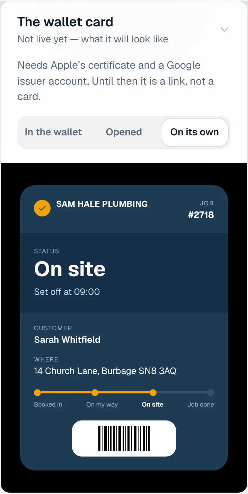
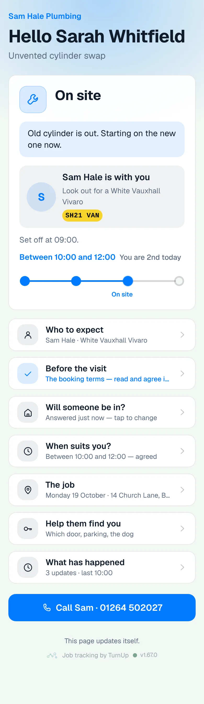
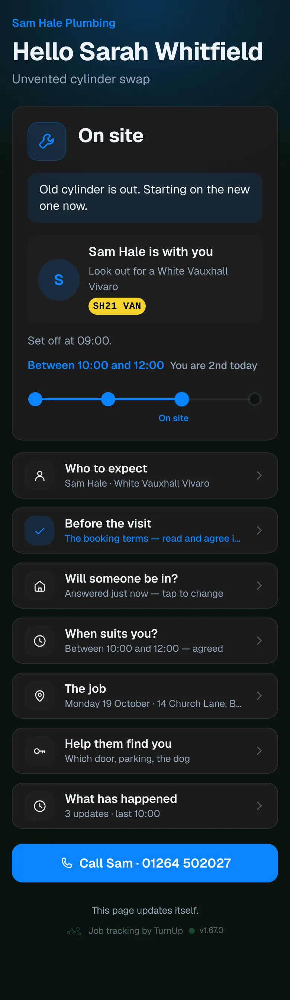
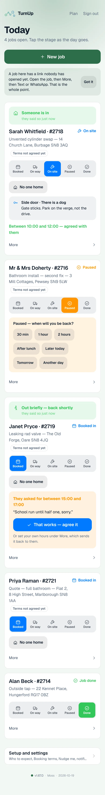
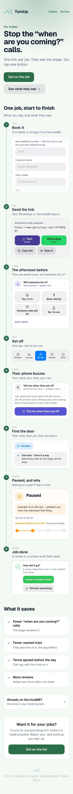
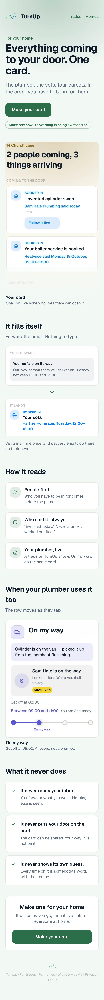
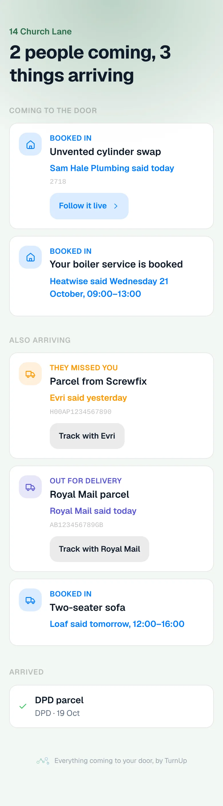
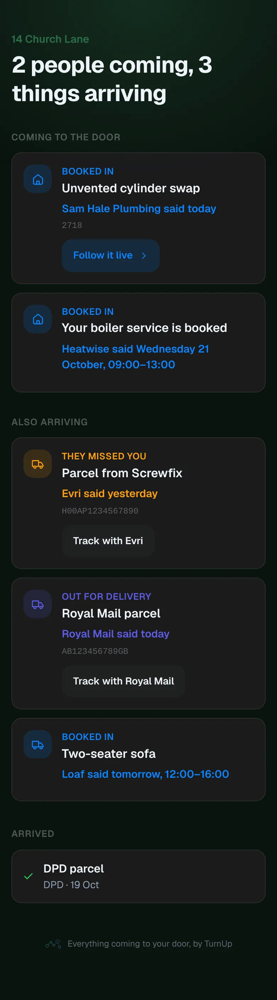

# v1.67.0 — Moss

**2026-10-19** · background `#f3f8f4` · accent `#2c6e49`

- The pilot numbers count what they say. Links opened no longer counts your own opens or the preview a messaging app fetches when the link is pasted. A wasted trip is counted on the day it happened, so rebooking the job no longer loses it, and a tap that timed out no longer records it twice. The thirty days start when you press Start on the panel; before that the panel says the window is rolling. Calls to the booking line are typed on the panel with one button.
- Where the card hears from: two new sources on the dashboard, both off until their setting exists. Read my own inbox connects your Google Workspace mailbox and files delivery emails on one card every five minutes, with no forwarding rule. Track parcels by their number hands a courier reference to Ship24 and the courier's own scans move the row from then on. Each panel shows exactly what it needs and ends in a Check now or a tracked count.
- Honest words: You are 2nd today shows only on the day; the roadmap says the van lookup is live, that door photos are yours alone, and that the wallet card does not carry your logo yet; the homepage no longer says the wallet card moves on its own.

### wallet-in-stack

### wallet-opened

### wallet-alone

### customer-light

### customer-dark

### dashboard

### dashboard-setup

### login

### homepage

### homepage-dark

### for-trades

### for-homes

### join

### household

### household-dark

