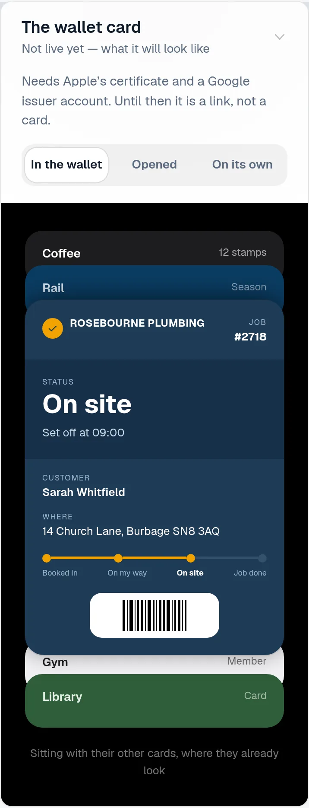
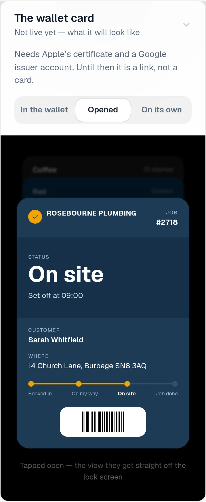
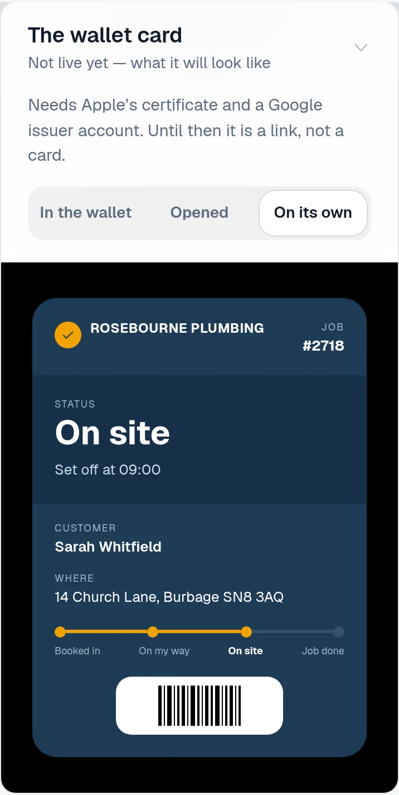
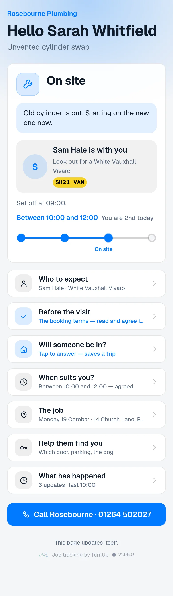
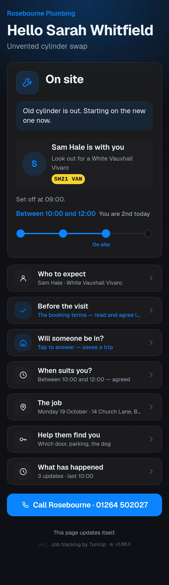
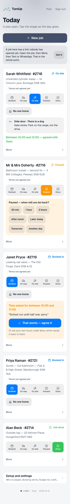
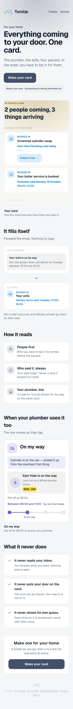
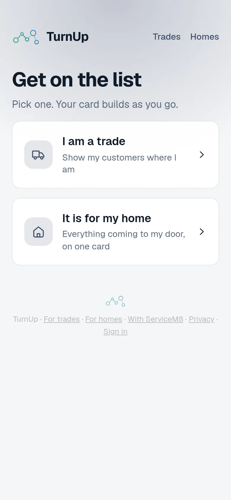
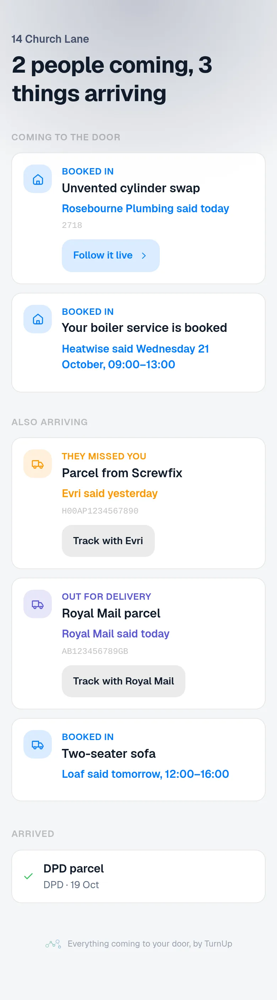
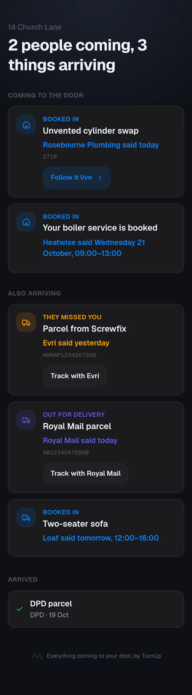

# v1.68.0 — Slate

**2026-10-19** · background `#f5f6f8` · accent `#44506b`

- A reminder that stops. An unanswered "Are you still coming?" buzzed the trade every ten minutes for as long as it stayed open — one asked at 15:34 on 18 October went all night and was still going at breakfast. Three locks now: three buzzes in total and no more; nothing between 21:00 and 07:00 in your own zone, with one summary at seven if a question was left open across the night; and an ask belongs to the day of the job it is about, so a stale one never pushes the next morning. A reminder that has not worked three times will not work the fortieth.
- Stop reminders, on the card. The only way to silence a buzzing question used to be to move the stage, which tells the customer something that is not true. The button answers the question without touching the card: no stage, no note on their page, no claim that anybody has set off. For when you have already rung them.
- The lock screen stops naming the customer on that one. "Sarah is asking" became "A customer is asking", and the time came out of the body. A notification is read by whoever picks the phone up off the kitchen table, and knowing which card to open never needed her name. The other trade notifications still carry a first name; that is the next thing to look at.
- The two window nudges sleep as well, and they lose nothing by it: each fires once, so a window that ended at 22:00 is reported at 07:00 rather than at 22:00. The missed-window notice is deliberately NOT quietened — that one is the customer being told their window has passed, and they are owed it whatever the hour.

### wallet-in-stack

### wallet-opened

### wallet-alone

### customer-light

### customer-dark

### dashboard

### dashboard-setup

### login

### homepage

### homepage-dark

### for-trades

### for-homes

### join

### household

### household-dark

