# v1.69.0 — Clay

**2026-10-19** · background `#faf6f2` · accent `#9a4a24`

- Your lock screen stops naming your customers. Ten notifications to your phone carried a first name — "Sarah’s window has started", "Sarah left a note after the job" — and one of them put the customer’s own private note straight in the body, which is the thing the rule in this product bans hardest. The rule was written for the customer’s phone and had simply never been applied to yours. Your phone sits on a kitchen table too.
- The cost, so it is your call and not a surprise: with four jobs on, the lock screen no longer says which one it is about. You tap, and the dashboard says. A name is the only thing that could tell them apart and a name is the thing that should not be there.
- What is left is a vocabulary rather than ten lines written in ten places (src/lib/trade-push-words.js), and nothing in it can take anything a customer supplied — there is nowhere to put it. What a notification may say is now a decision made in one file, the way it already was for the customer’s side.
- A check that can actually fail (node scripts/check-trade-push.mjs): it builds every line and reads it, then reads every notification call in the app as source and refuses one that passes a customer field. It carries the five shapes this bug really took, and fails if it stops catching them. A check that cannot fail is decoration.

### wallet-in-stack

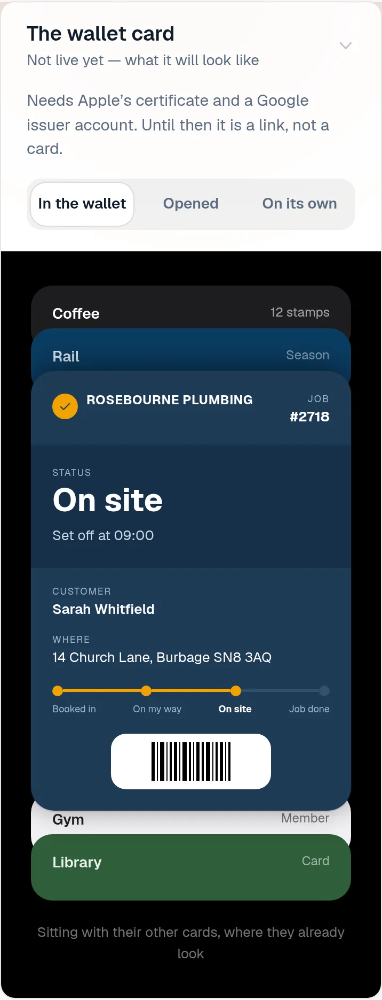

### wallet-opened

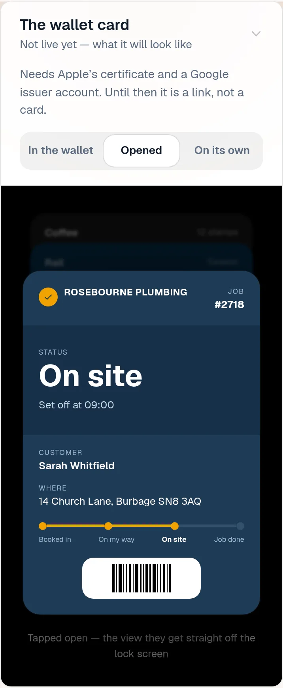

### wallet-alone

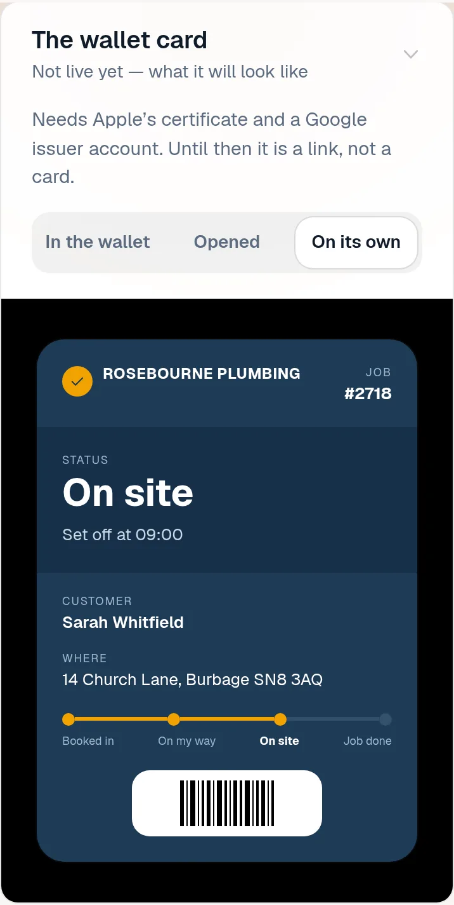

### customer-light

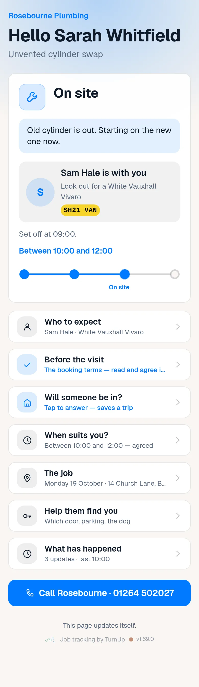

### customer-dark

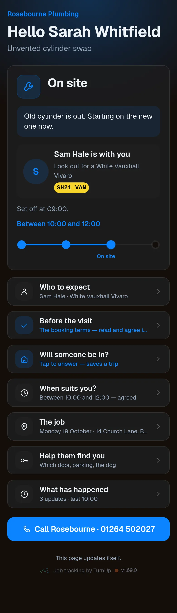

### dashboard

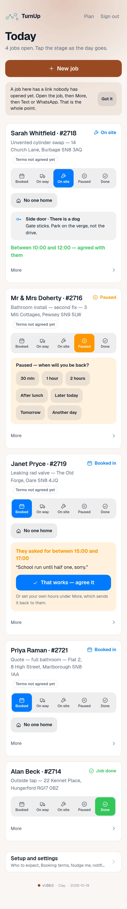

### dashboard-setup

### login

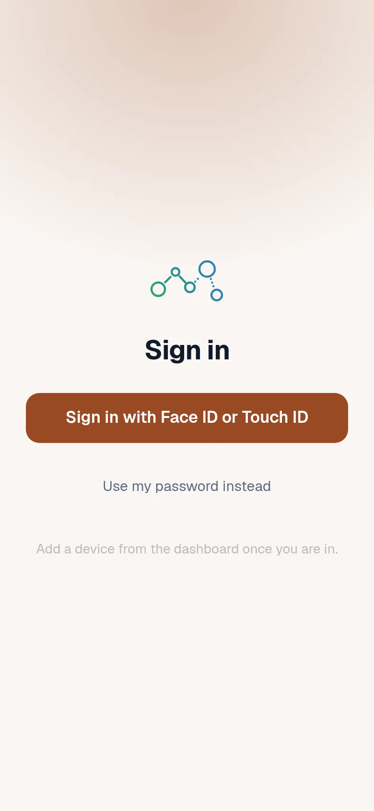

### homepage

### homepage-dark

### for-trades

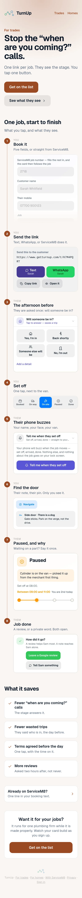

### for-homes

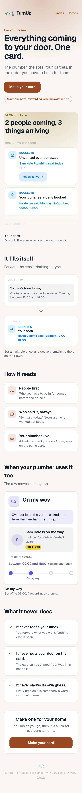

### join

### household

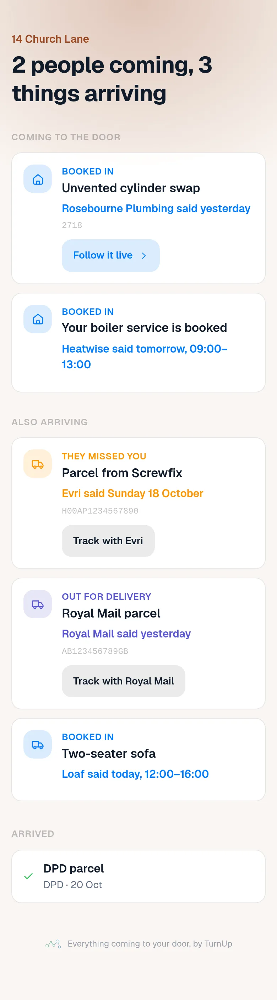

### household-dark

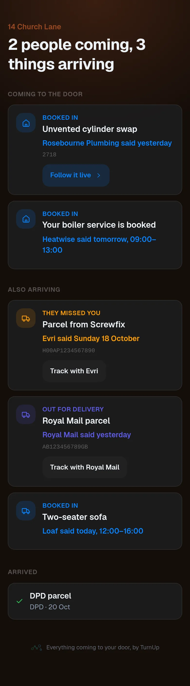
