# v1.70.0 — Indigo

**2026-10-20** · background `#f5f5fc` · accent `#463a94`

- Job done? On my way to the next one, offered. Tap Job done and a card at the top asks whether you are heading to the next job booked today, with their name, the job and the hours. One tap sends On my way, exactly as the button on their card would: push, the email fallback, the ServiceM8 diary. Not yet puts it away. If nothing else is booked today it says so. It never offers tomorrow's job and never names a time.

### wallet-in-stack

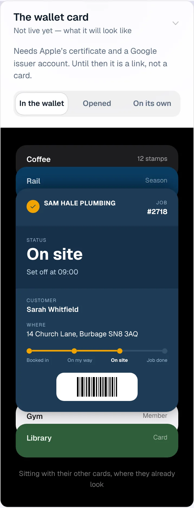

### wallet-opened

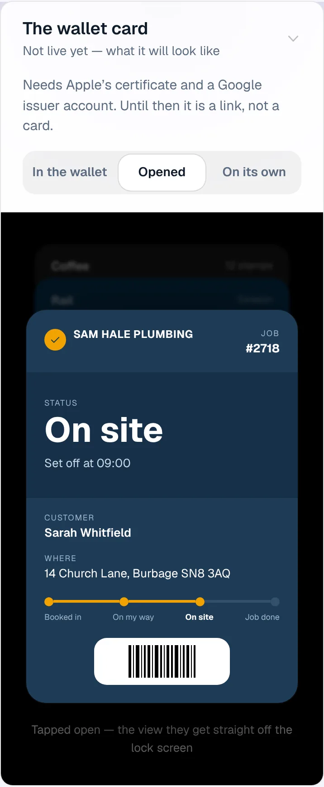

### wallet-alone

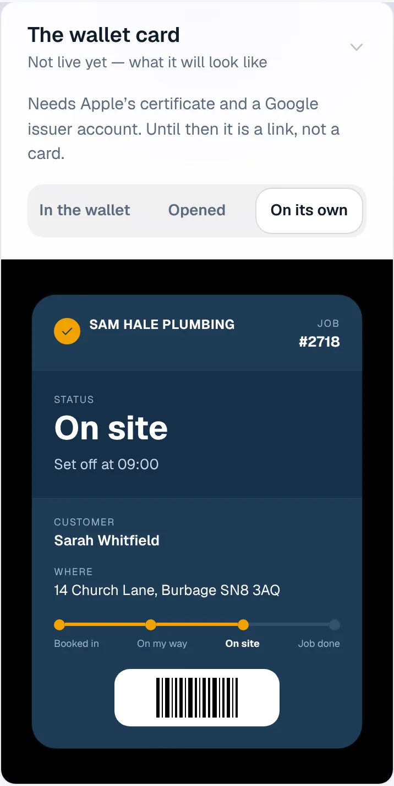

### customer-light

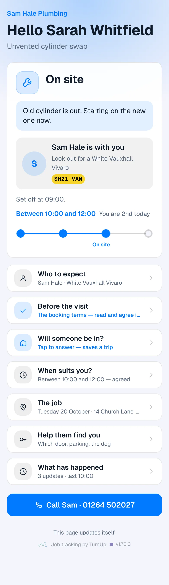

### customer-dark

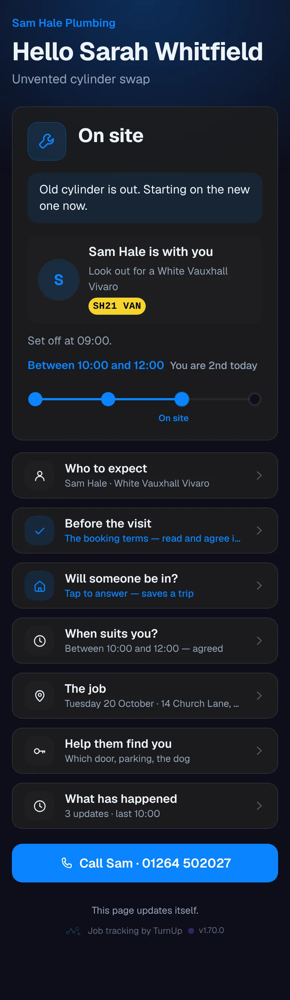

### dashboard

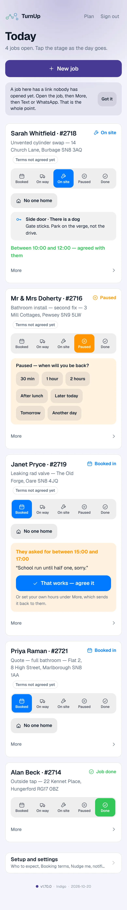

### dashboard-setup

### login

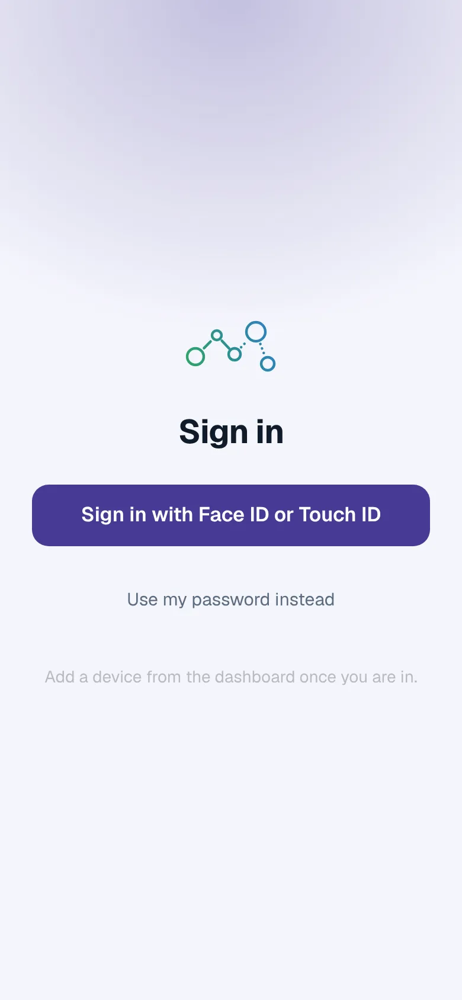

### homepage

### homepage-dark

### for-trades

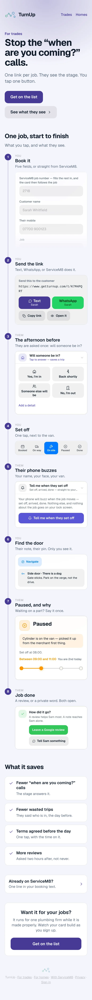

### for-homes

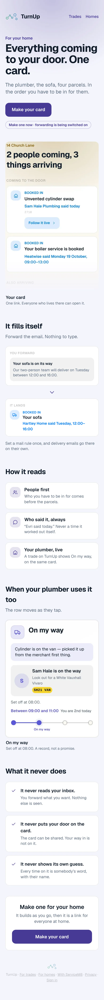

### join

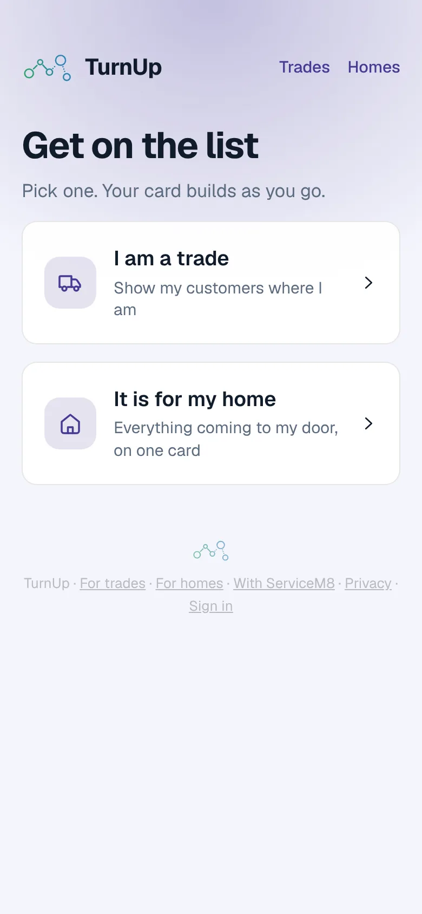

### household

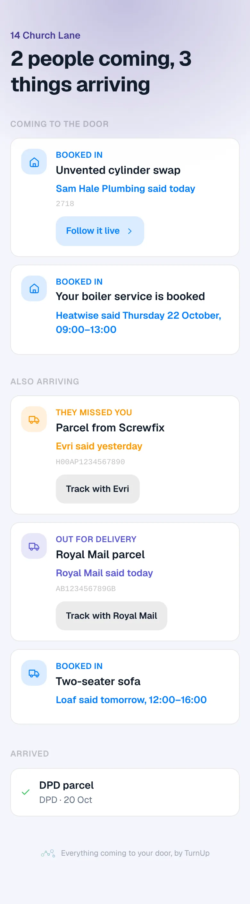

### household-dark

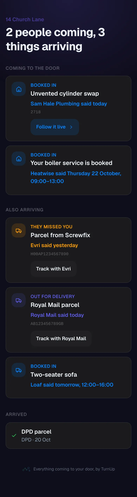
