# v1.71.0 — Teal

**2026-10-22** · background `#f2f9f9` · accent `#1f6f72`

- The ServiceM8 add-on no longer needs Vercel. The App ID and App Secret from ServiceM8's Developer page are pasted into two boxes on the ServiceM8 panel and saved encrypted in your own database, and the Connect button appears straight away: no settings page, no redeploy. Two Vercel settings were asked for three times and never happened, so the ask changed. The panel now says the three steps with a link for each and a Copy button for the Return URL, instead of pointing at a file in the repository you could not tap.

### wallet-in-stack

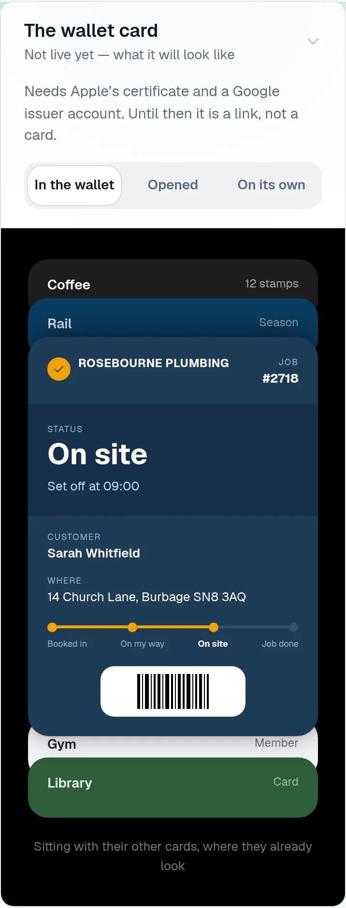

### wallet-opened

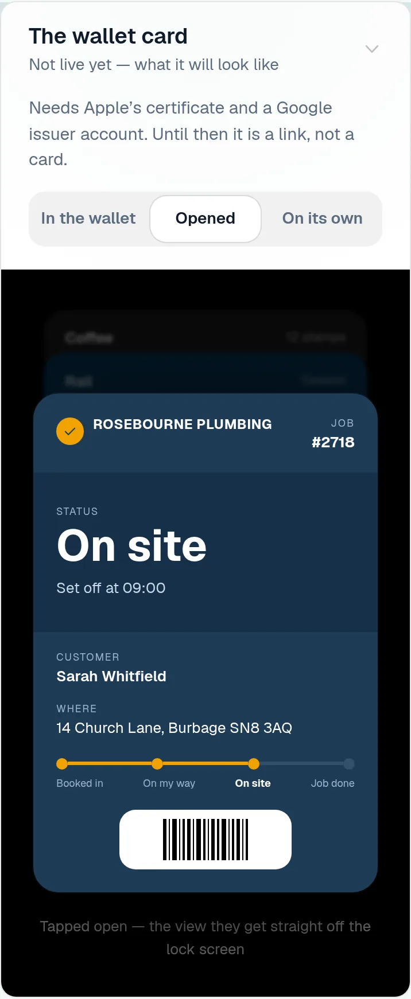

### wallet-alone

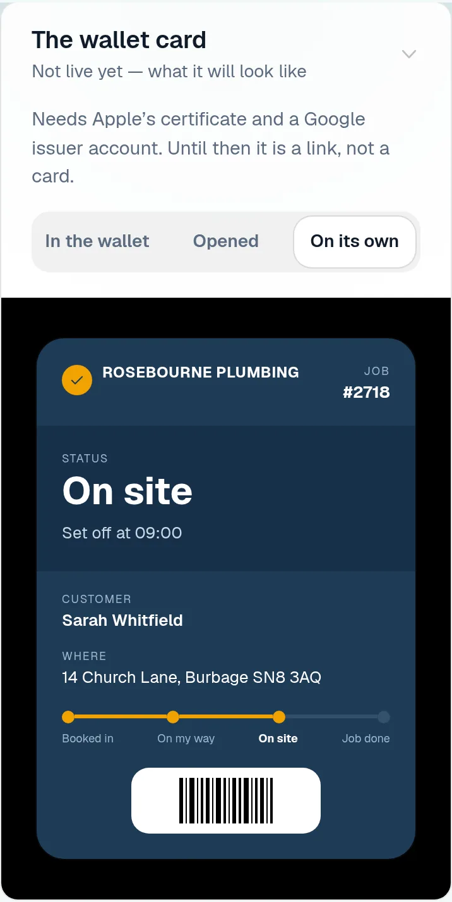

### customer-light

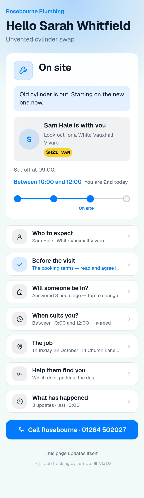

### customer-dark

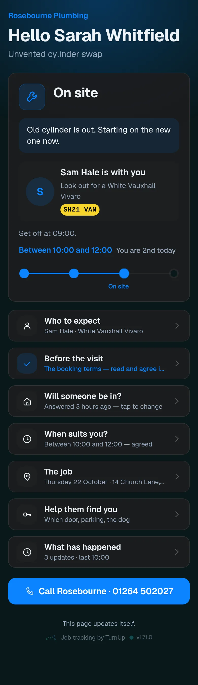

### dashboard

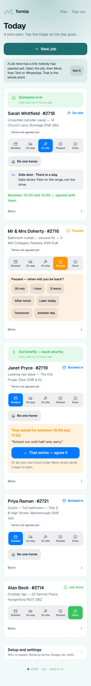

### dashboard-setup

### login

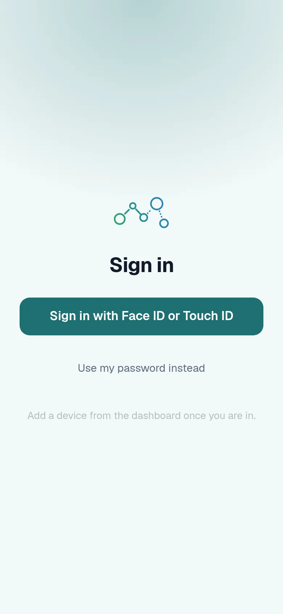

### homepage

### homepage-dark

### for-trades

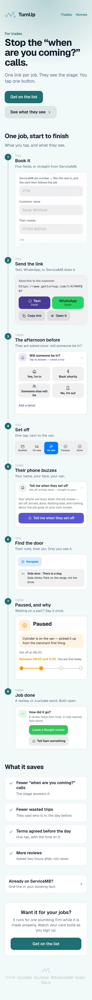

### for-homes

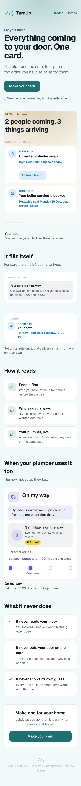

### join

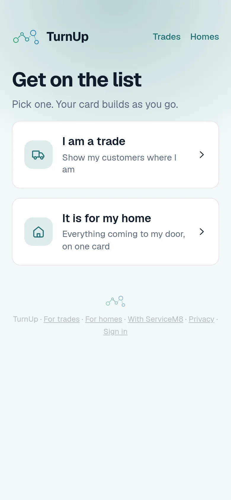

### household

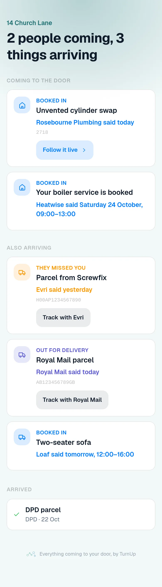

### household-dark

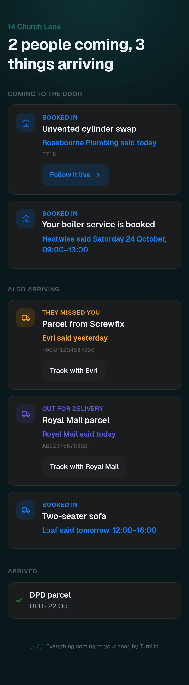
