# v1.72.0 — Plum

**2026-10-23** · background `#f9f4f8` · accent `#7a2f5e`

- Connect Gmail is two boxes on the phone, not Vercel. The Google Client ID and secret are pasted into the panel under Where the card hears from, sealed before they are stored, and Connect Gmail appears straight away: no settings page, no redeploy. The three Google steps are links you can tap. Same fix the ServiceM8 add-on got the day before, for the same reason.

### wallet-in-stack

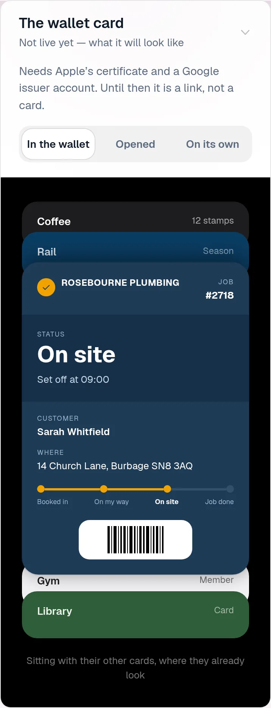

### wallet-opened

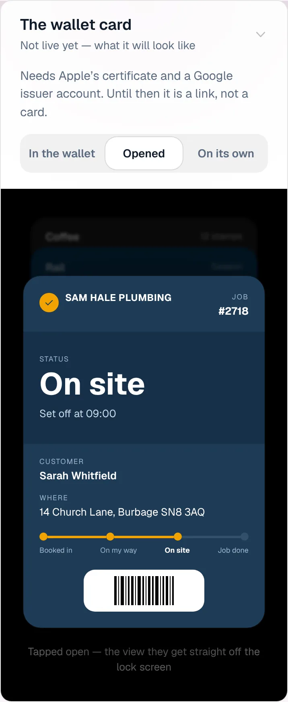

### wallet-alone

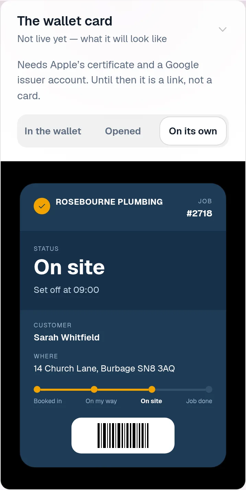

### customer-light

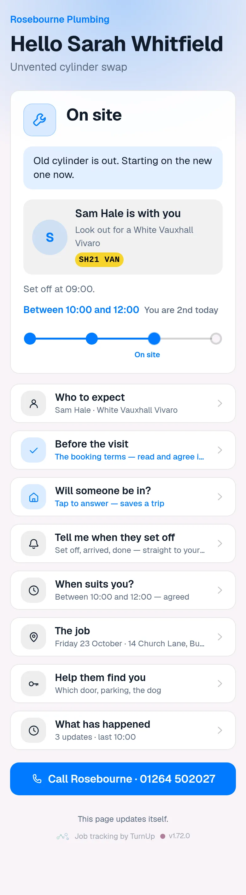

### customer-dark

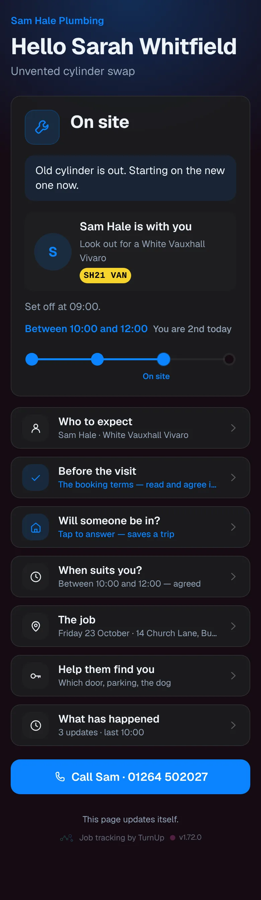

### dashboard

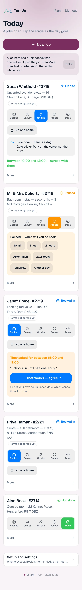

### dashboard-setup

### login

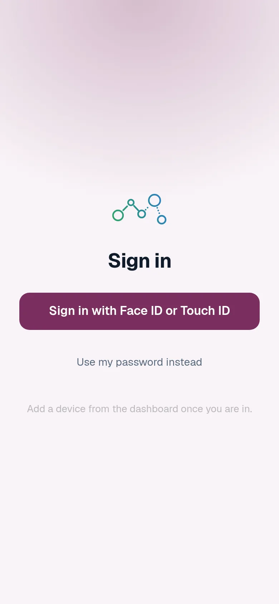

### homepage

### homepage-dark

### for-trades

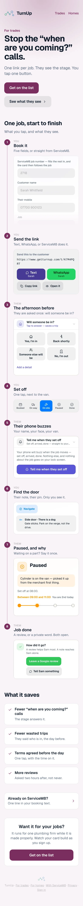

### for-homes

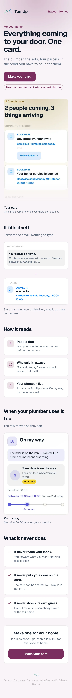

### join

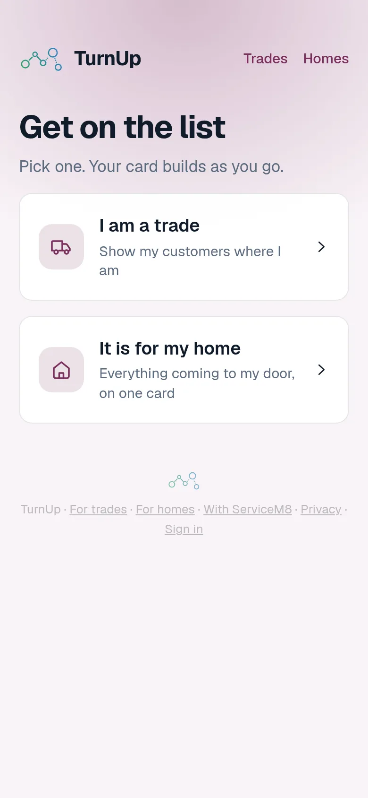

### household

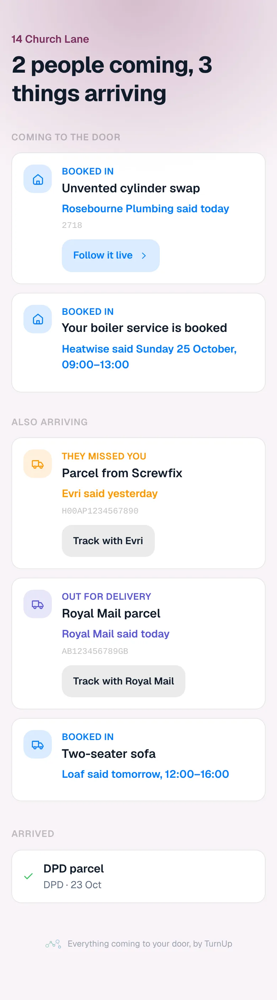

### household-dark

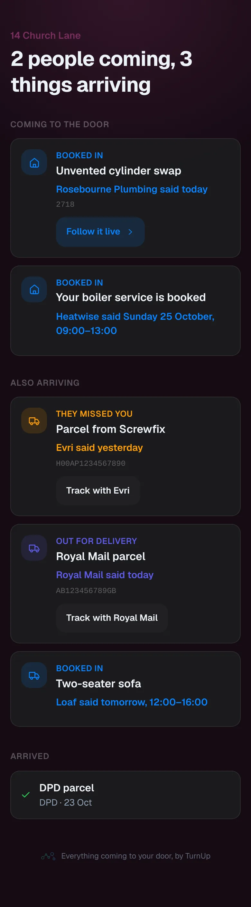
