# v1.73.0 — Ochre

**2026-10-23** · background `#fbf8f0` · accent `#8a6414`

- The wallet card can now update itself. Until tonight a pass showed the stage it was added at and nothing moved it again, which is the difference between a card and a screenshot. The four service calls Wallet makes are built: it registers a phone against a job, it asks what has changed since it last looked, it fetches the current card, and it reports back when something went wrong. A stage tap on the dashboard, or a booking moving in ServiceM8, now tells every phone holding that card to come and look.
- The push that does it carries no words at all — Apple’s pass push is an empty body that only says "ask me again", so there is nothing on a lock screen to get wrong and no vocabulary to guard. Everything the card says still comes from the same builder as the download, so the card in a pocket and the page on the link cannot say different things.
- A revoked link takes the card with it. Switch a job’s link off and the next time Wallet asks it is told the pass is no longer theirs, and it comes off the phone. The token a pass sends back is worked out from the job code and your own secret rather than stored, so there is no new column, nothing extra to leak, and one job’s pass cannot ask about another’s.
- Still waiting on one thing, and it is not code: the Pass Type ID certificate from Apple. The enrolment went through on 21 October, so that is the next job, and this half is ready for the day it lands. Two checks on it, and the second one earned its keep immediately: run against a real server it found that a card whose link had been switched off was told “come back later” instead of being removed from the phone. The paths Wallet itself calls are the one thing left to a real card, and every route logs a line so the log says whether it found them.

### wallet-in-stack

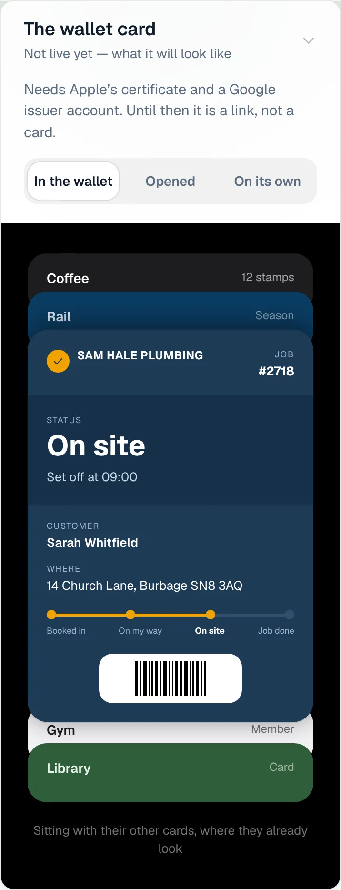

### wallet-opened

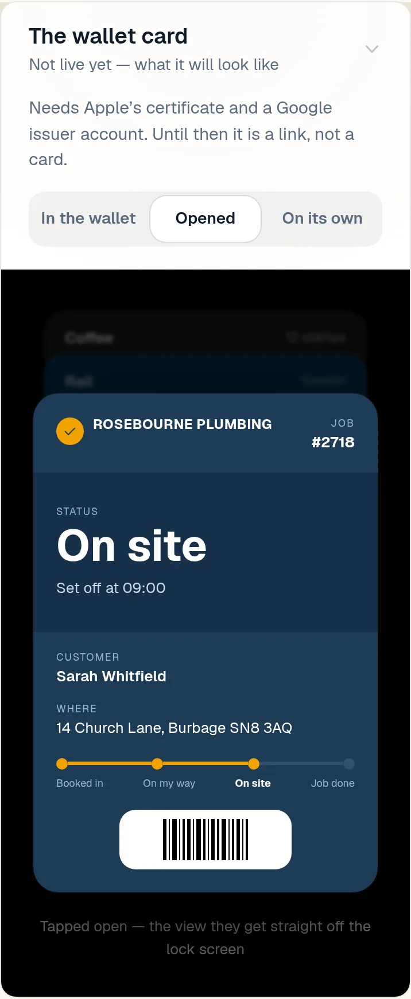

### wallet-alone

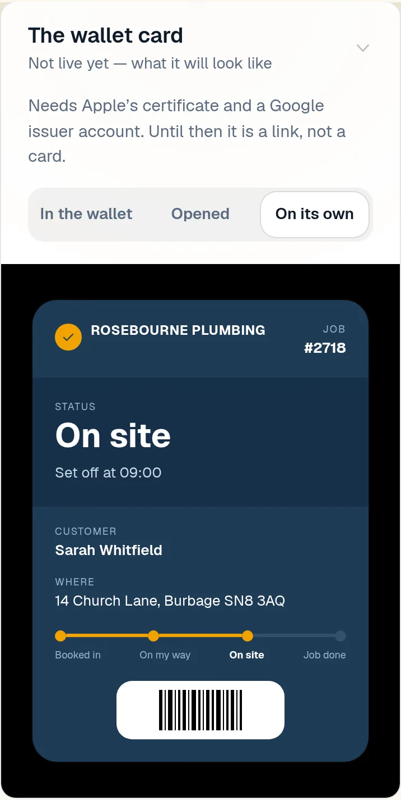

### customer-light

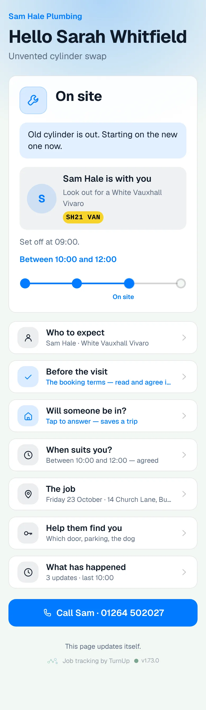

### customer-dark

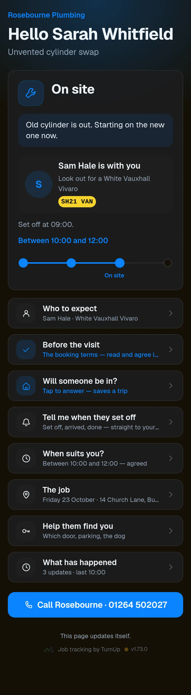

### dashboard

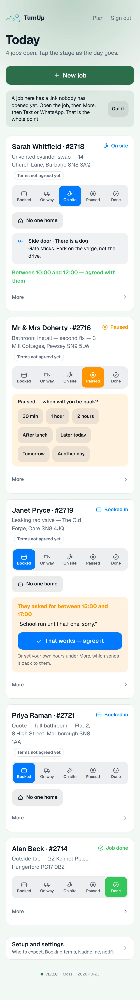

### dashboard-setup

### login

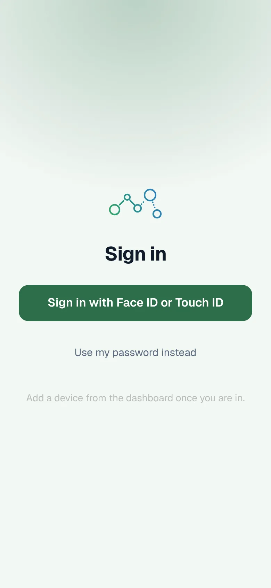

### homepage

### homepage-dark

### for-trades

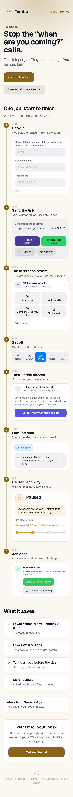

### for-homes

### join

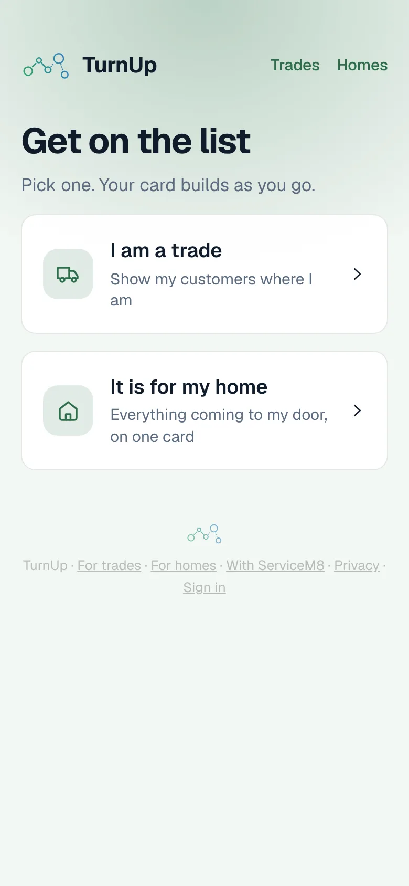

### household

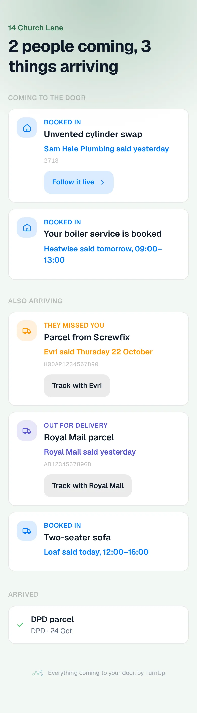

### household-dark

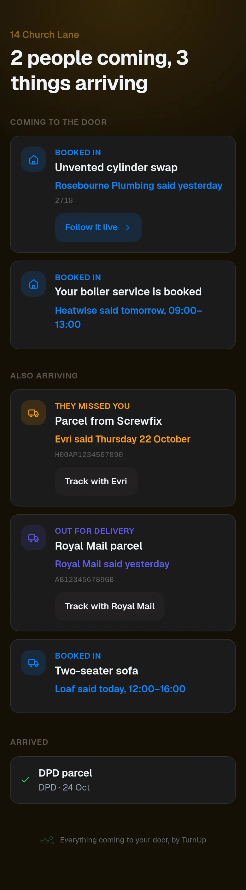
