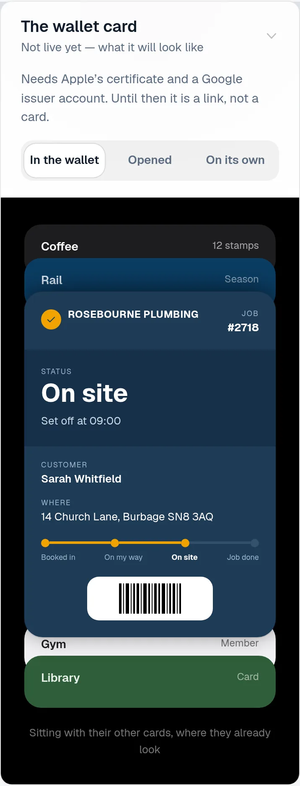
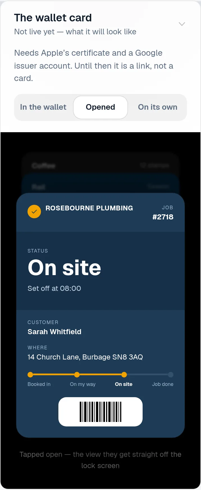
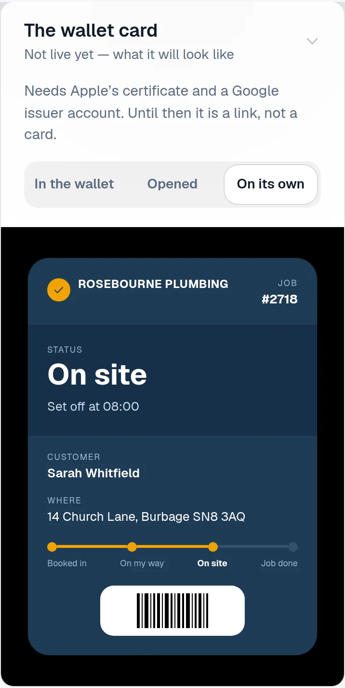
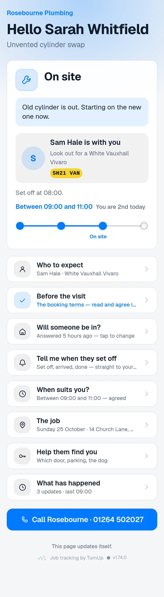
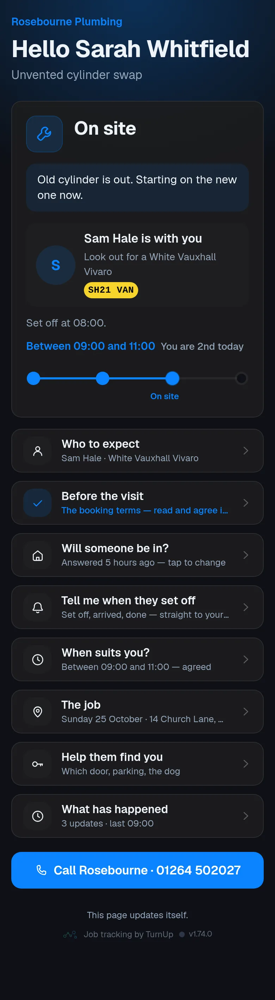
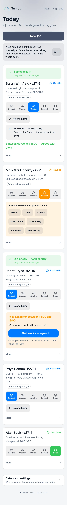
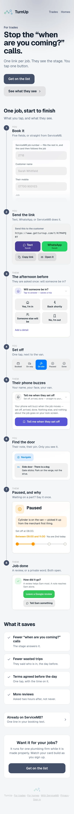
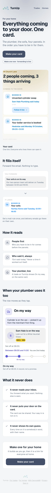
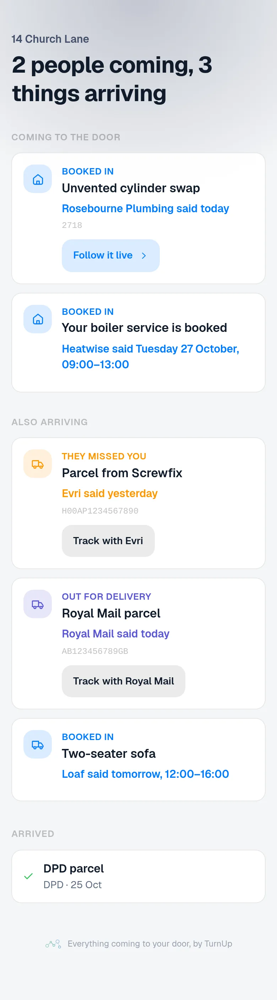
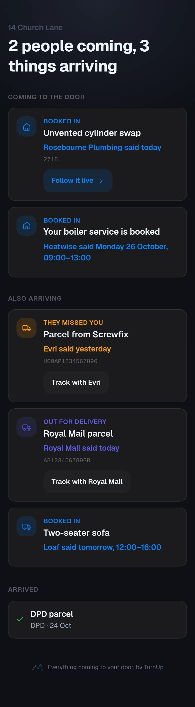

# v1.74.0 — Slate

**2026-10-25** · background `#f5f6f8` · accent `#44506b`

- The wallet card can now update itself. Until tonight a pass showed the stage it was added at and nothing moved it again, which is the difference between a card and a screenshot. The four service calls Wallet makes are built: it registers a phone against a job, it asks what has changed since it last looked, it fetches the current card, and it reports back when something went wrong. A stage tap on the dashboard, or a booking moving in ServiceM8, now tells every phone holding that card to come and look.
- The push that does it carries no words at all — Apple’s pass push is an empty body that only says "ask me again", so there is nothing on a lock screen to get wrong and no vocabulary to guard. Everything the card says still comes from the same builder as the download, so the card in a pocket and the page on the link cannot say different things.
- A revoked link takes the card with it. Switch a job’s link off and the next time Wallet asks it is told the pass is no longer theirs, and it comes off the phone. The token a pass sends back is worked out from the job code and your own secret rather than stored, so there is no new column, nothing extra to leak, and one job’s pass cannot ask about another’s.
- Still waiting on one thing, and it is not code: the Pass Type ID certificate from Apple. The enrolment went through on 21 October, so that is the next job, and this half is ready for the day it lands. Two checks on it, and the second one earned its keep immediately: run against a real server it found that a card whose link had been switched off was told “come back later” instead of being removed from the phone. The paths Wallet itself calls are the one thing left to a real card, and every route logs a line so the log says whether it found them.
- Apple Wallet is live. The certificate landed and the first real card went into a real wallet on 23 October — job #2742, added straight from the customer’s page. It is the premise of this whole product and it had never actually existed before today. Everything that described it as pending (the plan, the roadmap, the homepage badge, the instructions) now says what is true.
- And the first real card immediately proved why the half above matters: added while the update service was still in a branch, it froze at Booked in with no note, while the job itself had said running about thirty minutes late fourteen hours earlier. A card that cannot move is a screenshot of a moment.
- One thing the audit caught that nothing would have reported: the private key is AES-256 encrypted, so the push needs its passphrase as well — and the check that said whether pushing was switched on did not look at it. It would have answered yes, failed inside a swallowed error and left every card quietly not updating. It now says no, and names what is missing, and a card nobody can push says so in the log instead of nothing at all.
- One more from the audit, found the hard way: scripts/local-db.sh rewrites .env.local, which silently drops the pass type, after which every one of the twenty-four live checks fails as a 404 that explains nothing. The check now says that in one line instead. A check that fails confusingly is only slightly better than one that cannot fail.
- The card tells you it has changed. A pass that updates silently is a pass nobody looks at, so the stage is the one field that announces itself: when the job moves, the lock screen reads Now: On my way, and Wallet puts your business name beside it. Nothing else on the card may do that — not the note, not the address, not the customer’s name — and the check names all eight of them, because the risk was never the field that has one today.
- Said out loud on the privacy page too: what a Wallet registration holds (an anonymous device identifier and a token from Apple), how long it is kept, and that the push itself carries no words at all. A change to what is stored or sent is a change to that page; when the two disagree, the page is the defect.

### wallet-in-stack

### wallet-opened

### wallet-alone

### customer-light

### customer-dark

### dashboard

### dashboard-setup

### login

### homepage

### homepage-dark

### for-trades

### for-homes

### join

### household

### household-dark

