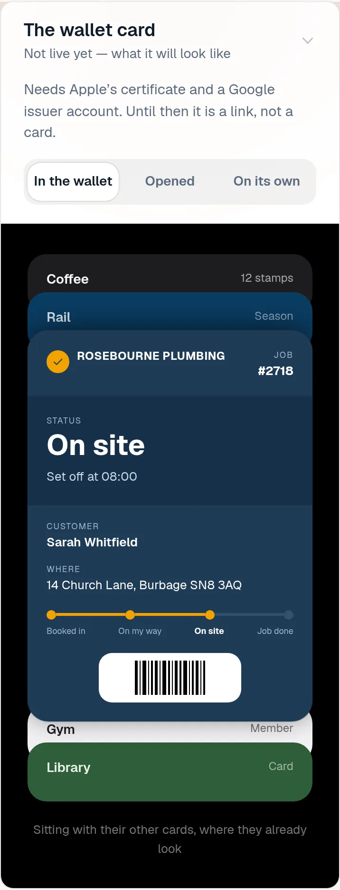
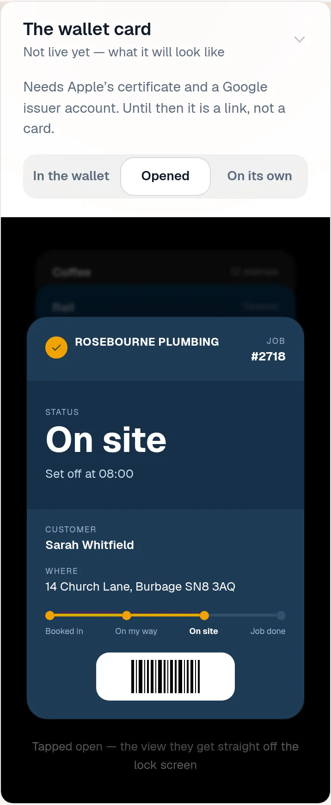
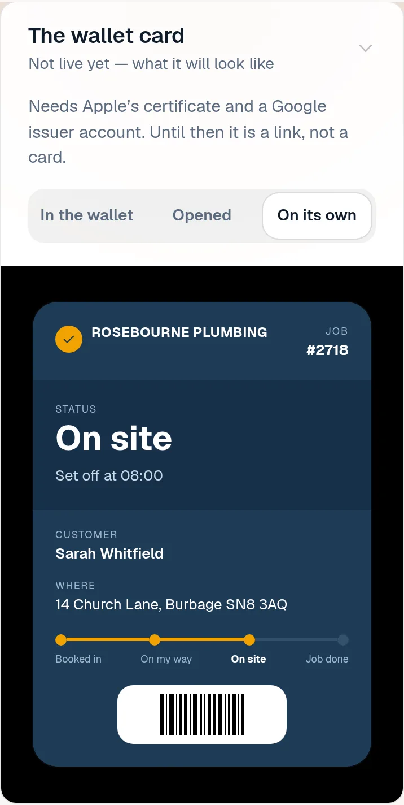
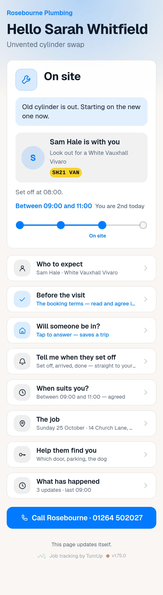
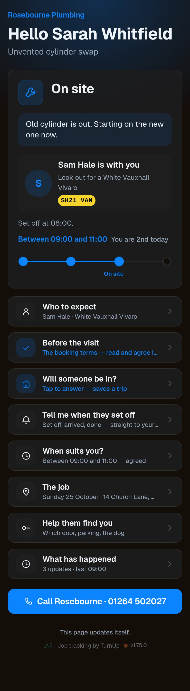
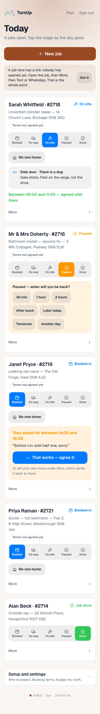
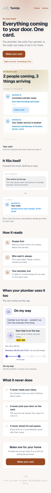
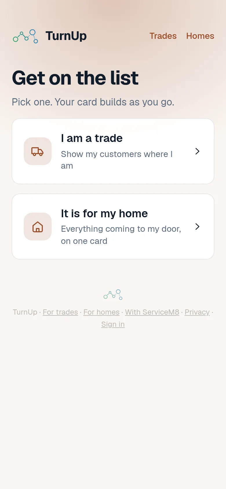
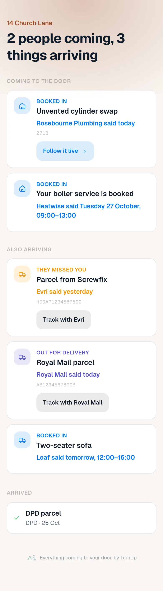
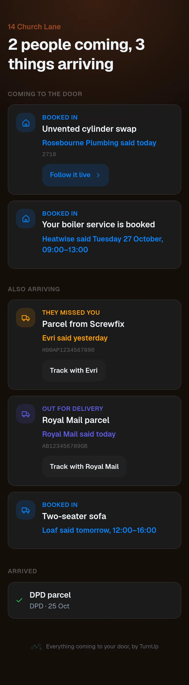

# v1.75.0 — Clay

**2026-10-26** · background `#faf6f2` · accent `#9a4a24`

- The same card, for Android. Save to Google Wallet appears on the customer’s page on an Android phone, and the card moves on a stage tap exactly as the Apple one does. Everything is built and checked; it stays invisible until three values from Google are pasted on the dashboard, which is one Cowork job on your Mac and then a paste on your phone — not settings in Vercel, which have been asked for three times and never happened.
- Saving those three ends in a demonstration rather than a claim: it makes the pass template at Google there and then, which is the first thing that uses all three together, so Saved means they actually work. The key is sealed before it is stored, never shown again and never reaches a browser.
- The check found a real fault before any of it shipped. Google silently truncates a save link over 1,800 characters, which is a button that looks right and does nothing — and a real card came out at 2,094. The template no longer rides inside every link, and the name and address on the card are trimmed to what is readable at a glance, so the longest card that can possibly exist is 1,760. That is proved by building one with every field overlong, not by measuring one card and hoping.
- Still Google’s to give: a new issuer account can only send a card to your own phone until they review it. The steps say which part can be done today and which waits.

### wallet-in-stack

### wallet-opened

### wallet-alone

### customer-light

### customer-dark

### dashboard

### dashboard-setup

### login

### homepage

### homepage-dark

### for-trades

### for-homes

### join

### household

### household-dark

