# v1.76.0 — Indigo

**2026-10-26** · background `#f5f5fc` · accent `#463a94`

- The paperwork a beta trade signs. Two new pages, linked from the footer: trade terms (/terms-for-trades) say what TurnUp does, what it never does (no times promised, no money held, no job management, no selling anyone’s details), that it is free during the beta, and that either side can stop any time. Data processing terms (/processor) say you are the controller of your customers’ details and TurnUp the processor, in the order the ICO lists: what is held, who else touches it and where, how a breach is reported, and what happens when you stop. The law on both pages is linked to its source.
- Your data, a new panel under Setup and settings (/dashboard?open=data). Download everything gives one file with every job, every note and every answer. Delete account switches every link off at once, deletes every job and everything on it, and tells every Apple Wallet holding a card that it is gone, so the phone removes it. It only goes once you have typed your business name, and the server checks the name again rather than trusting the screen. It ends by saying what it deleted.
- One job can now be deleted for good: switch its link off, then Delete for good, twice. That is how a customer’s request to be forgotten is met, and the privacy page said it was possible before it was.
- Things now go on their own. A daily sweep deletes a job twelve months after it was marked Job done (a job reopened and finished again starts again; one never finished is kept until you delete it) and each household row ninety days after it arrived. The rule is one small file with its own check, and the privacy and processing pages print their numbers from it, so the words cannot say one thing while the code does another.
- The privacy page catches up with the code: how long each thing is kept, two services it never listed (Ship24 for tracking numbers, Gmail for a connected inbox), a link to where each service runs (the site itself runs in Washington DC, checked with Vercel), and how a trade gets everything out or deletes it.

Not captured this time: the household card (set DEMO_PLACE to a seeded place code).

### wallet-in-stack

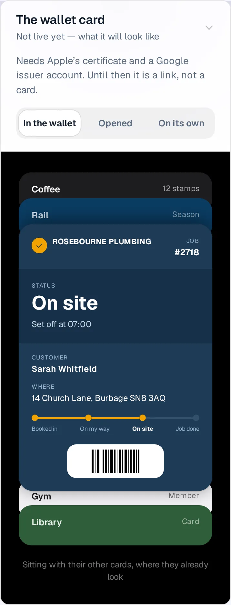

### wallet-opened

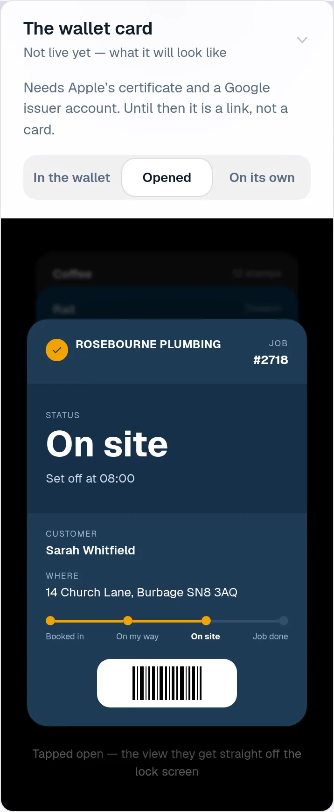

### wallet-alone

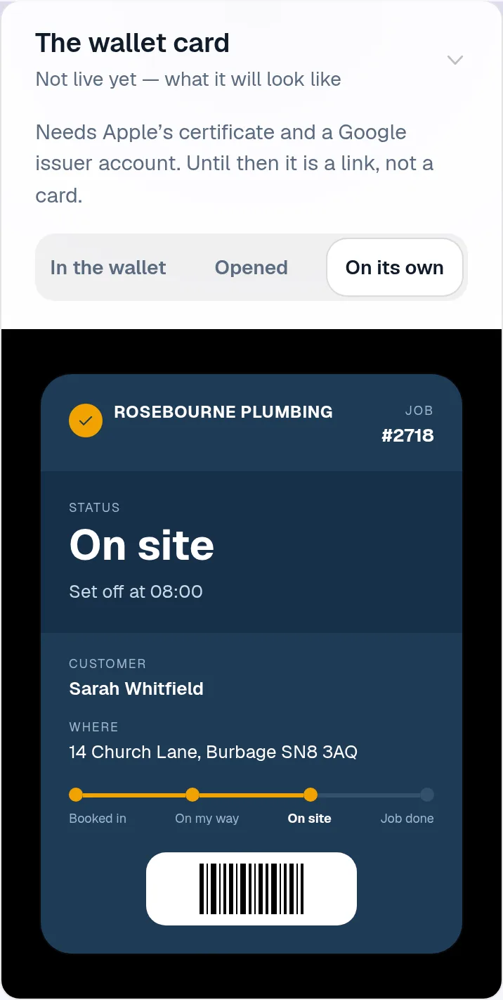

### customer-light

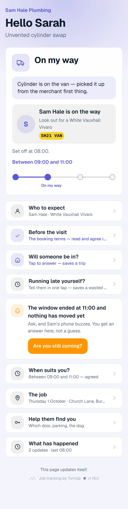

### customer-dark

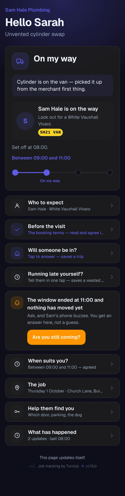

### dashboard

### dashboard-setup

### login

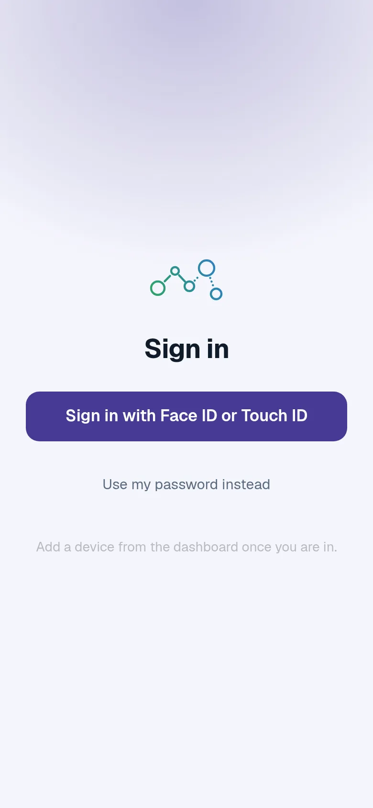

### homepage

### homepage-dark

### for-trades

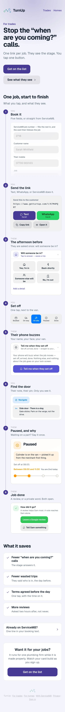

### for-homes

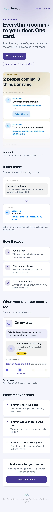

### join

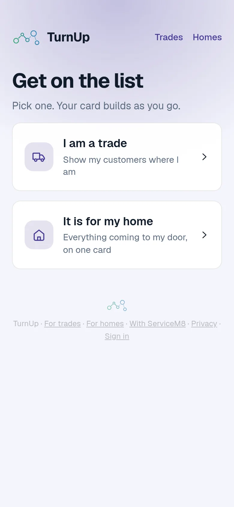

### your-data

The new panel under Setup and settings (`/dashboard?open=data`), on the seeded local database.

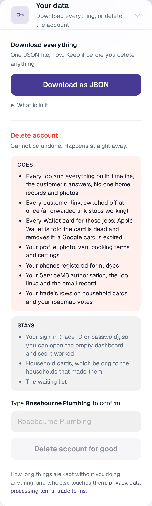

### your-data-deleted

After Delete account on the seeded database: the counts come back from the server.

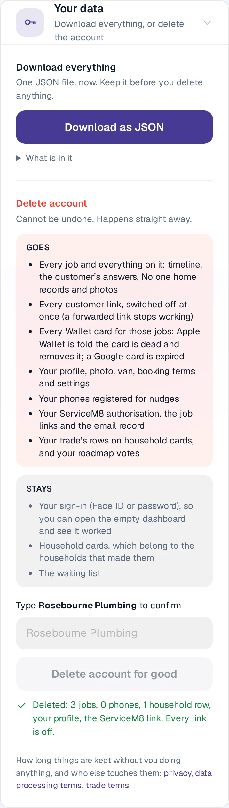

### terms-for-trades

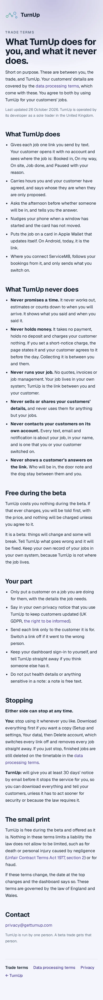

### processor

### privacy

