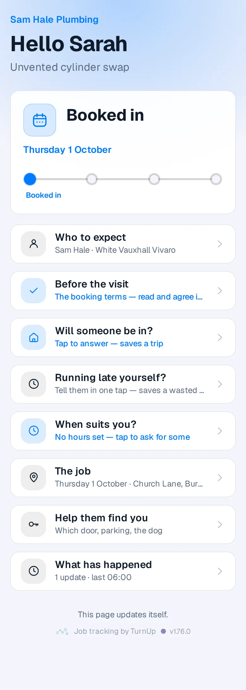

# v1.76.0 — Indigo

**2026-10-26** · background `#f5f5fc` · accent `#463a94`

- Safe to show another trade, the first stop on the way to a beta. Once the van is there, or the job is done, a late figure from this morning and an open “Are you still coming?” no longer show, on the customer’s page or on your card. Job #2742 said “running about 30 minutes late” after Job done; it will not again.
- No key ever ships. After the 21 Oct leak the whole repository, every commit in its history, every deployment since 13 Oct and the live site were checked: clean. Now a build that would serve a key, a password file or an environment file fails and does not deploy, and every push runs all the checks on GitHub, not only when a session remembers to.
- The reminders fix from 19 Oct was confirmed live: three buzzes at most, none between 21:00 and 07:00, gone at the end of the job’s day, a Stop reminders button, and no customer name on your lock screen.
- One thing left that only you can do: revoke the old Apple certificate. The steps now point at the right page, the pass type, which is where Revoke actually lives.

Not captured this time: the household card (set DEMO_PLACE to a seeded place code); the wallet views and the dashboard (they need an operator session).

### customer-light

### customer-dark

### customer-booked

### login

### homepage

### homepage-dark

### for-trades

### for-homes

### join

