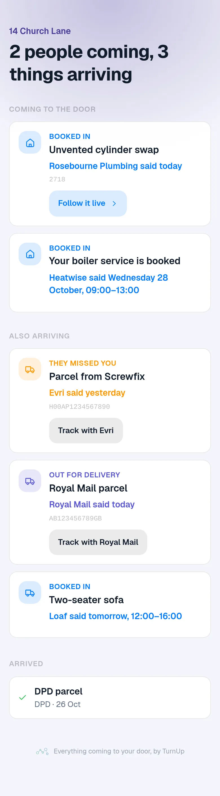
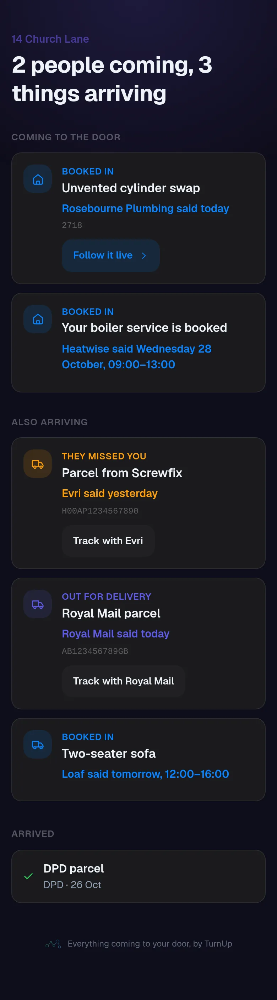

# v1.76.0 — Indigo

**2026-10-26** · background `#f5f5fc` · accent `#463a94`

- The pilot’s fourth number works. "When are you coming?" calls — the number this whole product is a bet against — was a running total typed on a panel folded inside Setup and settings. It ignored the 30/90 day switch and the start date, carried no dates, and sat somewhere nobody goes between jobs. Six days into the pilot it still read nothing, and in thirty days it would have read 0 — which looks exactly like nobody ringing, the answer the product was hoping for.
- It is one tap on the job now. They rang sits beside No one home on the row, shares its line so the page does not grow, and queues like every other tap so a call logged with no signal still counts and never doubles.
- Logging it on the JOB is the real change, not the convenience. The panel can now ask the only question that settles the bet: of the customers who opened their link, how many rang anyway, against the ones who never opened it. That needs no before — the control is inside the pilot — and a tally could never have answered it. A side with no jobs in it says so rather than drawing 0%, because none of nobody ringing is not a finding.
- An older hand-typed figure is shown beside the count, never added into it: there is no way to tell which window it belongs to.

### wallet-in-stack

### wallet-opened

### wallet-alone

### customer-light

### customer-dark

### dashboard

### dashboard-setup

### login

### homepage

### homepage-dark

### for-trades

### for-homes

### join

### household

### household-dark

