# v1.77.0 — Teal

**2026-10-27** · background `#f2f9f9` · accent `#1f6f72`

- The pilot comes to you. Every Monday at eight, one notification to your phone with last week's four numbers beside the week before: jobs, links opened by a customer, will-someone-be-in answered, wasted trips, calls asking when you are coming, and the totals since the count started. A tap opens the panel. Numbers only, never a name. Send me this week's now, on the pilot panel, sends the same message today so you can see it before you trust it.

### wallet-in-stack

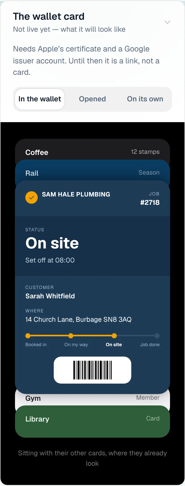

### wallet-opened

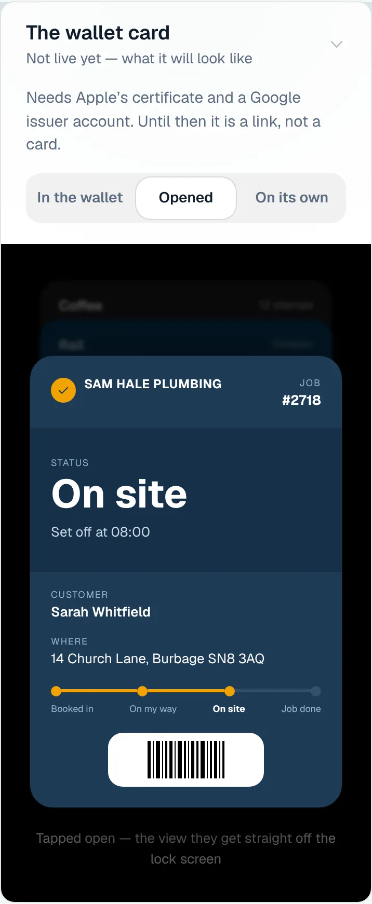

### wallet-alone

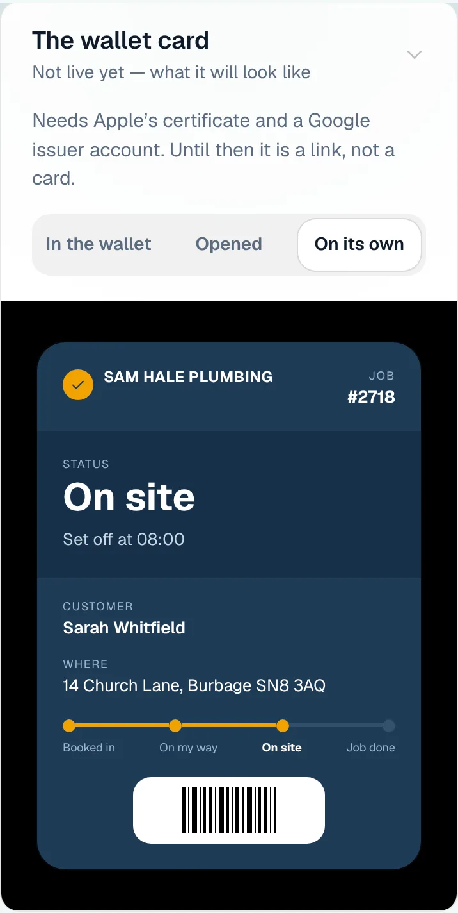

### customer-light

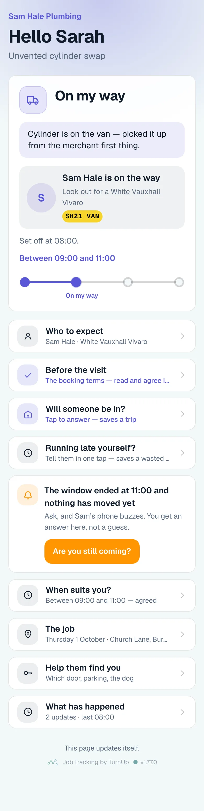

### customer-dark

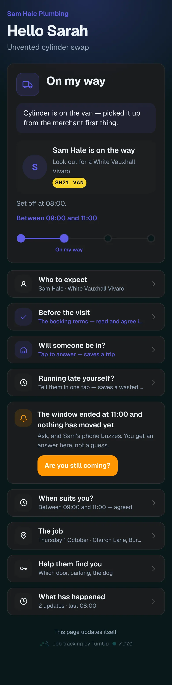

### dashboard

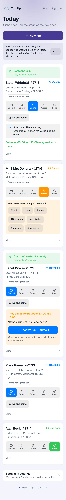

### dashboard-setup

### login

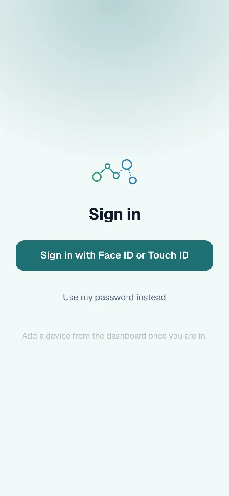

### homepage

### homepage-dark

### for-trades

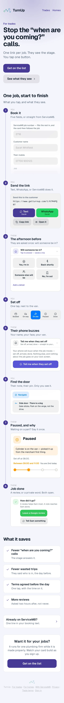

### for-homes

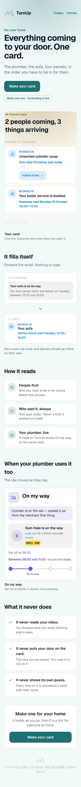

### join

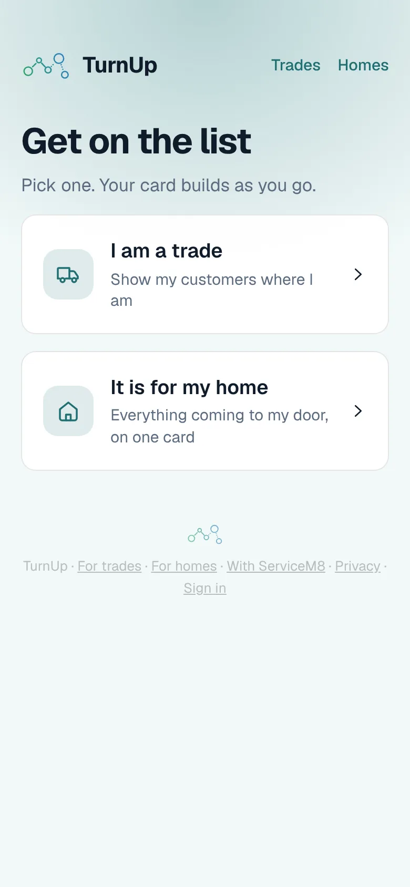

### household

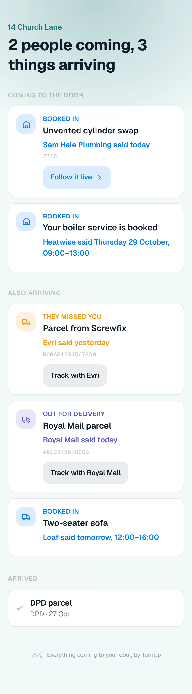

### household-dark

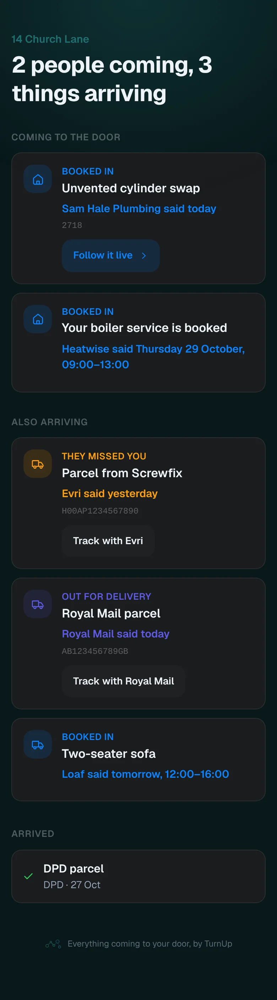
