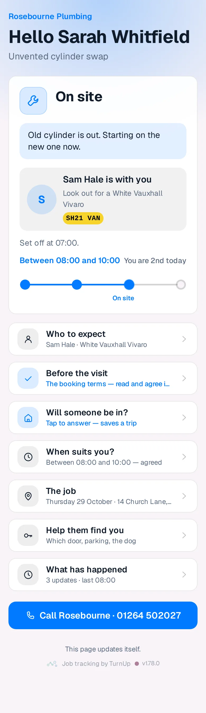
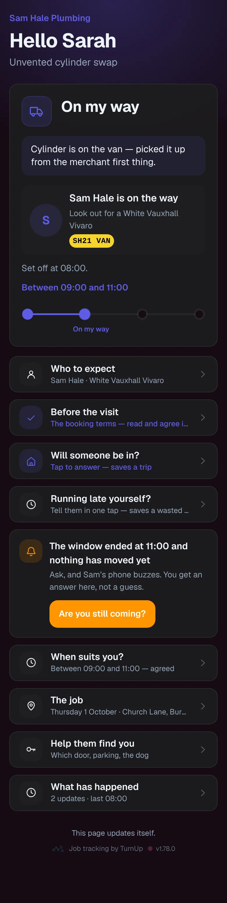
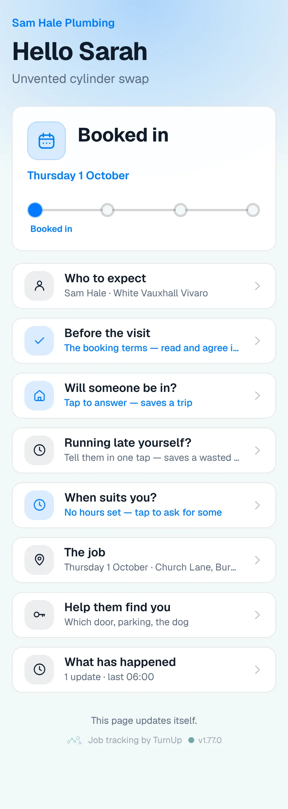
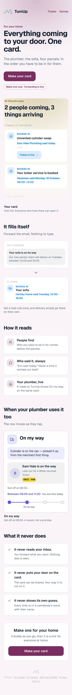

# v1.78.0 — Plum

**2026-10-28** · background `#f9f4f8` · accent `#7a2f5e`

- A Job done card stops saying the trade is running late. "Running about 30 minutes late" was written into the card’s note and nothing ever took it out, so job #2742 still said it after Job done, on the page and on the Wallet card. The note now comes off the moment the van is there (On site, Paused or Job done), whether the tap was on the dashboard or a ServiceM8 check-in, and cards already in that state stop showing it without anyone touching them. Anything the trade typed stays.
- The "are you still coming?" row and the late figure on the dashboard row now show only while the customer is still waiting: Booked in or On my way. On site, Paused or Job done, they are history. "When suits you?" was already hidden at Job done.

Not captured this time: the household card (set DEMO_PLACE to a seeded place code); the wallet views and the dashboard (they need an operator session).

### customer-light

### customer-dark

### customer-booked

### login

### homepage

### homepage-dark

### for-trades

### for-homes

### join

Captured on 27 Oct 2026 under the number v1.77.0, before main took that number for the pilot summary; renumbered at merge time on 28 Oct. The pictures are of this branch's build, in the Teal theme it then carried. Nothing was re-shot.
