# TurnUp review — 19 Oct 2026

Read-only audit. Nothing under `src/`, `scripts/` or config was changed.
Live site checked on 18 Oct 2026 at **375px** (phone) and **1280px** (desktop).
Sign-ups walked on a local build of `main` (v1.65.3) at 375px, because a walk-through on
production would have put test rows in the live database.

---

## Verdict: **IMPROVE**

**The site works and nothing is broken; the problem is what it says first — it leads with a wallet card that does not exist yet, and both sign-ups end on a waiting list.**

| | |
|---|---|
| Broken links | **0** |
| Sideways scroll | **0 pages** (375 and 1280) |
| Homepage on a phone | **18.6 screens** tall |
| Claims the app can't back | **8** (see section 1c) |
| Trade sign-up | **3 taps, 2 fields** to the list · nothing to try after |
| Home sign-up | **3 taps, 2 fields** to the list · **12 taps, 4 fields** to a live card |

A refresh would throw away a site that is fast, tidy and honest in most places.
The fixes are copy, order and length — a day's work, not a redesign.

---

## 1. Site audit

### 1a. Per page

Screen = 812px tall at 375 wide. Times are full load through this container's proxy, so read them as relative, not absolute.

| Page | Who it's for | Next action | Taps to do it | Height (phone) | Weight |
|---|---|---|---|---|---|
| `/` | **Both** (trade first) | Get on the list | **3** (CTA → trade/home → submit) | **15,092px · 18.6 screens** | 2,182 KB · 658 KB images |
| `/for-trades` | Trade | Get on the list | **2** (skips the chooser) | 4,152px · 5.1 | 1,197 KB |
| `/for-homes` | Household | Make your card | **2** to the list · **≈11** to a live card | 3,701px · 4.6 | 1,119 KB |
| `/with-servicem8` | Trade already on ServiceM8 | **None above the fold**; only CTA is "Dashboard" (sign-in) | n/a for a stranger | 11,065px · 13.6 | 1,065 KB |
| `/demo` | Household (example job) | Back to home | 1 | 1,898px · 2.3 | 1,307 KB |
| `/join` | Both | Pick trade or home | 1 | 812px · 1 | 648 KB |
| `/privacy` | Both | none (reference) | — | 5,865px · 7.2 | 526 KB |
| `/plan` | **Not public** — goes to sign-in | — | — | — | — |

Screenshots (top of page):

| Page | Phone | Desktop |
|---|---|---|
| `/` |  | 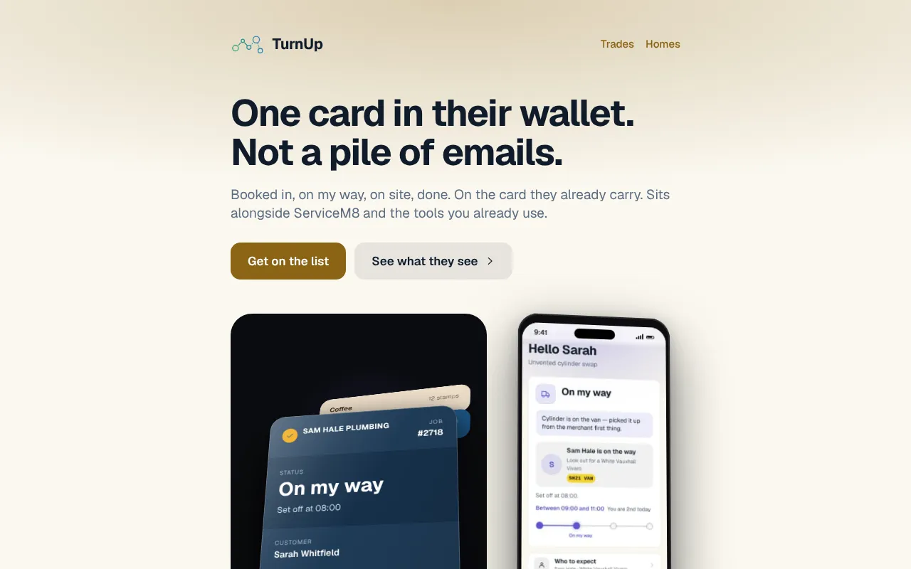 |
| `/for-trades` | 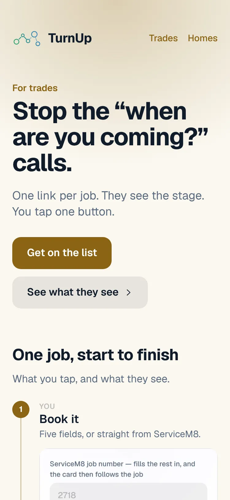 | 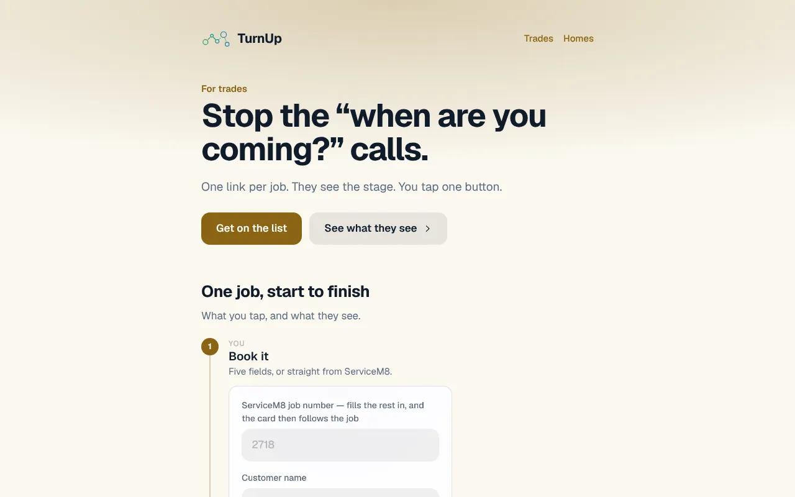 |
| `/for-homes` | 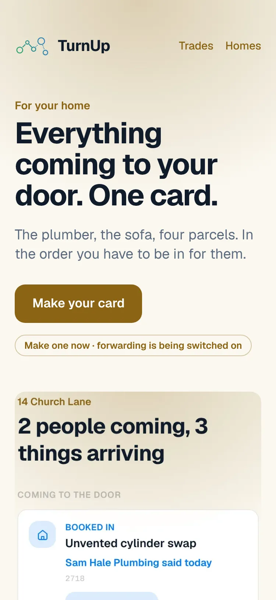 | 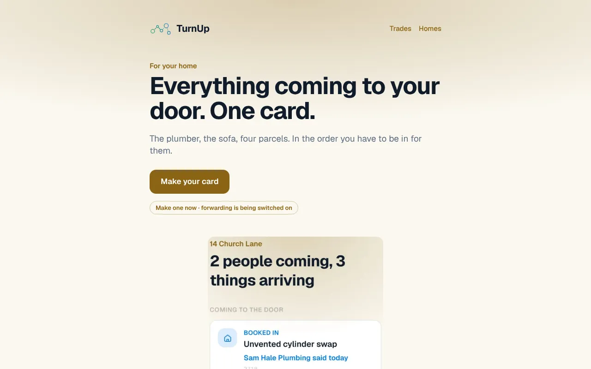 |
| `/with-servicem8` | 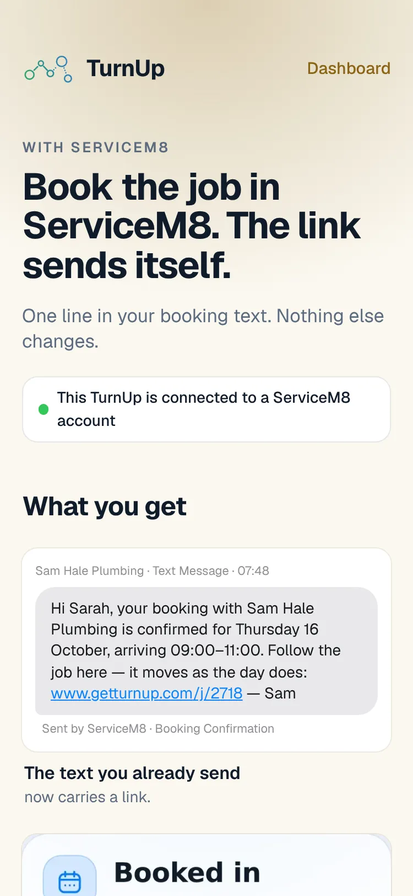 | 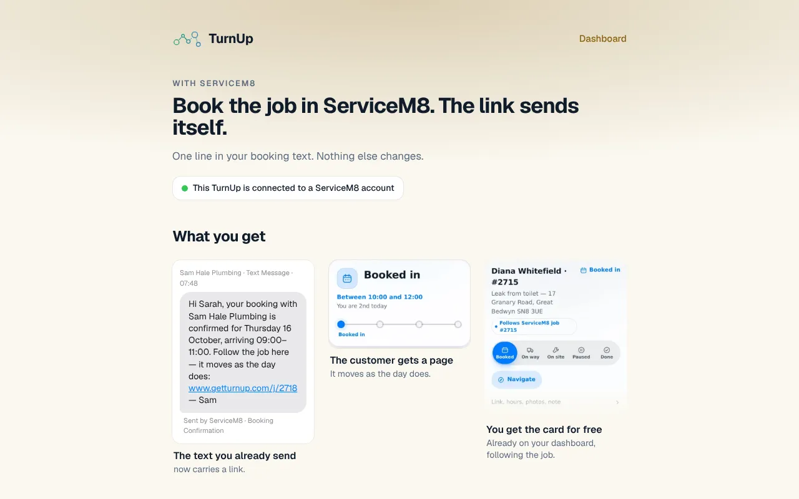 |
| `/demo` | 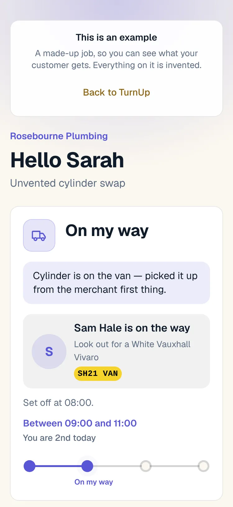 | 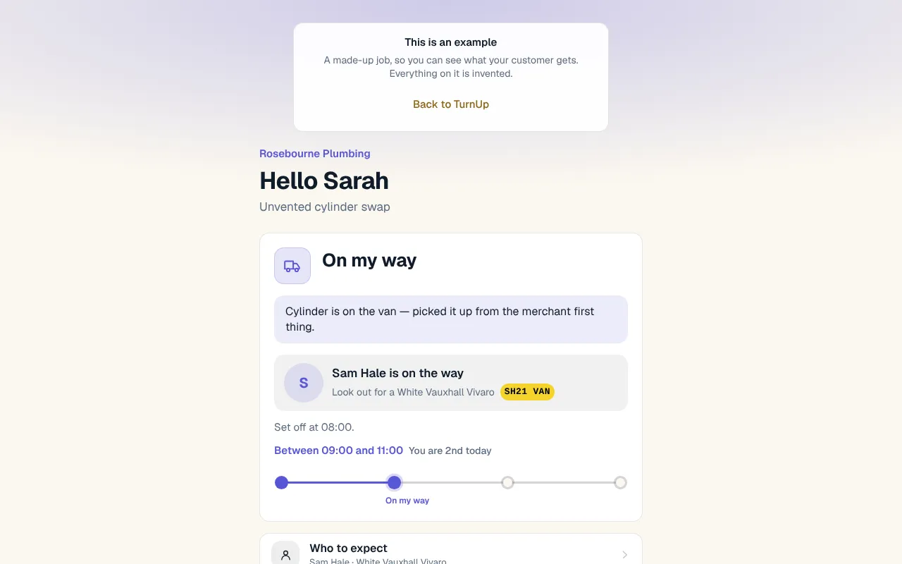 |
| `/join` | 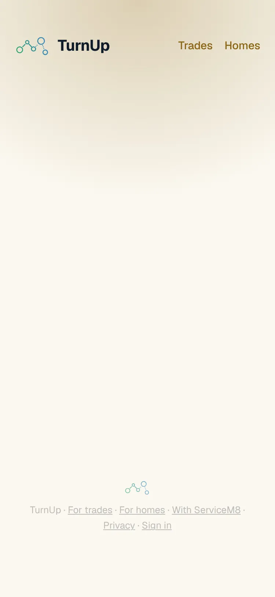 | 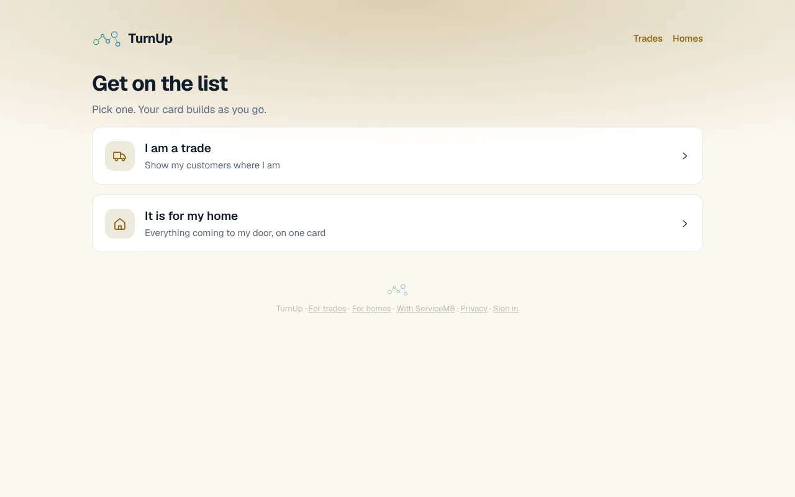 |
| `/privacy` | 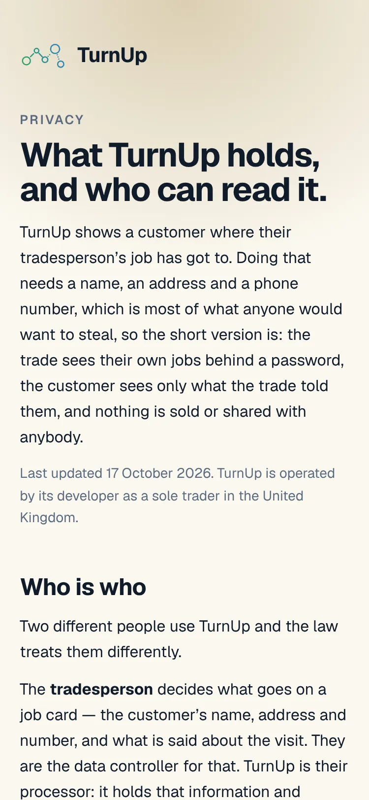 | 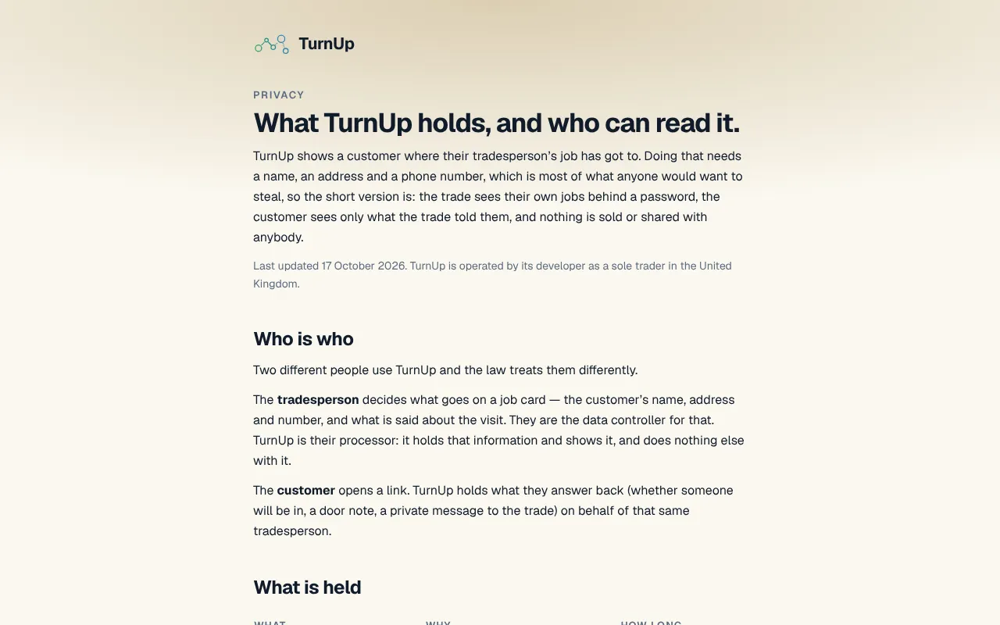 |
| `/plan` | 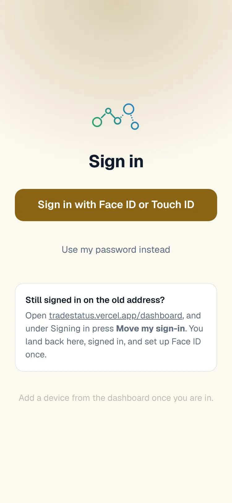 | 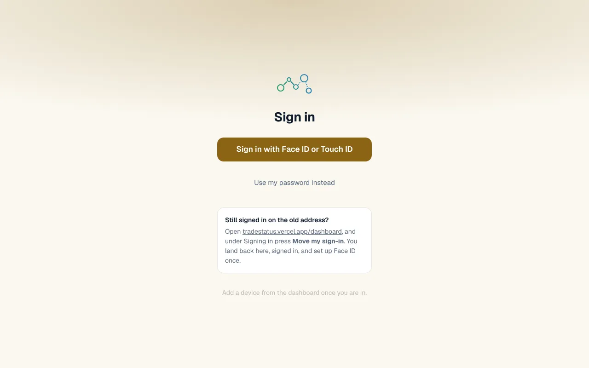 |

### 1b. What the first screen says

| Page | Headline | Under it |
|---|---|---|
| `/` | **One card in their wallet. Not a pile of emails.** | "On the card they already carry. Sits alongside ServiceM8 and the tools you already use." |
| `/for-trades` | **Stop the "when are you coming?" calls.** | "One link per job. They see the stage. You tap one button." |
| `/for-homes` | **Everything coming to your door. One card.** | "Make one now · forwarding is being switched on" |
| `/with-servicem8` | **Book the job in ServiceM8. The link sends itself.** | no button |
| `/demo` | "Hello Sarah" | an example job card |

`/for-trades` has the clearest first screen on the site. The homepage has the least clear one, because it describes the product that is not built yet.

### 1c. Claims the app can't back today (checked against the code)

| # | Claim | Where | What the code says | Severity |
|---|---|---|---|---|
| 1 | **"One card in their wallet"** as the title, H1 and subhead ("On the card they already carry") | `/` (`src/app/page.js:111`, page title) | The pass is not built for customers: no Apple certificate, no pass web service. `CLAUDE.md` → *Not built yet*: "Do not describe it as a wallet pass anywhere customer-facing." The "Built · awaiting Apple" badge sits under a picture, not on the claim. | **High** |
| 2 | "**Android next.**" | `/` (`src/components/WalletStory.jsx:370`) | No Google Wallet issuer, no code. A plan, said as a date. | Medium |
| 3 | `/demo` says everything on it is invented, then shows **"Rosebourne Plumbing"** and **"Call Rosebourne · 01264 502027"** as a working `tel:` link | `/demo` | The trade name comes from `NEXT_PUBLIC_TRADE_NAME`, which on production is Will's real business. A stranger taps it and rings Will. The homepage pictures use "Sam Hale Plumbing". | **High** |
| 4 | "**Your van, from the plate** — make and colour fill themselves in" | `/` (`src/app/page.js:83`), poster `t-van` marked `live` (`src/lib/posters.js:71`) | `src/lib/roadmap.js:107` marks the DVSA plate lookup **`ready`**, not live (keys not issued). | Medium |
| 5 | "A job is five fields. **Thirty seconds.**" | `/` (`src/app/page.js:80`), poster | Never measured. Five fields is true; thirty seconds is a guess. | Low |
| 6 | "**{n} things, live on every job**" | `/` (`src/app/page.js:248`) | Several of those need setup first (push keys, ServiceM8, Face ID, terms). "Live" yes; "on every job" no. | Low |
| 7 | "Sits alongside ServiceM8 **and the tools you already use**" | `/` | ServiceM8 is the only integration. | Low |
| 8 | **privacy@getturnup.com** | `/privacy` (`src/app/privacy/page.js:211`) | The apex domain has no MX record, so mail to it **bounces**. A privacy contact that bounces is a UK GDPR problem, not just a broken link. | **High** |

Stale lines (true once, not now):

| Line | Where | Now |
|---|---|---|
| "Make one now · **forwarding is being switched on**" | `/for-homes:70` | Forwarding is live (the letterbox receives). |
| "Your own address. **Live when your place opens.**" | `/join` (`Join.jsx:69`) | The household card goes live at the end of `/join` today. |
| "**When your place opens**, it goes live from here." | `/join` trade done screen (`Join.jsx:821`) | Fine for trades, but reads as if nothing works yet. |

What is **clean**:

- **No arrival-time promises** anywhere. No "with you in", no ETA, no countdown.
- **No invented numbers of customers, reviews or ratings.**
- The push row is configured on production, so "Tell me when they set off" is real.
- Gmail is shown honestly as "not yet".

### 1d. Links, scroll, images

| Check | Result |
|---|---|
| Internal links | All **200** (a signed-out `/dashboard` 307s to `/login`, which is right) |
| External links | ServiceM8, Apple, GOV.UK all answer |
| Sideways scroll at 375 / 1280 | **None** on any page |
| Missing images | **None** |
| Biggest single image | ≈48 KB (all WebP via `next/image`) |
| What's actually heavy | **JavaScript, ≈1.0–1.3 MB per page.** Images are 7–658 KB. |
| Homepage length | 18.6 phone screens. **The problem is length, not weight.** |

---

## 2. Sign-up teardown

Walked as a stranger on a phone (375px), counting every tap and typed field.

### 2a. Trade

| Step | Screen | Taps so far | Fields | Chars |
|---|---|---|---|---|
| 1 | Homepage | 0 | 0 | 0 |
| 2 | `/join`: trade or home? | 1 | 0 | 0 |
| 3 | Name and email | 2 | 0 | 0 |
| **4** | **On the list** — sign-up done | **3** | **2** | **46** |
| 5 | Where the van starts | 4 | 4 | 70 |
| 6 | Map up, drag the pin | 5 | 5 | 77 |
| 7 | Your face (photo) | 6 | 5 | 77 |
| 8 | Where your jobs live | 9 | 5 | 77 |
| **9** | **All filed. On the list, nothing to use yet.** | **11** | **5** | **77** |

| 1 | 2 | 3 | 4 | 5 |
|---|---|---|---|---|
| 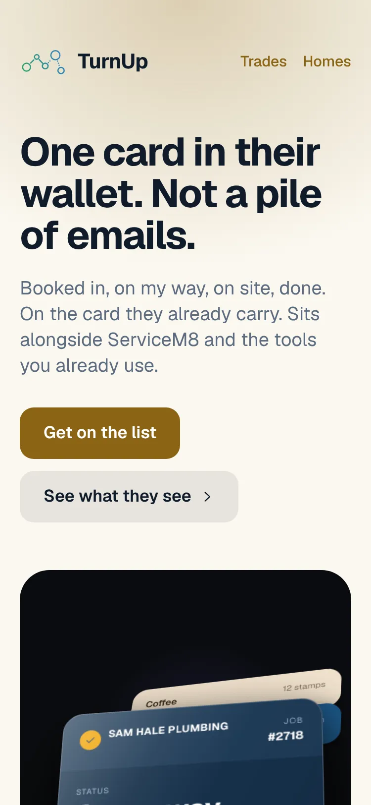 |  | 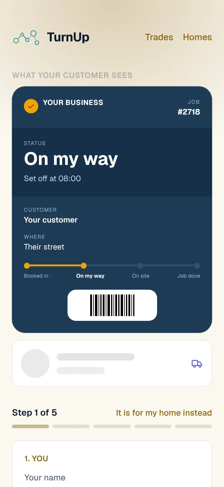 | 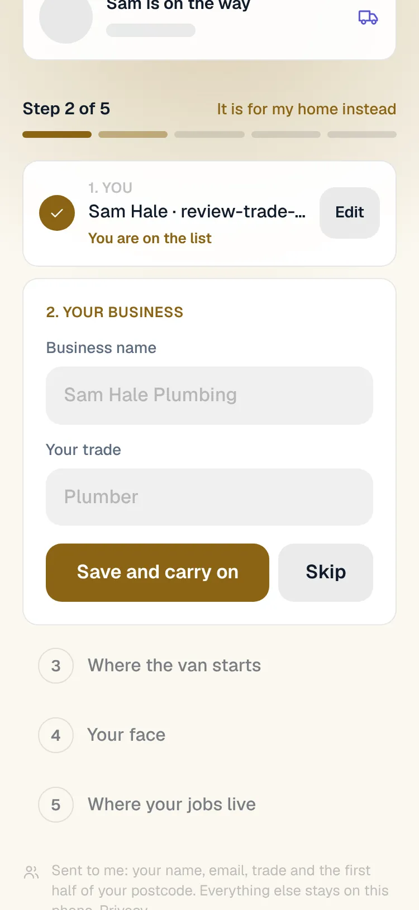 | 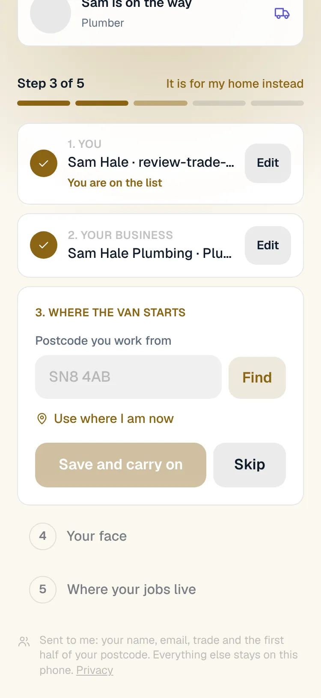 |
| **6** | **7** | **8** | **9** | |
| 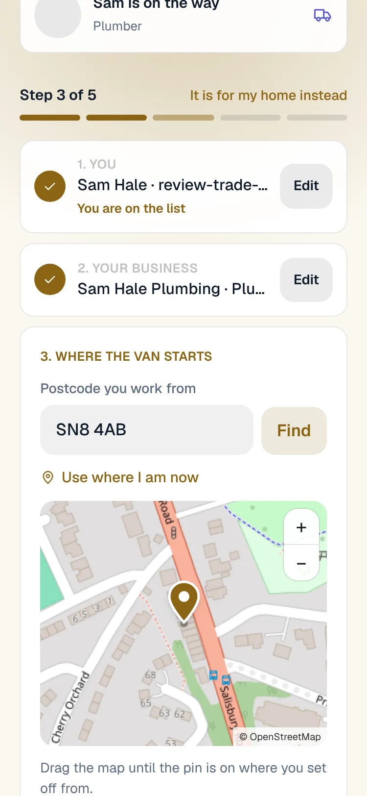 | 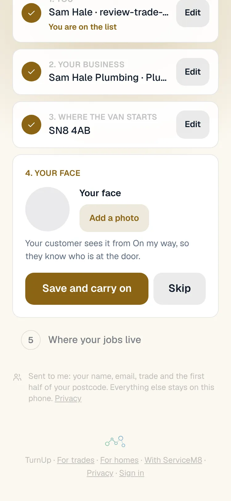 | 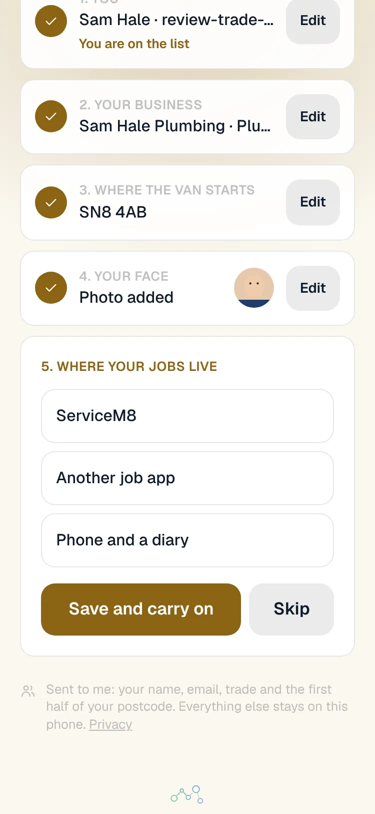 | 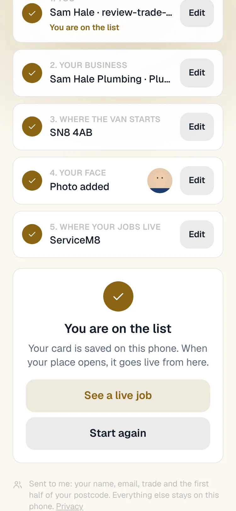 | |

**Where a plumber on a driveway gives up:**

| Point | Why |
|---|---|
| **Step 6, the map** | Dragging a pin one-handed with wet gloves. It's optional but doesn't look it. |
| **Step 7, your face** | "Take a selfie" in the van is the moment it feels like admin. |
| **Step 9, the end** | **The real drop-off.** Eleven taps and the reward is "you're on the list". Nothing to send, nothing to try, no reason to come back. |

### 2b. Household (via `/join`)

| Step | Screen | Taps so far | Fields | Chars |
|---|---|---|---|---|
| 1 | Homepage | 0 | 0 | 0 |
| 2 | `/join`: trade or home? | 1 | 0 | 0 |
| 3 | Name and email | 2 | 0 | 0 |
| **4** | **On the list** | **3** | **2** | **52** |
| 5 | Your home | 3 | 2 | 52 |
| 6 | Photos (optional) | 5 | 4 | 73 |
| 7 | How things reach it | 6 | 4 | 73 |
| 8 | Who else is home | 8 | 4 | 73 |
| 9 | A work address | 9 | 4 | 73 |
| 10 | Make it live — **the card does not exist until here** | 11 | 4 | 73 |
| **11** | **Card live, forwarding address shown** | **12** | **4** | **73** |
| 12 | Bottom: address + Gmail steps | 12 | 4 | 73 |

From `/for-homes` → "Make your card" it is about **10 taps**, because the chooser is skipped.

| 1 | 2 | 3 | 4 | 5 | 6 |
|---|---|---|---|---|---|
|  | 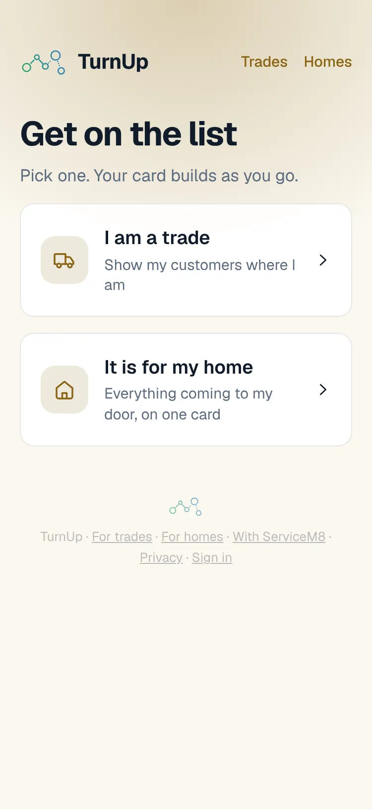 | 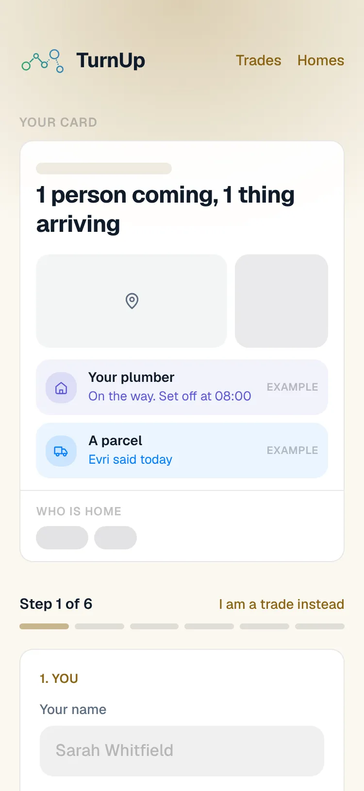 |  | 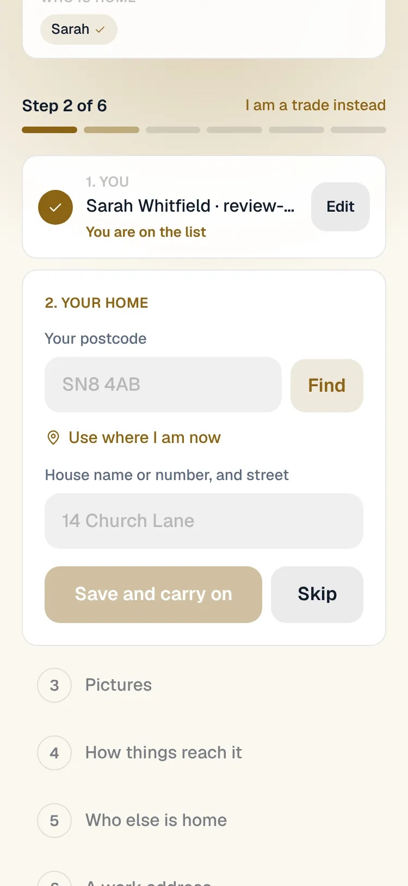 | 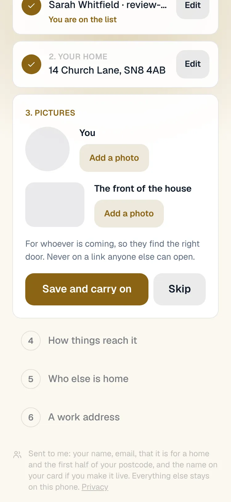 |
| **7** | **8** | **9** | **10** | **11** | **12** |
| 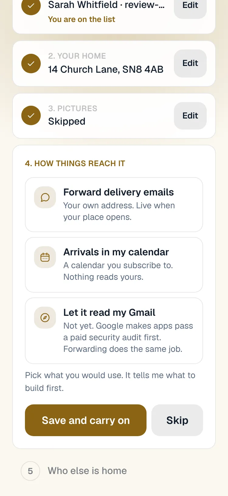 | 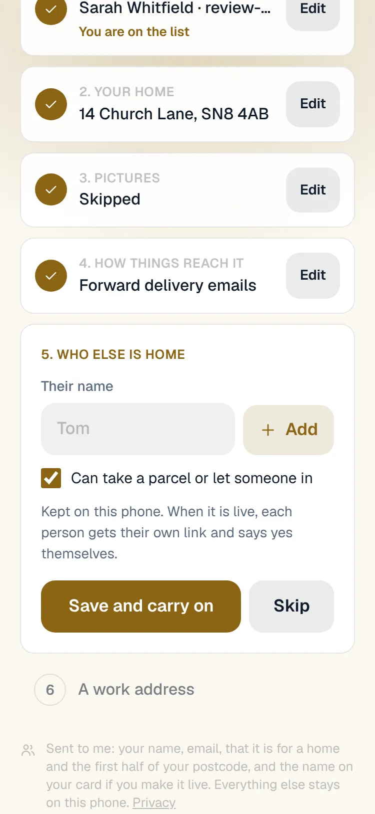 | 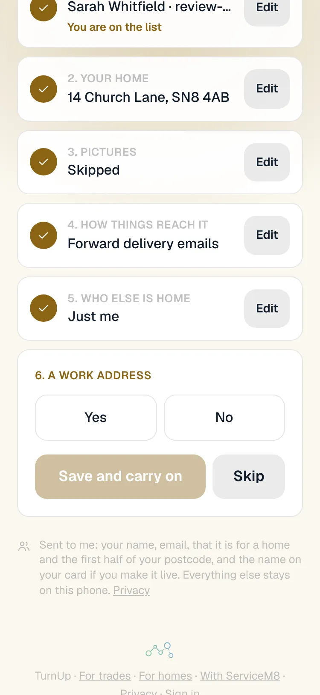 | 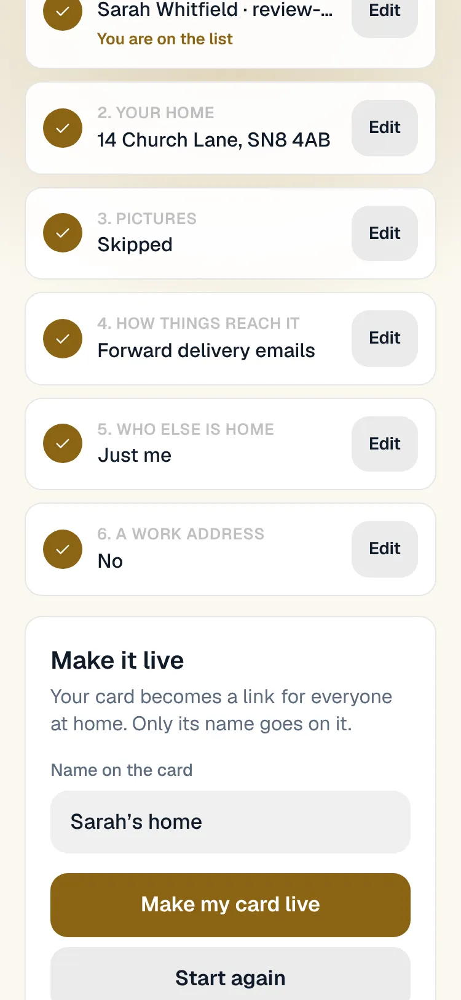 | 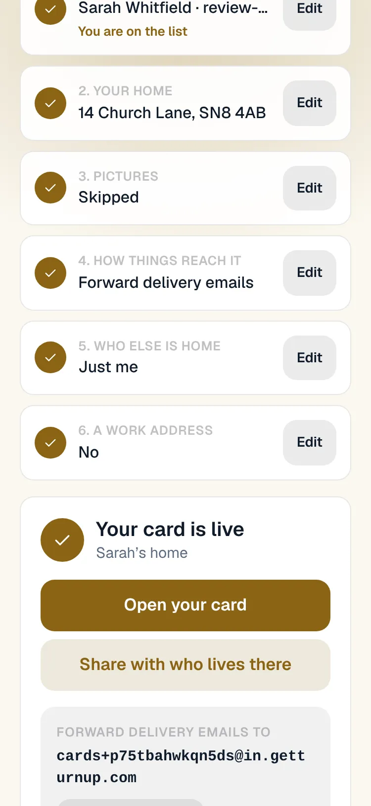 | 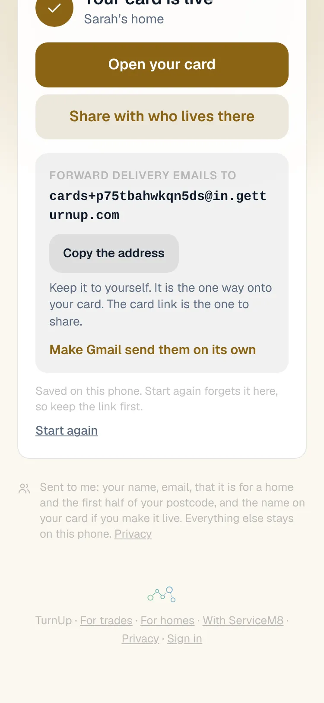 |

**Where a mum with a parcel coming gives up:**

| Point | Why |
|---|---|
| **Step 6, photos** | She came for one parcel. Photos of the house feel like a lot to hand over to a site she met a minute ago. |
| **Steps 8–9, people and work** | Still no card. Each step is reasonable; six in a row before the thing she wanted is not. |
| **Step 12, Gmail auto-forward** | **Needs a computer.** Gmail's forwarding and filters are not in the phone app. On a phone this is a dead end; she has to remember to do it later. |

**The fix for both is the same: give them the working thing first, ask for the extras after.**

---

## 3. Who does this well

How six products get a stranger from landing page to "it works". Patterns, not words.

| Product | Above the fold | What they ask first | Proof they use | Source |
|---|---|---|---|---|
| **Shop** (Shopify) | "Track orders" + app store badges | Nothing. Optional Gmail/Outlook connect; a forwarding address; or add a tracking number by hand | App Store rating (4.7, 744k ratings, UK store) | [App Store](https://apps.apple.com/gb/app/shop-all-your-favorite-brands/id1223471316) · [help.shop.app](https://help.shop.app/hc/en-us) |
| **Royal Mail** | "Tracking, redelivery, prices" | A tracking number or a barcode scan. **No account** | Rating (4.6, 414k) | [App Store](https://apps.apple.com/gb/app/royal-mail/id1435168829) |
| **DPD** | Track a parcel | Parcel number + postcode. **No account** | Driver name and photo on the tracking page; Wallet passes for pickup | [App Store](https://apps.apple.com/gb/app/dpd/id1064977107) · [dpd.co.uk tracking](https://d1-dpdonline.dpd.co.uk/track) |
| **Checkatrade** | "What do you need?" — trade + postcode | Two fields, then results | "Vetted", review counts, a named guarantee | [App Store](https://apps.apple.com/gb/app/checkatrade/id6474018934) · [join.checkatrade.com](https://join.checkatrade.com/) |
| **Jobber** | "Run a stronger service business" + Start free trial | Email, then a short trial form. **No card needed** | Named real customers with photos | [getjobber.com](https://getjobber.com/) · [Client Hub help](https://help.getjobber.com/hc/en-us/articles/360046586294) |
| **ServiceM8** | "Smart job management for trades & services" | Four fields, or sign in with Xero | Trade logos, app ratings | [servicem8.com/uk](https://www.servicem8.com/uk) · [register](https://www.servicem8.com/uk/register) · [Track My Arrival](https://support.servicem8.com/hc/en-us/articles/115001860188-What-is-Track-My-Arrival) |

**Patterns worth stealing**

| Side | Pattern | Who does it | TurnUp today |
|---|---|---|---|
| Home | **Value before account.** Track first, sign up later | Royal Mail, DPD | Card only after 6 steps |
| Home | **One-tap copy** of the forwarding address | Shop | Address shown; copy button exists on the live screen ✓ |
| Home | **Say exactly what's read, keep a manual route** | Shop | Privacy page says it; `/join` could say it at the point of asking |
| Home | **Tell people where to find what you ask for** ("the number's on your email") | Royal Mail, DPD | Gmail steps exist but are computer-only |
| Trade | **Tiny trial form, "no card needed"** | Jobber, ServiceM8 | Waiting list only |
| Trade | **Let them try it on themselves** | Jobber (sample data) | Nothing to try |
| Trade | **Specific, sourced proof only** | Checkatrade, Jobber | Correctly avoids invented numbers ✓ — but has no proof yet either |
| Trade | **Light re-check after a gap** (last four digits) | Jobber Client Hub | `/j/<number>` already does this ✓ |
| Trade | **Real people at the top**, with permission | Jobber | Invented "Sam Hale" (fine) — Will's own story is unused |

**One pattern not to steal:** DPD and ServiceM8 both lead with a live ETA ("arriving in 25 mins"). TurnUp's rule is never to invent a time. That's a difference to say out loud, not a gap to close.

---

## 4. Marketing drafts

Plain, UK, nothing invented. No arrival times, no numbers, no quotes, no "gents".

### One-line pitch

| Side | Line |
|---|---|
| **Trades** | One link per job, so your customer can see where you're up to without ringing you. |
| **Homes** | Everyone coming to your door — the plumber, the sofa, the parcels — on one page. |

### Social posts — trades

1. > "When are you coming?" is the call you take with your hands full.
   > TurnUp gives each job one link. You tap "On my way". They see it. Nobody rings.
   > Built by a working plumber in Wiltshire. getturnup.com

2. > Your customer doesn't want a time you can't keep. They want to know you've set off.
   > One tap next to the van. Their phone buzzes with your name and your face. That's it.

3. > Waiting on a cylinder? Say it once, on the job's link, and every customer who opens it reads why.
   > No ringing round. No "just checking in".

### Social posts — homes

1. > The plumber Tuesday, the sofa Wednesday, three parcels somewhere in between.
   > Forward the emails to your TurnUp card and it puts them in the order you need to be in for.

2. > One link for your house. Everyone who lives there can open it.
   > No app to download, no account to remember.

3. > It always says who said it: "Evri said Thursday", not "Thursday".
   > So you know whose promise it is.

### A text a trade sends another trade

> Been using this for my jobs — customer gets a link, sees when I've set off, stops the phone calls.
> getturnup.com, worth a look if you're sick of "are you still coming?"

### Homepage headline options

| | Trades | Homes |
|---|---|---|
| 1 | **Stop the "when are you coming?" calls.** | **Everyone coming to your door, on one page.** |
| 2 | **One link per job. They can see you've set off.** | **The plumber, the sofa, the parcels. In one place.** |
| 3 | **Tap "On my way". They stop ringing.** | **Forward the email. Your card does the rest.** |

All six only describe what works **today** (a link by text, forwarding). The wallet card can go back in the headline the day Apple signs it.

---

## 5. Top 5 changes, ranked

For the website session tomorrow.

| # | Change | Why | Effort | Page |
|---|---|---|---|---|
| **1** | **Homepage hero leads with what works today.** Headline and title about the link ("Stop the when-are-you-coming calls" or similar). Wallet moves below the fold, labelled "Coming: built, waiting on Apple". Drop "Android next". | The first thing a stranger reads is the one thing that isn't built, and `CLAUDE.md` forbids it. | **S** | `/` |
| **2** | **`/demo`: invented trade, no real number.** Use a fixed demo name ("Sam Hale Plumbing") and a non-dialling number, not `NEXT_PUBLIC_TRADE_NAME`. | The page says "invented" and then rings Will's real phone. Also fix the bouncing **privacy@** address (set up the mailbox, or point at one that receives) — same severity. | **S** | `/demo`, `/privacy` |
| **3** | **`/join`: working thing first.** Home: card live straight after name + postcode, forwarding address on the next screen, photos/people/work as "add later". Trade: after the list, offer "text yourself a demo link" so there's something to try. | Both sign-ups end in nothing usable. The household card is 12 taps away and the trade gets a waiting list. | **M** | `/join` |
| **4** | **Cut the homepage from 18.6 screens to about 6.** Hero, how it works (3 pictures), one section each side linking to `/for-trades` and `/for-homes`, CTA. Move the wallet story and roadmap strips to their own page. | Nobody scrolls 18 screens on a phone. The two side pages already do the job better. | **M** | `/` |
| **5** | **Fix the stale and unbacked lines.** Plate lookup → "coming"; drop "Thirty seconds"; "live on every job" → "live today"; drop "and the tools you already use"; remove "forwarding is being switched on" and "when your place opens". Give `/with-servicem8` a button above the fold. | Each one is small. Together they're the difference between an honest site and one that's nearly honest. | **S** | `/`, `/for-homes`, `/join`, `/with-servicem8` |

---

*Method:* live pages captured with Playwright (Chromium) through `curl` for TLS, all form POSTs to production blocked. Sign-ups walked on a local `next start` of `main` with a seeded local database. Competitor facts from public App Store listings and the vendors' own pages, checked 18 Oct 2026.
